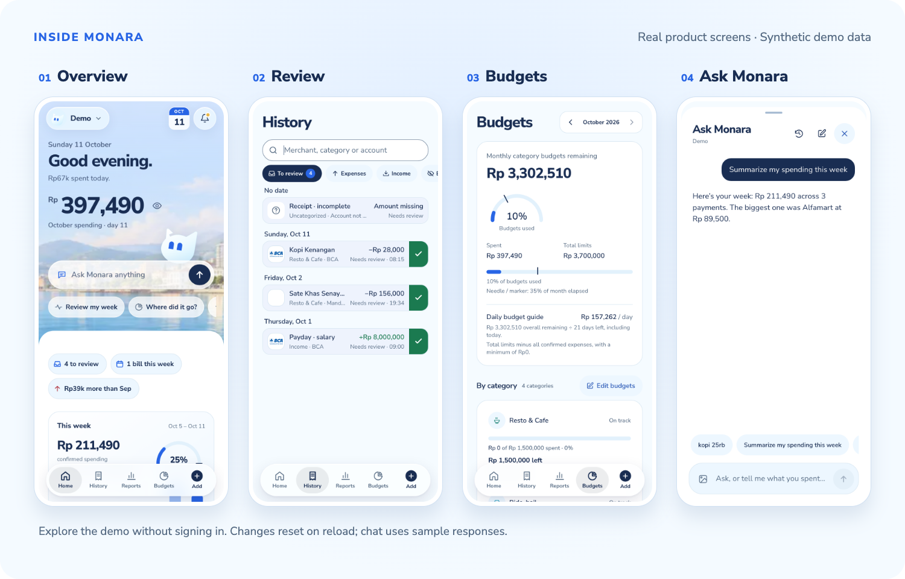
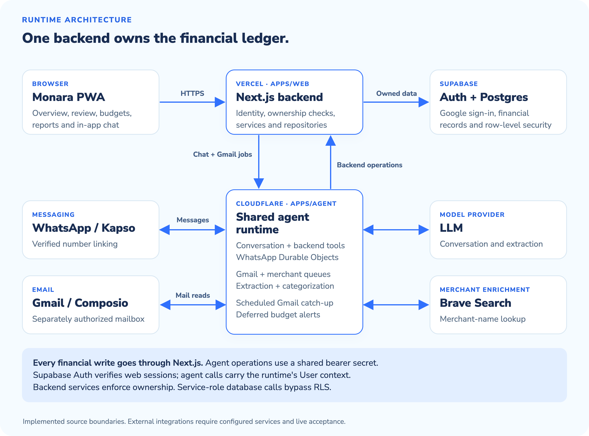

<div align="center">

<a href="https://monara-finance.vercel.app/demo">
  <picture>
    <source media="(prefers-reduced-motion: reduce) and (prefers-color-scheme: dark)" srcset="apps/web/public/logos/monara-lockup-dark.svg">
    <source media="(prefers-reduced-motion: reduce)" srcset="apps/web/public/logos/monara-lockup-light.svg">
    <source media="(prefers-color-scheme: dark)" srcset="docs/assets/readme/monara-lockup-dark.gif">
    
  </picture>
</a>

### No more scattered spending.

An AI personal-finance assistant for tracking spending,<br>reviewing transactions, and managing budgets.

[](https://github.com/ZoeMohamed/Monara/actions/workflows/ci.yml) [](https://monara-finance.vercel.app/demo) [](docs/tech/README.md)

[](apps/web) [](packages/contracts) [](supabase) [](apps/agent)

[Overview](#overview) · [Try it](#try-it) · [Architecture](#architecture) · [Run locally](#run-locally) · [Documentation](#documentation)

<a href="https://monara-finance.vercel.app/demo"></a>

<sub>Captured from the public demo at 390 × 844. All records are synthetic; demo chat uses sample responses.</sub>

</div>

## Overview

Bank emails, e-wallet payments, receipts, and quick spending notes can leave your finances scattered across apps. Monara brings them into a personal ledger, helps you review uncertain entries, and shows how confirmed spending fits your budgets.

Built for **FinTechathon 2026**, Monara combines a mobile-first PWA with a shared finance agent for in-app chat and WhatsApp.

- **See where it goes.** Explore confirmed spending, income, category breakdowns, merchant totals, and weekly or monthly trends.
- **Bring supported bank emails together.** Connect Gmail separately from sign-in. Background jobs extract and categorize notifications from supported institutions, with deduplication and review for uncertain records.
- **Keep control of your ledger.** Add, edit, confirm, exclude, or delete transactions. Only confirmed records contribute to financial totals.
- **Plan with budgets.** Set category limits and follow spending against weekly or monthly budget periods.
- **Ask Monara.** Use natural-language questions and supported ledger operations in-app or through a verified WhatsApp link. WhatsApp receipt photos create pending entries for review.

> [!NOTE]
> The public demo runs without sign-in and resets on reload. The repository includes the backend and integration implementations, but real Google sign-in, Gmail, WhatsApp, model calls, and alerts require configured services and live acceptance. Recurring bills and personal reminders remain demo features. See the [runtime guide](apps/agent/README.md) for supported operations and remaining work.

## Try it

**[Open the interactive demo →](https://monara-finance.vercel.app/demo)** No account or Gmail connection needed.

| Explore | What to try |
| --- | --- |
| [Overview](https://monara-finance.vercel.app/demo) | Check the spending snapshot and weekly guide. |
| [Transaction review](https://monara-finance.vercel.app/demo/transactions?view=review) | Inspect an incomplete receipt or confirm a pending payment. |
| [Budgets](https://monara-finance.vercel.app/demo/budgets) | Explore category limits and the daily budget guide. |
| [Reports](https://monara-finance.vercel.app/demo/reports) | Compare categories and spending over time. |
| [Ask Monara](https://monara-finance.vercel.app/demo/chat) | Try “Summarize my spending this week” with the demo assistant. |

Individual screenshots: [Overview](docs/assets/readme/screenshots/overview.png) · [Review](docs/assets/readme/screenshots/review.png) · [Budgets](docs/assets/readme/screenshots/budgets.png) · [Chat](docs/assets/readme/screenshots/chat.png).

## Architecture

<a href="docs/assets/readme/architecture.png"></a>

- **Next.js on Vercel** serves the PWA and owns financial writes through shared services and repositories.
- **Supabase Auth and Postgres** provide Google sign-in, owned financial records, and row-level security. Gmail authorization through Composio is separate from sign-in.
- **Cloudflare Workers** host the shared agent, per-User WhatsApp Durable Objects, Gmail and merchant queues, and scheduled processing. The worker calls authenticated backend operations for financial reads and writes.
- **Composio and Kapso** handle Gmail access and WhatsApp transport. Signed provider webhooks, server identity checks, and explicit WhatsApp linking establish who may act.

Web requests verify Supabase sessions. Agent requests instead authenticate the runtime with a shared bearer secret and use its supplied User context. Backend services scope financial operations to that User; service-role database calls bypass RLS.

The PWA includes an installable shell and a static offline fallback. Personal financial data and authentication responses are never cached by the service worker.

See [runtime boundaries](docs/adr/0001-initial-runtime-boundaries.md), [workspace ownership](docs/repository-structure.md), and the [agent runtime](apps/agent/README.md) for the detailed contracts. The initial ADR records the architecture decision; its original scaffold status is historical.

## Run locally

Use **Node.js 24** and **pnpm 10+**. To explore the public demo locally:

```bash
git clone https://github.com/ZoeMohamed/Monara.git
cd Monara
corepack enable
pnpm install --frozen-lockfile
pnpm dev
```

Open the URL printed by Next.js and visit `/demo`. The main checkout defaults to port `3000`; linked worktrees receive their own ports.

For the backend, start a Docker-compatible runtime and run `pnpm worktree:bootstrap`, then `pnpm dev`. Google OAuth and external integrations need their own local configuration. Follow the [local development guide](docs/local-development.md) for database setup, Gmail testing, phone previews, PWA installation, and team deployment instructions.

```bash
pnpm check   # Lint, types, dependency checks, tests, React Doctor, docs, DB prerequisites
pnpm build   # Web build and local agent dry-run bundle
```

## Documentation

| Guide | Contents |
| --- | --- |
| [Technical documentation](docs/tech/README.md) | Hackathon submission sections, authors, and review status |
| [Local development](docs/local-development.md) | Demo setup, local backend, integrations, and deployment workflow |
| [Repository structure](docs/repository-structure.md) | Workspace packages, dependency direction, and team ownership |
| [Supabase workflow](docs/supabase-workflow.md) | Local migrations, generated types, and ownership/RLS checks |
| [Agent runtime](apps/agent/README.md) | Conversation tools, Gmail processing, WhatsApp, and integration limits |
| [Domain glossary](CONTEXT.md) | Shared product terminology |
| [UI design system](docs/ui-design-system.md) | Branding, components, and interaction conventions |

The technical documentation includes drafts and owner review statuses. A passing structure check does not establish final submission acceptance.
