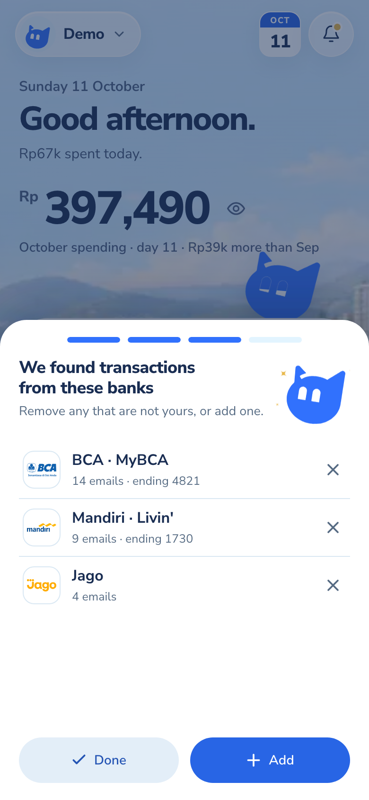
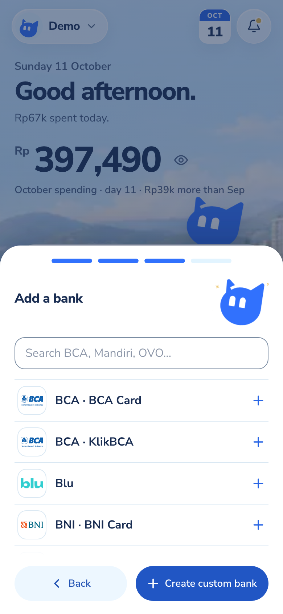

# Custom Bank design

Status: implemented and verified locally, 2026-10-20. Remote migrations and deployment remain separate from implementation.

## Accepted requirements

- A Custom Bank is private to the User who creates it, reusable across that User's Financial Accounts, and available across devices.
- Custom Banks support Gmail discovery and transaction imports, rather than serving only as account labels.
- Require a bank name and one or more exact transaction-notification sender addresses. Provide an Add another email control; customer-service addresses and whole-domain rules are not substitutes for actual notification senders.
- The icon is optional. Reuse existing logo search with a neutral fallback and persist the selection with the Custom Bank. Do not add image uploads in this version.
- Provide creation from onboarding's bank-detection/review step and from Profile. Keep form fields and layout consistent; the surrounding container may differ.
- Preserve account nicknames and last four digits as Financial Account details.
- Create the Custom Bank and its first usable Financial Account together. Default the account name to the bank name; nickname and last four digits remain optional. Additional accounts may reuse the bank later.
- Support Bank, Credit card, and Wallet product kinds, with Bank selected by default. This uses the existing account model, not new credit-card billing or debt functionality.
- Reject a sender already listed in the built-in registry. Show an inline error such as "This bank is already listed in Monara. Choose it from the list."
- Prioritize shipping quickly and avoid adding a broad custom-bank management scope.

See the [ownership decision](adr/0006-user-owned-custom-banks.md) and [domain glossary](../CONTEXT.md).

## Starting implementation, inspected before this change

### Catalog and account model

The [bundled institution registry](../packages/contracts/src/institutions/institution-senders.json) has 34 bank/product/wallet entries: 21 banking apps, 11 credit-card entries, and two e-wallet entries. Twenty-five entries have 27 sender addresses in total; nine have no known sender. These are product identities, not necessarily distinct banks: MyBCA, KlikBCA, and BCA Card are separate entries. The file explicitly says its sender addresses have not been independently verified against live inboxes.

[Institution contracts](../packages/contracts/src/institutions.ts) supply stable registry keys, names, providers, platforms, and sender lists. Registry keys must belong to the bundled list, and sender addresses resolve to one exact entry case-insensitively. The catalog is shared application code, with no owned Custom Bank entity today.

[Financial Account contracts](../packages/contracts/src/ledger.ts) distinguish bank, wallet, and cash accounts. Accounts store a nickname, optional institution label, optional registry key, currency, optional last four digits, and active state. A [mailbox link](../supabase/migrations/20261017110000_gmail_account_mailbox.sql) associates an account with one owned Gmail Connection for imports.

The [schema migrations](../supabase/migrations/20261012080806_initial_monara_schema.sql) and [institution-flow migration](../supabase/migrations/20261016190100_gmail_institution_flow.sql) enforce owned accounts and source identity. SQL currently checks the institution key's format; application contracts check membership in the static registry. Account writes go through the [backend repository](../packages/core/src/supabase-finance-repository.ts); authenticated database clients have owner-scoped read access, and server-side operations own writes. Account deactivation preserves historical transaction references. There is no inspected live database state or remote migration acceptance in this investigation.

### Onboarding and Profile

[OnboardingDetect](../apps/web/src/components/onboarding-detect.tsx) contains the current bank review/editor and registry-only AddBankPicker. [BankChoice and its adapters](../apps/web/src/lib/onboarding/banks.ts) deduplicate choices by registry key. [Live onboarding](../apps/web/src/components/use-gmail-onboarding.ts) creates selected Financial Accounts when the User continues, with per-choice request IDs; [demo onboarding](../apps/web/src/components/use-demo-onboarding.ts) uses synthetic choices.

[ProfileScreen](../apps/web/src/components/profile-screen.tsx) hosts the account-management area. [FinancialAccountSetup](../apps/web/src/components/financial-account-setup.tsx) has shared account fields and live/demo submit adapters. Its form includes account name, bank/wallet/cash type, institution, logo, a registry notification-source choice, mailbox, and last four digits. It accepts a free-text institution label, but arbitrary labels do not enable Gmail importing.

[BrandLogoField](../apps/web/src/components/brand-logo-field.tsx) and LogoSearch provide the existing icon selection UI. [Current logo overrides](../apps/web/src/components/use-brand-logo.ts) are exact-label browser-local preferences, not owned database records. Custom Bank icons therefore need an owned persistence path even if the picker is reused. [AccountBadge](../apps/web/src/components/account-badge.tsx) supplies known marks or a neutral fallback.

### Gmail pipeline

[Discovery](../packages/core/src/gmail-discovery.ts) scans recent metadata, currently 30 days and at most 500 messages, and recognizes exact bundled sender addresses. Subjects supply possible last four digits; they do not establish bank identity. Discoveries suggest accounts and do not by themselves create an account or establish complete historical coverage.

The [ingestion repository](../packages/core/src/supabase-gmail-ingestion-repository.ts) resolves active accounts for the selected owned mailbox and filters institution keys through the static registry. The [Worker pipeline](../apps/agent/src/gmail/pipeline.ts) builds queries from those senders, checks sender/account eligibility, extracts transaction facts, and submits backend operations. Its initial import window is also 30 days; catch-up queries overlap the last sync without going beyond that window. [New-account import scheduling](../apps/web/src/lib/gmail/import.ts) already starts a targeted recent-mail import when an account is linked, provided its mailbox is active and the User has saved their full name.

[Trigger configuration](../packages/integrations/src/gmail-trigger.ts) and the [web trigger reconciler](../apps/web/src/lib/gmail/trigger.ts) also use sender queries. Trigger creation remains behind the existing deployment setting; custom support must update sender resolution without silently enabling it. Adding a text field or arbitrary key alone would leave custom senders ignored or rejected.

Account mapping uses sender identity and account hints without inventing a Financial Account. Missing or ambiguous mappings remain reviewable. Durable message claims prevent duplicate imports per mailbox/message. Custom support must preserve those properties and the current confidence-based review policy; an exact custom sender match is not independent proof of authenticity.

## Accepted release scope

The User confirmed the trimmed release scope, kept deletion and archiving out of v1, and authorized simple editing if it could reuse the creation form. The implementation reuses that form to edit the name, logo, and sender addresses.

### Shared form and two entry points

- Fields: name, Bank/Credit card/Wallet selector, one or more exact sender addresses, optional logo from existing search, and optional account nickname/last four. Keep account extras visually secondary.
- Onboarding: add a Create custom bank action to the existing bank picker and its no-results state. Show the form inside the current onboarding sheet, without nesting a second modal. Adding returns to the bank review with the new choice selected; continuing saves the bank and first account together. Back preserves the in-progress selection. Closing before continuing discards unsaved additions.
- Profile: expose Create custom bank from the existing Banks & wallets account-add flow. Reuse the same form in that flow's dialog. Save creates the bank and first account together; no separate bank-management screen.
- Include saved Custom Banks in the relevant account/provider choices so another Financial Account can reuse one. Keep existing multiple-account mapping behavior: use known last four digits to disambiguate, otherwise leave uncertain imports in review.

### Validation and imports

- Trim and normalize sender addresses case-insensitively. Use the current bounded sender/name conventions and reject malformed addresses, repeated addresses in the form, and built-in sender matches before saving.
- Also reject a sender already assigned to another of the User's Custom Banks, with "This sender is already used by [bank]. Choose that bank instead." The same unknown sender may be configured independently by different Users. Do not infer duplicate identity from display names alone.
- Create the bank and first account atomically with an idempotent request, retaining entered values and request identity after uncertain failures. Do not leave an orphan bank or duplicate account on a retry.
- Use the current onboarding mailbox. In Profile, reuse the existing mailbox selector, single-mailbox default, and manual-only option; no Gmail connection is required merely to save a bank/account.
- Reuse the existing 30-day initial-import window when an account becomes linked to an active owned mailbox. Respect the existing full-name prerequisite, current review/confidence policy, status reporting, and durable message deduplication. No new history-range picker or historical reclassification.
- Keep Custom Bank data private and persist its icon across devices. Demo creation uses synthetic/browser state through the same form, rather than writing real data.

### Editing and deferred lifecycle

Profile exposes Edit custom bank beside accounts that use one. Reuse the form for name, logo, and complete sender-list edits, checked against the original update timestamp. Product kind cannot change after creation. Name/logo-only edits refresh the ledger; changed senders also reconcile enabled triggers and request the existing targeted 30-day import once per relevant mailbox.

Defer custom-bank archiving/deletion, image uploads, sender-domain rules, and a dedicated bank-management screen. The database blocks hard deletion while accounts reference the bank. Full Monara User Deletion remains a separate action that removes the owned graph.

Retain existing Financial Account editing, mailbox unlinking, and deactivation. The [current account editor](../apps/web/src/components/financial-account-setup.tsx) already supports setting the mailbox to None and deactivating an account; extend source resolution so those same controls apply to custom sources. Deactivating or unlinking one account must not stop another active account that still uses the sender. Existing transaction history is retained.

## Accepted design decisions

Q1 to Q9 and the subsequent deletion discussion are resolved. A later instruction permits simple editing through the same form. No product decision remains pending for this scope.

## Implementation boundaries to preserve

- The Next.js backend resolves identity and owns financial and bank writes. Worker requests use defined backend operations. Owned references must be checked server-side and enforced in database relationships/RLS.
- Keep custom senders within their owning User and the account's selected mailbox. Do not broaden Gmail queries to arbitrary domains or trust caller-supplied owner IDs.
- Keep built-in catalog entries working without rewriting existing financial history. Choose and document a stable owned identity before adding custom references to discoveries, queued jobs, or accounts.
- Preserve durable message deduplication, uncertain account mapping, financial facts, and the established import-completion/review policy.
- Never send personal sender addresses, mailbox data, or financial content to public business search. Existing public-search restrictions remain in force.
- Use one shared form with context-specific containers and live/demo adapters. Verify behavior in a mobile viewport, default 390 by 844 CSS pixels.
- Update repository documentation that currently restricts Gmail reads to bundled institution senders when an owned-custom-sender implementation is accepted.

## Implemented technical shape

The bundled catalog and existing institution keys remain intact. `custom_banks` stores owned bank metadata and generates a stable `custom_<uuid without hyphens>` key. `custom_bank_senders` enforces sender uniqueness within each User. `financial_accounts.custom_bank_id`, the existing institution key, and a composite owner foreign key keep references explicit and prevent deletion of referenced banks. Browser clients have owned read access; writes go through authenticated backend operations.

The finance boundary exposes `list_custom_banks`, `create_custom_bank`, and `update_custom_bank` as web operations. Creation uses one idempotent SQL transaction for the bank, senders, and first account. Edits require the current update timestamp. Financial Account reads join the current owned bank name/logo, preserving account nicknames and transaction IDs.

The backend resolves custom source configuration for the owned Gmail connection and supplies validated entries to the Worker. Worker sender matching and listing intersect those entries with the mailbox's active account keys. Discovery can also recognize the User's own saved custom senders. Per-message resolution keeps queued work subject to current account and sender configuration.

Reuse the current mutation protections: server identity, same-origin checks for browser writes, bounded external input, rate limiting, request idempotency, and conflict checks. Make bank and first-account persistence atomic and safe to retry. Update trigger reconciliation only through the existing configured path.

## Local verification

- `pnpm check` passes, covering lint, TypeScript, workspace consistency, boundary tests, documentation, and migration validation. React Doctor reports 100 with no findings for both web and UI packages.
- `pnpm build` passes for the Next.js production build and the Worker dry-run bundle.
- All 559 database assertions across 19 test files pass against the integrated main branch, including 34 Custom Bank assertions for ownership, RLS, atomic creation/retries, sender uniqueness, optimistic edits, account types, deletion fencing, and preserved account/transaction references. Local database lint reports no schema errors, and generated types match the schema.
- Mobile browser checks pass at 390 by 844 CSS pixels for demo onboarding and Profile creation, built-in sender rejection, multiple senders, logo selection, editing, and reusing the bank for another account. The edit form also fits a 320-pixel viewport without horizontal overflow.
- A signed-in local browser flow creates and edits persisted bank data and an account nickname. A fresh browser context loads the saved logo from the backend. Its synthetic identity and records are removed after verification.

The local migration has been applied only to this worktree's isolated stack. Tests use synthetic identities and demo/browser state. Live Google authorization, Gmail provider acceptance, remote schema changes, and deployment remain unverified.

### Onboarding entry point

From the detected-bank results, choose **Edit**, then **Add**. The **Create custom bank** button stays pinned at the bottom right of the bank picker. If detection finds no banks, **Add a bank** opens that picker directly.

For a later deployment, apply the migration and deploy the Worker before exposing the new web UI. The Worker accepts omitted custom metadata for built-in-only callers, so it remains compatible with the older backend during that order.
