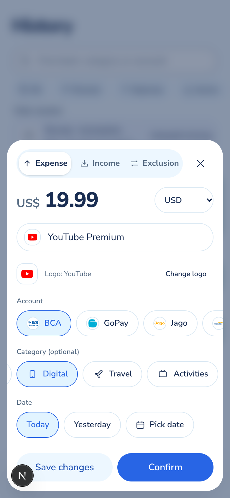
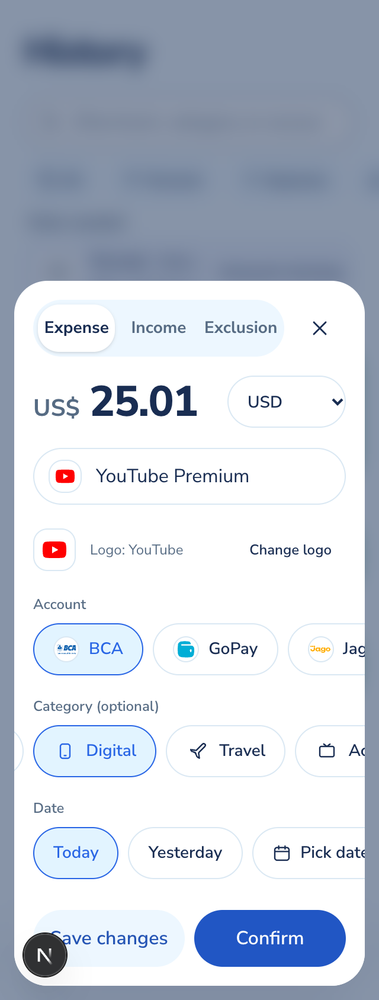

# USD transaction editor

Synthetic demo data, verified locally on 2026-10-20. These screenshots show the shared creation and editing sheet with USD cents, account and category chips, date choices, and the pending-review actions.

The browser check created a USD 19.99 transaction, edited it to USD 25.01, saved it, and reopened the form with the exact amount preserved. The 320-pixel check confirmed that the document stayed within the viewport. Account, category, and date choices scroll within their rows.

The T3 collaborative preview's click calls repeatedly timed out and its host temporarily disconnected. The successful checks used an isolated local Chrome session through Playwright. No real Gmail inbox or production transaction was used.

## 390 by 844 CSS pixels

## 320 by 844 CSS pixels

