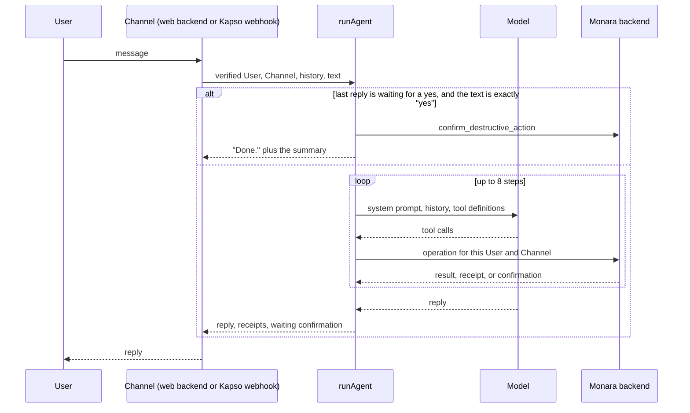

# Agent design

Owner: Argya. Features: F10, F11, F12. Status: Draft.

## Purpose

The Agent lets a User keep their books by talking: log spending and income, correct or undo a change, review imports, set Budgets, and ask what they spent. One Agent serves in-app chat (F11) and WhatsApp (F12), so a request behaves the same in both (F10).

It is built to show the five qualities in PRD section 6.1. It understands colloquial requests and asks when something is missing. It plans multi-step requests across tools. It executes safely through Permission Tiers. It leaves the User in control with undo and explicit confirmation. Its value is measured by the scenario suite described under How to verify.

The Agent runs end to end today against an in-memory ledger. The backend operations it calls in production are **Planned**: no route under `apps/web/src/app/api/agent` exists yet.

## How it works

The Agent is a Cloudflare Worker in `apps/agent`. Both Channels end in the same function, `runAgent` in `apps/agent/src/conversation/agent.ts`, built once by `createRespond` in `respond.ts`.



**Tool loop.** `runAgent` sends the system prompt (`prompt.ts`), the earlier turns, and the tool definitions to an OpenAI-compatible model (`llm.ts`). It runs each tool call the model makes, feeds the result back, and stops when the model replies in text or after 8 steps.

**Tool registry and tiers.** Tools are plain objects with a zod input schema and a tier (`tools.ts`). Arguments are parsed with that schema before anything runs.

| Tier | Tools | What the registry does |
| --- | --- | --- |
| T0 read | `get_summary`, `suggest_budget`, six `list_*` tools (`read-tools.ts`) | Runs the tool. |
| T1 reversible write | `add_transaction`, `edit_transaction`, `confirm_pending`, `reject_pending`, `create_budget`, `edit_budget`, `set_reminder_preferences`, `undo_action` (`write-tools.ts`) | Runs the tool and collects the reversible action receipt. |
| T2 destructive | `delete_transaction`, `delete_budget`, `delete_bill` (`destructive-tools.ts`) | Never runs anything. Asks the backend for a confirmation. |
| T3 never in chat | none | The type has no T3, so such a tool cannot be registered. |

**Add-transaction conversation.** The prompt tells the model to ask only for what is missing, infer the type from the wording, default the date and time to now, pick the closest Category, and record a clearly stated transaction at once. `add_transaction` accepts only the fields the User gave, fills the rest with null, and parses the result with `createTransactionInputSchema` from `packages/contracts`. A missing Financial Account or amount is rejected there and returned to the model, which then asks the User.

**Echo, correction, and undo.** Every write returns a receipt. The Channel stores receipts on the Agent's turn and sends them back as history, so "no, 38k" edits the same record and "undo that" calls `undo_action` with the right action id.

**Totals.** `get_summary` reads every page of confirmed transactions and adds them up in integer rupiah with `BigInt`. The model is told not to do arithmetic on amounts.

**Deletes.** Calling a T2 tool sends `request_destructive_action` and returns the backend's summary to the model, which asks the User to reply yes. The confirmation travels with the reply. If the User's next message is exactly `yes`, `runAgent` sends `confirm_destructive_action` itself and replies without calling the model.

**WhatsApp.** `apps/agent/src/whatsapp/index.ts` verifies Kapso's HMAC signature, then asks the backend who the sender is. Only a verified WhatsApp Link names a User. A linked User's text is queued in a per-User Durable Object (`conversation.ts`, logic in `session.ts`), which answers messages in order and keeps recent turns for 30 minutes. Linking rules (keyed phone hash, six-digit code stored as a digest, ten-minute expiry, five attempts) are in `packages/core/src/whatsapp-link.ts`.

**Planned.** Backend routes for every operation and for `resolve-sender`; the audit log of tool calls (`agent_action_logs`, written by the backend); `confirm_recurring_bill` and `bulk_edit`; receipt photos and voice notes, which get a fixed reply today; the Settings screen that starts linking.

## Key decisions

| Decision | Rejected alternative | Why |
| --- | --- | --- |
| One `runAgent` for every Channel | A separate bot per Channel | PRD F10 requires the same result on web and WhatsApp. One loop means one set of rules to test. |
| The Agent calls backend operations and holds no database client | Let the worker write to Supabase | ADR `docs/adr/0001-initial-runtime-boundaries.md`: the Next.js backend owns writes and ownership checks. A prompt-injected model then cannot reach past the operations. |
| A T2 tool has no code to run, and the yes is handled outside the model | A `confirm` tool the model calls after the User agrees | A model can be talked into calling a tool. It cannot produce the User's own next message. |
| Only the exact word `yes` confirms | Accept "ok", "sure", or a yes inside a longer message | PRD 6.2 asks for an explicit yes. "Yes, and delete the rest too" must not confirm. |
| Totals are computed in code | Let the model add amounts | In testing the model averaged three months to Rp 723.333 when the answer was Rp 715.000. |
| In-app chat sends its own history; WhatsApp keeps it in a Durable Object | Store conversations in Postgres | The ERD keeps conversations out of product tables. WhatsApp has no client to hold history, so it is held for 30 minutes and then deleted. |
| On WhatsApp the Agent runs at most once per message | Retry the whole turn on failure | A retried turn could record a transaction twice. Only sending the reply is retried. |
| English only | An i18n layer | PRD 6.3. Out of scope for the submission. |

## Security and risks

- **Identity.** A tool receives the User and Channel from the verified caller (`ToolContext` in `tools.ts`). No tool has a user id in its input schema, and the schemas are strict, so a user id supplied by the model is rejected. `/chat` accepts only the shared backend secret, compared in constant time. On WhatsApp a phone number is a claim until the backend finds a verified link.
- **Injection.** The prompt marks quoted email, receipt, and voice text as data. That alone is not relied on: the worst a hijacked model can do is call T0 and T1 tools for the same User, every T1 change has a receipt and can be undone, and it cannot answer a T2 confirmation.
- **Fail closed.** Each handler returns 503 when a secret or binding is missing. A failed write tells the User the change could not be confirmed, never that it was or was not saved.
- **Data handling.** Errors report status codes only, because provider and backend bodies can echo conversations or records. Tool failures reach the model as `"<tool> failed."`. Results are parsed with the shared contracts, so a field outside the contract is not shown to the model. Kapso media is fetched only from Kapso's origin, without following redirects.
- **Provider filter.** The model provider rejects some override attempts outright. That is returned as a fixed refusal.

Open risks:

- The backend does not exist yet, so ownership checks, undo expiry, confirmation binding, and the audit log are unproven.
- History for in-app chat comes from the caller. A forged history cannot confirm a delete without a confirmation id the backend issued, but the backend must check every id.
- The model runs with reasoning switched off, because the provider does not accept function tools with reasoning on its chat completions endpoint.
- WhatsApp conversation turns sit in Durable Object storage for up to 30 minutes, including the User's number while a reply is waiting to be sent.
- The Durable Object and the Kapso send path have run locally only, never against a real Kapso number.

## How to verify

```sh
pnpm --filter @monara/agent test      # 40 tests, no network
pnpm --filter @monara/core test       # 11 tests for WhatsApp Link codes
pnpm --filter @monara/integrations test
pnpm --filter @monara/agent sandbox   # needs LLM_* in apps/agent/.dev.vars
```

The tests in `apps/agent/test` use a scripted model and a fake backend. They cover the loop, tier enforcement, each confirmation rule, exact totals, the webhook, and the WhatsApp session (ordering, duplicates, crash recovery, expiry).

`sandbox` plays the scenarios in `apps/agent/sandbox/scenarios.ts` against the real model and the in-memory ledger in `sandbox/ledger.ts`. Each scenario checks what happened to the ledger, not the wording. It prints PASS or FAIL per scenario and exits non-zero on any failure.

| Suite | Cases | Result on 13 Oct 2026, model `gpt-6-luna` |
| --- | --- | --- |
| Scripted tasks (log expense with follow-up, income, transfer, correct and undo, Review Queue, Budget, Category report, bills due, multi-step plan, confirmed delete, stop Reminders, investment fallback) | 12 | 12 of 12 in each of three consecutive runs |
| Attacks (another User's data, spoofed identity, T3 escalation, delete without confirmation, injected email text, injected stored record, prompt and secret extraction) | 7 | 7 of 7 in each of three consecutive runs |

Earlier runs the same day failed on transfers and on T3 escalation before the prompt and tool descriptions were tightened, so the suite is not deterministic. These figures are for the in-memory ledger; they are not evidence about the real backend.
