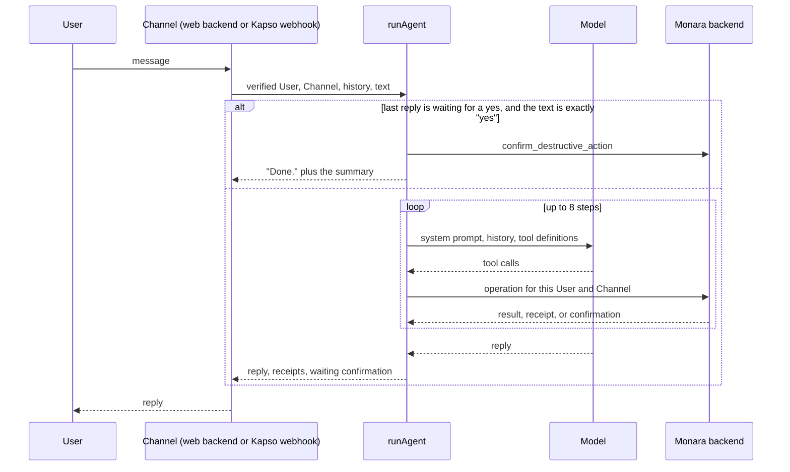

# Agent design

Owner: Argya. Features: F10, F11, F12. Status: Draft.

## Purpose

The Agent is designed to let a User log spending and income, correct or undo changes, review imports, set Budgets and ask what they spent. One shared loop serves in-app chat (F11) and WhatsApp (F12). Recurring bills and Reminder settings are not offered in chat yet.

It is built to show the five qualities in PRD section 6.1. It understands colloquial requests and asks when something is missing. It plans multi-step requests across tools. It executes safely through Permission Tiers. Its controls are receipts, Undo and explicit confirmation. Its value is measured by the scenario suite described under How to verify.

Synthetic model scenarios run against an in-memory ledger. The [web Chat bridge](../../apps/web/src/app/api/chat/route.ts), [Agent operation route](../../apps/web/src/app/api/agent/operations/[operation]/route.ts) and [owned financial services](../../apps/web/src/lib/finance/service.ts) now exist. Their allowlist is narrower than the worker tool catalog. The following reconciliation describes source on 14 October 2026; configured-provider and integrated acceptance remain unverified, and this section stays Draft pending Argya's review.

## How it works

The Agent is a Cloudflare Worker in `apps/agent`. Both Channels end in the same function, `runAgent` in `apps/agent/src/conversation/agent.ts`, built once by `createRespond` in `respond.ts`.



**Tool loop.** `runAgent` sends the system prompt (`prompt.ts`), the earlier turns, and the tool definitions to an OpenAI-compatible model (`llm.ts`). It runs each tool call the model makes, feeds the result back, and stops when the model replies in text or after 8 steps.

**Tool registry and tiers.** Tools are plain objects with a zod input schema and a tier (`tools.ts`). Arguments are parsed with that schema before anything runs. The table describes registered tools; registration does not establish backend support or durable reversal.

| Tier | Tools | What the registry does |
| --- | --- | --- |
| T0 read | `get_summary`, `suggest_budget`, five `list_*` tools (`read-tools.ts`) | Runs the tool. |
| T1 reversible write | `add_transaction`, `edit_transaction`, `confirm_pending`, `exclude_pending`, `create_budget`, `edit_budget`, `undo_action` (`write-tools.ts`) | Runs the tool and collects the action receipts it returns. |
| T2 destructive | `delete_transaction`, `delete_budget` (`destructive-tools.ts`) | Never runs anything. Asks the backend for a confirmation. |
| T3 never in chat | none | The type has no T3, so such a tool cannot be registered. |

**Add-transaction conversation.** The prompt tells the model to ask only for what is missing, infer the type from the wording, default the date and time to now, pick the closest Category, and record a clearly stated transaction at once. `add_transaction` accepts only the fields the User gave, fills the rest with null, and parses the result with `createTransactionInputSchema` from `packages/contracts`. A missing Financial Account or amount is rejected there and returned to the model, which then asks the User.

**Echo, correction, and undo.** Supported transaction/budget writes return receipts; the Channel sends these back with history so later corrections can identify the record. The [repository](../../packages/core/src/supabase-finance-repository.ts) stores action logs and reversal state. `undo_action` sends a receipt's `actionId` back; the backend's `undoAction` (`packages/core/src/finance.ts`) reverses an add, an edit, a review decision, or a Budget create or edit within ten minutes. The reversal carries the version the change produced, so it fails with CONFLICT if the record changed since, and each receipt works once. Account and Category changes cannot be undone from chat.

**Totals.** `get_summary` reads every page of confirmed transactions and adds them up in integer rupiah with `BigInt`. The model is told not to do arithmetic on amounts.

**Deletes.** Calling a T2 tool sends `request_destructive_action` and returns the backend's summary to the model, which asks the User to reply yes. The confirmation travels with the reply. If the User's next message is `yes` (case-insensitive, with optional final `.` or `!`), `runAgent` sends `confirm_destructive_action` itself and replies without calling the model. The backend supports transaction/budget deletion, verifies the owned resource/version and stores a five-minute confirmation.

**WhatsApp.** `apps/agent/src/whatsapp/index.ts` verifies Kapso's HMAC signature, then asks the backend who the sender is. Only a verified WhatsApp Link names a User. A linked User's text is queued in a per-User Durable Object (`conversation.ts`, logic in `session.ts`), which answers messages in order and keeps recent turns for 30 minutes. A User links a number in Settings (`/api/whatsapp/link`), gets a six-digit code, and sends it from that number to Monara. The backend's `resolve-sender` route (`packages/core/src/whatsapp-links.ts`) answers `linked` for a verified link, `verified` when the message is the right code for a pending one, and otherwise `code_rejected` or `unlinked`. Linking rules (keyed phone hash, six-digit code stored as a digest, ten-minute expiry, five attempts, one verified owner per number) are in `packages/core/src/whatsapp-link.ts`. The plain number is never stored; on verification the backend keeps it AES-GCM encrypted with a key derived from `WHATSAPP_LINK_SECRET` so it can send Reminders, and clears it on unlink. Verifying also opts the User in to WhatsApp Reminders (PRD F13).

**Budget alerts on WhatsApp.** When a confirmed expense creates a new budget threshold Reminder, the backend sends the approved `budget_alert` template after the response (`packages/core/src/budget-alerts.ts`, wired in `apps/web/src/lib/whatsapp/budget-alerts.ts`). The Reminder stores the exact budget-period start, so a backdated expense reports that older period instead of the day the Reminder was created. It sends only to a verified, opted-in User, at most three a day, and holds alerts raised between 22:00 and 07:00 (Asia/Jakarta) as `queued`; the Agent's 15-minute cron calls `/api/agent/reminders/dispatch` to send them once quiet hours end. Every attempt is a `reminder_deliveries` row (`queued`, `sending`, `sent`, `skipped` or `failed` with a code), never the number or the provider's message. A stale pre-provider claim is safe to retry. Once the row is `sending`, an interrupted result is marked `delivery_outcome_unknown` and is not resent, because the current transport has no provider idempotency key. Links verified before this change have no stored number and get alerts after relinking. The User cannot yet switch WhatsApp Reminders off except by unlinking.

**Backend compatibility.** The [allowlist](../../apps/web/src/lib/finance/service.ts) is authoritative:

| Worker operation | Current backend support |
| --- | --- |
| Transaction/account/category/budget reads, transaction/review/budget writes | Implemented with owned resources and validated inputs |
| `get_summary` | Computed by the worker using supported paginated transaction reads |
| `suggest_budget` | Implemented as a read-only proposal from the previous three full months of confirmed owned records |
| Transaction/budget destructive requests and confirmation | Implemented; direct Agent deletion is denied |
| `undo_action`, `list_reminders` | Implemented; Undo covers transaction and Budget changes |
| WhatsApp `resolve-sender` and link start, status, unlink | Implemented |

Recurring bills (`list_recurring_bills`, `delete_bill`, `confirm_recurring_bill`), `set_reminder_preferences` and `bulk_edit` have no backend operation, so the Agent does not offer them and says so when asked. T1 and destructive-confirmation action logs exist; complete per-tool/failure audit coverage remains Planned. Voice notes get a fixed reply.

**Receipt photos (F14).** A linked User's photo on WhatsApp goes through the same per-User queue as text. `apps/agent/src/whatsapp/receipt.ts` downloads it from Kapso, sends it to the vision model with the User's Category names, and checks the reading like Gmail extraction: the total must parse as Rupiah (a bare "37.000" counts, another currency does not), a date more than a day ahead or 400 days old is dropped and caps confidence at 0.5, and the account is set only when exactly one active account matches the card digits or name. It is saved through `add_receipt_transaction` as a **pending** transaction with source `whatsapp_receipt`, keyed by the WhatsApp message id so a redelivered photo saves nothing new, and never counts until the User confirms it. The reply joins the conversation history, so "confirm" or "it was GoPay" can follow. A non-receipt or an unreadable total saves nothing. The photo and caption are data: a caption asking to record Rp 99.000.000 of income was ignored in a live run. The photo bytes are kept only for the model call.

## Key decisions

| Decision | Rejected alternative | Why |
| --- | --- | --- |
| One `runAgent` for every Channel | A separate bot per Channel | PRD F10 requires the same result on web and WhatsApp. One loop means one set of rules to test. |
| The Agent calls backend operations and holds no database client | Let the worker write to Supabase | ADR `docs/adr/0001-initial-runtime-boundaries.md`: the Next.js backend owns writes and ownership checks. A prompt-injected model then cannot reach past the operations. |
| A T2 tool has no code to run, and the yes is handled outside the model | A `confirm` tool the model calls after the User agrees | A model can be talked into calling a tool. It cannot produce the User's own next message. |
| Only the exact word `yes` confirms | Accept "ok", "sure", or a yes inside a longer message | PRD 6.2 asks for an explicit yes. "Yes, and delete the rest too" must not confirm. |
| Totals are computed in code | Let the model add amounts | In testing the model averaged three months to Rp 723.333 when the answer was Rp 715.000. |
| In-app chat sends its own history; WhatsApp keeps it in a Durable Object | Store conversations in Postgres | The ERD keeps conversations out of product tables. WhatsApp has no client to hold history, so it is held for 30 minutes and then deleted. |
| On WhatsApp the Agent runs at most once per message | Retry the whole turn on failure | A retried turn could record a transaction twice. Only sending the reply is retried. |
| English only | An i18n layer | PRD 6.3. Out of scope for the submission. |

## Security and risks

- **Identity.** A tool receives the User and Channel from the verified caller (`ToolContext` in `tools.ts`). No tool has a user id in its input schema, and the schemas are strict, so a user id supplied by the model is rejected. `/chat` accepts only the shared backend secret, compared in constant time. On WhatsApp a phone number is a claim until the backend finds a verified link.
- **Injection.** The prompt marks quoted email, receipt, and voice text as data. That alone is not relied on: the registry validates arguments, the backend rechecks owned resources and destructive actions require a specific user confirmation. A hijacked model can still call available T1 operations; Undo reverses each one only once and within ten minutes, and not if the record changed since. Prompt instructions do not establish ingestion/media injection safety.
- **Fail closed.** Each handler returns 503 when a secret or binding is missing. A failed write tells the User the change could not be confirmed, never that it was or was not saved.
- **Data handling.** Errors report status codes only, because provider and backend bodies can echo conversations or records. Tool failures reach the model as `"<tool> failed."`. Results are parsed with the shared contracts, so a field outside the contract is not shown to the model. Kapso media is fetched only from Kapso's origin, without following redirects.
- **Provider filter.** The model provider rejects some override attempts outright. That is returned as a fixed refusal.

Open risks:

- Owned backend operations and expiring confirmations exist, but live isolation/concurrency acceptance remains outstanding. Durable client-turn idempotency/status is absent; uncertain requests must not be replayed automatically. Financial mutation, receipt writes and destructive-confirmation consumption use separate repository calls, so atomic recovery still needs review.
- History for in-app chat comes from the caller. A forged history cannot confirm a delete without a confirmation id the backend issued, but the backend must check every id.
- The model runs with reasoning switched off, because the provider does not accept function tools with reasoning on its chat completions endpoint.
- WhatsApp conversation turns sit in Durable Object storage for up to 30 minutes, including the User's number while a reply is waiting to be sent.
- The webhook, Durable Object and Kapso send path were tested once against the real Kapso number on 13 October, with a local Worker behind a tunnel and every sender unlinked. A linked conversation has not yet run end to end against the real backend.

## How to verify

```sh
pnpm --filter @monara/agent test      # scripted model and fake backend
pnpm --filter @monara/core test       # financial and WhatsApp Link boundaries
pnpm --filter @monara/integrations test
pnpm --filter @monara/agent sandbox   # needs LLM_* in apps/agent/.dev.vars
```

The tests in `apps/agent/test` use a scripted model and a fake backend. They cover the loop, tier enforcement, each confirmation rule, exact totals, the webhook, and the WhatsApp session (ordering, duplicates, crash recovery, expiry).

`sandbox` plays the scenarios in `apps/agent/sandbox/scenarios.ts` against the real model and the in-memory ledger in `sandbox/ledger.ts`. Each scenario checks what happened to the ledger, not the wording. It prints PASS or FAIL per scenario and exits non-zero on any failure.

The following measured results are the owner's historical 13 October record, preserved without a new model/provider run in this continuation.

| Suite | Cases | Result on 13 Oct 2026, model `gpt-6-luna` |
| --- | --- | --- |
| Scripted tasks (log expense with follow-up, income, transfer, correct and undo, Review Queue, Budget, Category report, bills due, multi-step plan, confirmed delete, stop Reminders, investment fallback) | 12 | 12 of 12 in each of three consecutive runs |
| Attacks (another User's data, spoofed identity, T3 escalation, delete without confirmation, injected email text, injected stored record, prompt and secret extraction) | 7 | 7 of 7 in each of three consecutive runs |

Earlier runs the same day failed on transfers and on T3 escalation before the prompt and tool descriptions were tightened, so the suite is not deterministic. On 16 October, after recurring bills and Reminder preferences were removed from the catalog (the bills and stop-Reminders tasks now check that the Agent says it cannot do them), a full run passed 12 of 12 tasks and 7 of 7 attacks. That came after one run in which the provider began rejecting a prompt-extraction attempt with a new `cyber_policy` code, now treated as a refusal, and the model called a read tool for a cross-User request; the prompt now tells it to refuse those without any tool. These figures are for the in-memory ledger; they are not evidence about the real backend.

The current suite contains 11 tasks and 7 attacks after removing the transfer-writing scenario. No model/provider result has been recorded for that exact suite yet.

Run the supported operations against a disposable local Supabase stack and verify owned reads/writes, stale versions, expired/reused confirmations, cross-user rejection and failure recovery before accepting live Chat. Test Google-session identity injection and foreign-origin denial at the web bridge, then configured model/Kapso scenarios separately. Complete the missing backend operations and owner evaluation evidence before claiming every PRD scenario works in both Channels.
