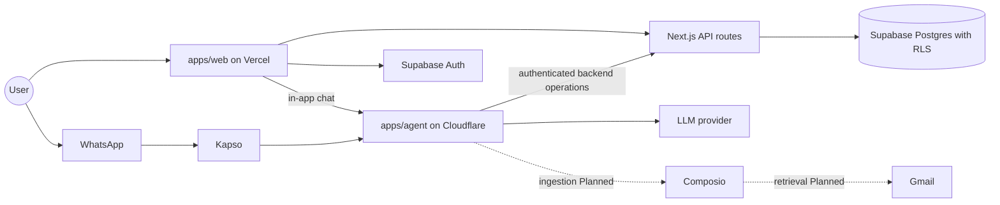

# System architecture

Owner: Abhip. Features: F1 to F16. Status: Draft.

## Purpose
Monara is a personal-finance PWA with owned ledger screens and an Agent runtime for chat. Its intended email-to-ledger and cross-channel flows still require the integrations described below. This document shows how the pieces fit together: the runtimes, the data flows, the trust boundaries, and where each PRD feature runs. The decisions behind the boundaries are in [ADR 0001](../adr/0001-initial-runtime-boundaries.md).

## How it works

### Runtimes and packages

| Part | Runtime | Responsibility |
| --- | --- | --- |
| `apps/web` | Next.js PWA and thin API routes on Vercel | UI, sign-in, and the backend operations that are the only writers of financial data |
| `apps/agent` | TypeScript worker on Cloudflare | Agent core and WhatsApp handlers; Gmail jobs and Reminder scheduling are Planned |
| `packages/core` | Shared TypeScript | Owned financial services, budgets and threshold notifications; insight forecasts and delivery are Planned |
| `packages/contracts` | Shared TypeScript (zod) | Validated types shared by the UI, backend, and Agent |
| `packages/db` | Shared TypeScript | Supabase client helpers and generated database types |
| `packages/integrations` | Shared TypeScript | Composio (Gmail) and Kapso (WhatsApp) adapters |
| `packages/ui` | React | HeroUI components and theme |
| `supabase/` | Postgres | Schema migrations, row-level security, and synthetic seed data |
| `playground/llm` | Local only | Experiments, never imported by production code |

External services: Supabase (Auth and Postgres), Composio (Gmail OAuth and retrieval), Kapso (WhatsApp Cloud API), and an LLM provider.

### Data flows

1. **Email to ledger (F2 to F4, Planned).** Composio retrieves payment and income emails. An import job in the agent runtime extracts structured fields with the LLM and asks the backend to create Pending Transactions. A processed-message table prevents duplicates. Only transactions the User confirms count in any total.
2. **Chat to action (F10 to F12, source implemented with gaps).** The [web Chat bridge](../../apps/web/src/app/api/chat/route.ts) verifies the session and same origin, injects identity and forwards validated messages to the [worker](../../apps/agent/src/conversation/index.ts). Registered tools call the [authenticated operation route](../../apps/web/src/app/api/agent/operations/[operation]/route.ts) through [financial services](../../apps/web/src/lib/finance/service.ts), which enforce owned resources. The worker also verifies Kapso signatures and queues messages, but its sender-resolution/linking backend is absent. Several advertised tools are unsupported; see [agent.md](agent.md). Live-provider and deployed acceptance remain Planned.
3. **Notifications and Reminders (F13, partially implemented).** [Financial services](../../packages/core/src/finance.ts) create deduplicated budget-threshold events from confirmed expenses; the dashboard exposes active events and owned web list/read/archive operations persist notification receipts. Bill scheduling, quiet hours, persisted delivery preferences and WhatsApp delivery remain Planned. Personal user-created Reminder controls added to the UI are a separate demo-only browser-memory feature; they do not schedule messages or prove bill payment.

### Identity and trust boundaries

- Sign-in uses Supabase Auth with Google. The Gmail Connection is separate, and Composio holds the Gmail credentials, so Monara never stores Gmail OAuth tokens.
- A WhatsApp number must be linked and verified by the signed-in User before it can reach any data.
- The Agent never writes to Supabase directly. It calls backend operations with a shared server-side credential plus verified User context.
- Row-level security is the last line of defense, not the only one.
- Provider keys stay server-side. Only the public Supabase URL and publishable key reach the browser.

### Implementation status — reconciled 14 October 2026

| Area | Source status | Remaining acceptance |
| --- | --- | --- |
| Workspace boundaries, gates and worktree isolation | Implemented | Clean-clone/worktree checks |
| Public demo and shared HeroUI PWA screens | In review ([PR #29](https://github.com/ZoeMohamed/Monara/pull/29)) | Physical-phone installation, touch and keyboard |
| Google Auth, UUID schema, migrations/RLS and owned financial services | Implemented | Configured OAuth, local database replay and live-session isolation |
| Protected ledger/review, account, category and budget UI adapters | In review | Persisted writes, concurrency and recovery against local Supabase |
| Agent loop, web bridge, tiered tools and destructive confirmation | Implemented with unsupported tools | Agent/backend compatibility, durable Undo/turn recovery and live scenarios |
| Gmail connection lifecycle | Implemented | Live consent; import/extraction/deduplication jobs remain Planned |
| Kapso handler and conversation Durable Object | Implemented handlers | Sender-resolution/linking backend and live-number acceptance remain Planned |
| Budget-threshold notifications and owned web read/archive receipts | Implemented source | Delivery policy, bill scheduling and WhatsApp delivery remain Planned |
| Sandbox/model scenarios | Synthetic runs documented in [agent.md](agent.md) | Integrated submission evaluation/red-team evidence remains Planned |

This table distinguishes current code from deployed configuration and external tracker completion. This section remains Draft pending Abhip's review; correcting stale source claims does not establish owner acceptance.

## Key decisions

- **The backend owns financial writes, and the Agent calls it.** The alternative was letting the Agent write to Supabase directly. We rejected it so validation, ownership checks, and audit logging live in one place (ADR 0001).
- **Two deployables, web on Vercel and the Agent on Cloudflare.** A single Next.js app was the alternative. The Agent needs durable background jobs and a different runtime, so it ships separately.
- **Shared packages with a one-way dependency direction.** Apps never import apps, and UI stays presentation only (see `docs/repository-structure.md`).
- **One channel-agnostic Agent.** In-app chat and WhatsApp use the same core, so demos and evaluations do not depend on a phone link (PRD D-017, D-018).
- **Composio for Gmail OAuth.** It keeps tokens out of our database (PRD D-014).

## Security and risks

- The Agent's tools are tiered (read, reversible write, destructive with confirmation, never in chat). Details are in [agent.md](agent.md).
- The Agent prompt treats email, receipt and voice content as data. Extraction/media pipelines and their injection defenses still need integration evidence; prompt instructions alone do not establish safety.
- External dependencies can fail or be slow. Missing secrets fail closed, unsupported operations fail explicitly and UI recovery reads do not replay uncertain writes. Persisted Undo, durable turn status and atomic mutation/receipt/confirmation behavior remain acceptance risks.
- [Security self-assessment](security-self-assessment.md) remains Not started; its owner must complete the risk list and evidence before submission.

## How to verify

- Run `pnpm install`, `pnpm check` and `pnpm build` on Node 24 from a clean clone. Source gates and a dry-run worker bundle do not prove deployment.
- `pnpm dev` serves the web app, and `pnpm dev:agent` serves the Agent. `GET /health` on the agent reports `status: scaffold` today.
- Against a disposable local Supabase stack, verify authenticated ledger persistence, User A/User B isolation, RLS and stale/uncertain-write recovery. Test configured OAuth, Agent operations and Kapso separately from synthetic fixtures.
- Complete the submission scenarios and measured report in [evaluation.md](evaluation.md); that section and the other Not started owner sections still require content and review.
