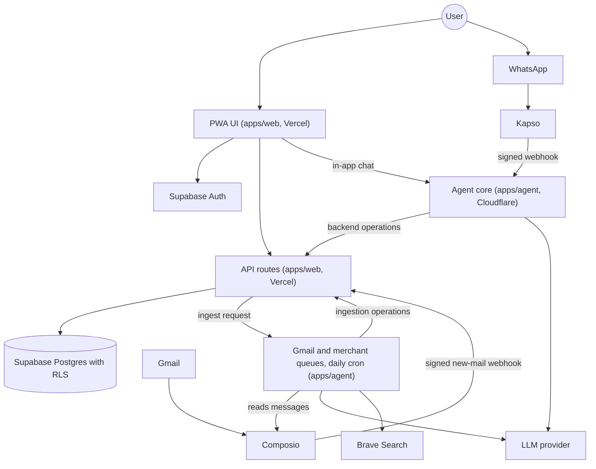

# System architecture

Owner: Abhip. Features: F1 to F16. Status: Draft.

## Purpose

Monara is a personal-finance PWA with an Agent that the User can talk to in the app or on WhatsApp. It finds payment and income emails in the User's Gmail, turns them into transactions, keeps uncertain ones for review, and manages Budgets and spending insights from the confirmed ledger. This document shows how the pieces fit together: the runtimes, the data flows, the trust boundaries, and where the PRD features run. It describes the source on `main` at commit `00700cd` (18 October 2026). The decisions behind the boundaries are in [ADR 0001](../adr/0001-initial-runtime-boundaries.md).

## How it works

### Runtimes and packages

| Part | Runtime | Responsibility |
| --- | --- | --- |
| `apps/web` | Next.js PWA and API routes on Vercel | UI, Google sign-in, and the backend operations that are the only writers of financial data. Also the Gmail connection routes, the Composio webhook, and the WhatsApp Link routes |
| `apps/agent` | TypeScript Cloudflare Worker | The Agent core (`/chat`), the Kapso WhatsApp webhook, a conversation Durable Object per User, the Gmail and merchant job queues, and two crons (daily Gmail catch-up and a 15-minute Reminder dispatch) |
| `packages/core` | Shared TypeScript | Financial services, Budgets and threshold notifications, insight calculations, Gmail ingestion rules, and WhatsApp Link logic |
| `packages/contracts` | Shared TypeScript (zod) | Validated types shared by the UI, backend and Agent, including the institution sender list |
| `packages/db` | Shared TypeScript | Supabase client helpers and generated database types |
| `packages/integrations` | Shared TypeScript | Composio (Gmail read and new-mail trigger), Kapso (WhatsApp) and Brave Search adapters |
| `packages/ui` | React | HeroUI components and theme |
| `supabase/` | Postgres | Schema migrations, row-level security, database functions and synthetic seed data |
| `playground/llm` | Local only | Experiments, never imported by production code |

External services: Supabase (Auth and Postgres), Composio (Gmail OAuth, retrieval and the new-mail trigger), Kapso (WhatsApp Cloud API), an LLM provider, and Brave Search (merchant lookup for categorization).

### Data flows

1. **Email to ledger (F2 to F4).** The User connects Gmail through Composio, which is separate from sign-in. The web backend discovers which supported institutions the mailbox has mail from (`packages/contracts/src/institutions/institution-senders.json`) and creates a Composio new-mail trigger limited to those senders. When mail arrives, Composio calls `/api/webhooks/composio`, which verifies the signature, finds the connection from its own record, and asks the Worker to ingest that message. A daily cron (01:00 UTC) and a manual sync cover anything the trigger missed. The Worker's queue consumers (`apps/agent/src/gmail`) read the message, check the sender and Gmail's own DKIM or SPF result, extract fields with the LLM, and call the Gmail ingestion operations on the backend. A merchant job looks up a Category from history or Brave Search. Each Gmail message is claimed once and each item has a stable index, so retries do not create duplicates. Items start pending. The database confirms one only when Gmail authenticated the sender, the model confidence is at least 0.9, it has an amount, a date and a mapped Financial Account, and it is an expense or income. Everything else waits in the Review Queue.
2. **Chat to action (F10 to F12).** The [web Chat bridge](../../apps/web/src/app/api/chat/route.ts) verifies the session and same origin, injects identity and forwards the message to the [Worker](../../apps/agent/src/conversation/index.ts). Registered tools call the [authenticated operation route](../../apps/web/src/app/api/agent/operations/[operation]/route.ts), which runs the [financial services](../../apps/web/src/lib/finance/service.ts) with owned-resource checks. On WhatsApp the Worker verifies the Kapso signature and asks the backend who the sender is (`api/agent/whatsapp/resolve-sender`). Only a verified WhatsApp Link names a User. The User creates the link from Profile (`api/whatsapp/link`). A receipt photo becomes one pending transaction (`apps/agent/src/whatsapp/receipt.ts`). Voice notes get a fixed reply because they are not read yet. Both Channels end in the same Agent function, described in [the Agent section](agent.md).
3. **Notifications and Reminders (F13).** [Financial services](../../packages/core/src/finance.ts) create deduplicated Budget-threshold Reminders when confirmed spending crosses a Budget's warning percent or 100%. The dashboard shows them, and owned list, read and archive operations store read receipts. For a User with a verified WhatsApp Link the backend can also send the `budget_alert` template through Kapso, holding alerts between 22:00 and 07:00 Jakarta time and allowing three a day, with the Worker's 15-minute cron sending held alerts. That WhatsApp delivery is **deferred for the submission** and was not tested against a real number. Details are in [the Reminders section](reminders.md). **Planned:** bill-due Reminders. User-created Reminders in the UI live in browser memory only.

### Identity and trust boundaries

- Sign-in uses Supabase Auth with Google. The Gmail Connection is separate, and Composio holds the Gmail credentials, so Monara never stores Gmail OAuth tokens or raw email bodies.
- A WhatsApp number must be linked and verified by the signed-in User before it can reach any data.
- The Agent and the Gmail jobs never write to Supabase directly. They call backend operations with a shared server-side secret plus verified User context. System jobs take ownership from the stored connection, not from the request.
- Incoming webhooks are signed: Kapso for WhatsApp and Composio for new mail, each checked before the body is read.
- Row-level security is the last line of defense, not the only one.
- Provider keys stay server-side. Only the public Supabase URL and publishable key reach the browser.

### Implementation status (source on `main` at `00700cd`, 18 October 2026)

| Area | Source status | Remaining acceptance |
| --- | --- | --- |
| Workspace boundaries, gates and worktree isolation | Implemented | Clean-clone check |
| PWA screens, first-run onboarding and unified ledger and review views | Implemented | Physical-phone installation, touch and keyboard |
| Google Auth, schema, migrations, RLS and owned financial services | Implemented | Configured OAuth and live-session isolation |
| Gmail connection, institution discovery, trigger, queues, extraction and auto-confirm | Implemented | A run against a real mailbox on the deployed stack |
| Agent loop, web bridge, tiered tools and destructive confirmation | Implemented | Live provider scenarios and durable turn recovery |
| WhatsApp webhook, sender resolution, Link routes and receipt photos | Implemented | A linked number end to end on the deployed stack. Voice notes are not read |
| Budget-threshold Reminders, WhatsApp budget alerts and owned read and archive receipts | Implemented. WhatsApp delivery is deferred | In-app Reminders are accepted as is. A WhatsApp send was not tested against a real number. Bill-due Reminders are Planned |
| Sandbox and red-team scenarios | Synthetic runs recorded in [the Agent section](agent.md) | A final run recorded in [the evaluation section](evaluation.md) |

This table separates source code from deployed configuration. A passing local build does not show that the hosted services are configured.

## Key decisions

- **The backend owns financial writes, and the Agent calls it.** The alternative was letting the Agent write to Supabase directly. We rejected it so validation, ownership checks and audit logging live in one place (ADR 0001).
- **Two deployables, web on Vercel and the Agent on Cloudflare.** A single Next.js app was the alternative. Email import needs durable queues, a daily cron and per-User conversation state, which fit a Worker with Durable Objects, so the Agent ships separately.
- **A new-mail trigger plus a daily catch-up, not polling alone.** The trigger imports a new bank email within seconds. We kept the daily cron because a missed or failed webhook would otherwise leave a gap.
- **Auto-confirm only for authenticated, high-confidence imports.** The alternative was confirming every import by hand. That makes the ledger lag behind, so a message with a passing DKIM or SPF result, confidence of at least 0.9 and a mapped account is confirmed on import. Anything uncertain stays pending, and the rule is enforced in the database, not only in code.
- **Transfers and non-personal records are an `exclusion` type, not a separate transfer table.** They stay visible for audit and deduplication and never count toward income or spending.
- **Shared packages with a one-way dependency direction.** Apps never import apps, and UI stays presentation only (see `docs/repository-structure.md`).
- **One channel-agnostic Agent.** In-app chat and WhatsApp use the same core, so demos and evaluations do not depend on a phone link.
- **Composio for Gmail OAuth.** It keeps tokens out of our database.

## Security and risks

- The Agent's tools are tiered: read, reversible write, destructive with confirmation, and never in chat. The tiers, identity checks and the known-risk list are in the [Security Self-Assessment](security-self-assessment.md).
- Email, receipt and voice content is treated as data in the prompt. Prompt instructions alone do not prove safety, so the Sandbox includes injected-email and injected-record attacks.
- Webhooks are signed, and the Composio check also rejects events more than five minutes old. Missing secrets make a route fail closed, and unsupported operations fail with an explicit error.
- External services can fail or be slow. Queue jobs retry a limited number of times, and the daily cron recovers imports a trigger missed.
- Open risks: there is no application-level rate limit on the web and chat routes, and no page-level Content Security Policy. Both are recorded in the self-assessment.

## How to verify

- Run `pnpm install`, `pnpm check` and `pnpm build` on Node 24 from a clean clone. Source gates and a dry-run Worker bundle do not prove deployment.
- `pnpm dev` serves the web app, and `pnpm dev:agent` serves the Agent. `GET /health` on the Agent returns `{"service":"monara-agent","status":"ok"}`.
- For Gmail, run `pnpm dev`, `pnpm dev:tunnel` and `pnpm dev:agent` in separate terminals and connect a test mailbox through the dev Composio project (see `AGENTS.md`).
- Replay the migrations and run the ownership suite with `pnpm db:check --reset --base-ref origin/main`.
- The measured scenario results are in [the Agent section](agent.md) and [the evaluation section](evaluation.md).
