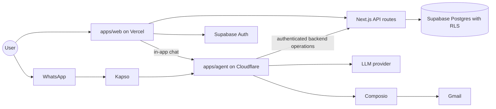

# System architecture

Owner: Abhip. Features: F1 to F16. Status: Draft.

## Purpose
Monara is a personal finance PWA with an AI Agent that records spending and income from email and lets the User manage them by chat. This document shows how the pieces fit together: the runtimes, the data flows, the trust boundaries, and where each PRD feature runs. The decisions behind the boundaries are in [ADR 0001](../adr/0001-initial-runtime-boundaries.md).

## How it works

### Runtimes and packages

| Part | Runtime | Responsibility |
| --- | --- | --- |
| `apps/web` | Next.js PWA and thin API routes on Vercel | UI, sign-in, and the backend operations that are the only writers of financial data |
| `apps/agent` | TypeScript worker on Cloudflare | Agent core, Gmail import jobs, WhatsApp handling, Reminder scheduling |
| `packages/core` | Shared TypeScript | Business rules and services, such as budgets, insights, and Reminder logic |
| `packages/contracts` | Shared TypeScript (zod) | Validated types shared by the UI, backend, and Agent |
| `packages/db` | Shared TypeScript | Supabase client helpers and generated database types |
| `packages/integrations` | Shared TypeScript | Composio (Gmail) and Kapso (WhatsApp) adapters |
| `packages/ui` | React | HeroUI components and theme |
| `supabase/` | Postgres | Schema migrations, row-level security, and synthetic seed data |
| `playground/llm` | Local only | Experiments, never imported by production code |

External services: Supabase (Auth and Postgres), Composio (Gmail OAuth and retrieval), Kapso (WhatsApp Cloud API), and an LLM provider.

### Data flows

1. **Email to ledger (F2 to F4, Planned).** Composio retrieves payment and income emails. An import job in the agent runtime extracts structured fields with the LLM and asks the backend to create Pending Transactions. A processed-message table prevents duplicates. Only transactions the User confirms count in any total.
2. **Chat to action (F10 to F12, Planned).** A message arrives from the in-app chat or WhatsApp. The channel resolves the User's identity (web session or verified WhatsApp Link). The Agent plans, then calls tools in four permission tiers. Every tool is a defined backend operation, and the backend checks ownership again.
3. **Reminders (F13, Planned).** A scheduled job checks budget thresholds and upcoming bills, records in-app Reminders, and sends WhatsApp messages (a free-form message inside the 24-hour window, an approved template outside it).

### Identity and trust boundaries

- Sign-in uses Supabase Auth with Google. The Gmail Connection is separate, and Composio holds the Gmail credentials, so Monara never stores OAuth tokens.
- A WhatsApp number must be linked and verified by the signed-in User before it can reach any data.
- The Agent never writes to Supabase directly. It calls backend operations with a shared server-side credential plus verified User context.
- Row-level security is the last line of defense, not the only one.
- Provider keys stay server-side. Only the public Supabase URL and publishable key reach the browser.

### Implementation status (11 Oct 2026)

| Area | Status |
| --- | --- |
| Workspace, package boundaries, dependency direction | Done |
| Lint, formatting, git hooks, CI, react-doctor gate | Done |
| Per-worktree ports and local Supabase stacks | Done |
| Web prototype with sample data, installable PWA | Done (sample data only) |
| Agent worker with a `/health` scaffold response | Done (scaffold only) |
| Auth, schema, ledger, review flow | Planned (M1) |
| Agent, tools, in-app chat, WhatsApp | Planned (M2) |
| Gmail import, extraction, bills, Reminders | Planned (M3) |
| Sandbox, red-team, metrics | Planned (M4) |

Update this table as features land.

## Key decisions

- **The backend owns financial writes, and the Agent calls it.** The alternative was letting the Agent write to Supabase directly. We rejected it so validation, ownership checks, and audit logging live in one place (ADR 0001).
- **Two deployables, web on Vercel and the Agent on Cloudflare.** A single Next.js app was the alternative. The Agent needs durable background jobs and a different runtime, so it ships separately.
- **Shared packages with a one-way dependency direction.** Apps never import apps, and UI stays presentation only (see `docs/repository-structure.md`).
- **One channel-agnostic Agent.** In-app chat and WhatsApp use the same core, so demos and evaluations do not depend on a phone link (PRD D-017, D-018).
- **Composio for Gmail OAuth.** It keeps tokens out of our database (PRD D-014).

## Security and risks

- The Agent's tools are tiered (read, reversible write, destructive with confirmation, never in chat). Details are in [agent.md](agent.md).
- Email, receipt, and voice content is treated as data, never as instructions, to resist prompt injection.
- External dependencies (LLM, Composio, Kapso, Meta template approval) can fail or be slow. In-app channels and Reminders are the fallback.
- The full list of known risks is in [security-self-assessment.md](security-self-assessment.md).

## How to verify

- `pnpm install` then `pnpm check` and `pnpm build` pass on a clean clone.
- `pnpm dev` serves the web app, and `pnpm dev:agent` serves the Agent. `GET /health` on the agent reports `status: scaffold` today.
- As features land, the Sandbox scenarios in [evaluation.md](evaluation.md) are the end-to-end proof.
