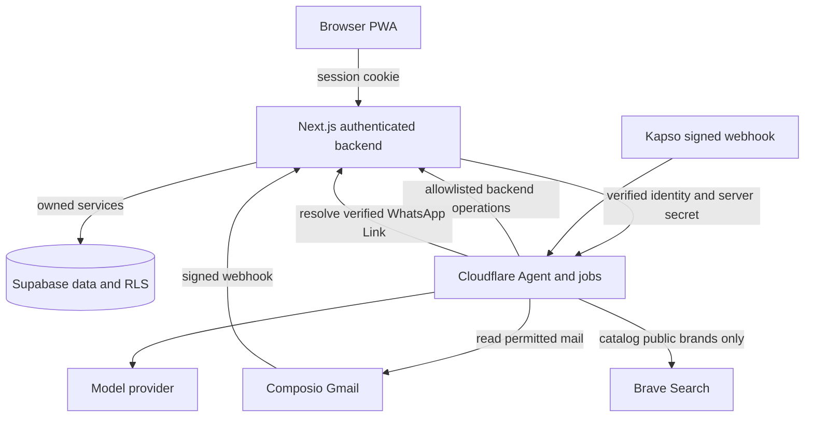

# System architecture

Owner: Abhip. Features: F1 to F16; forecast extension F17. Status: Draft.

## Purpose

Monara combines an owned financial ledger with Gmail capture and a conversational Agent. Confirmed expenses and income feed Budgets and insights; uncertain imports await review, and confirmed exclusions remain outside totals. This section describes parent PR #85 at `e74524752c538ca8866295c91bdc456e17842eb3`, reconciled on 19 October 2026. The [submission scope and integration dependencies](README.md) apply to every technical section; owner review remains pending.

## How it works

**Runtime boundaries.** [ADR 0001](../adr/0001-initial-runtime-boundaries.md) and [repository structure](../repository-structure.md) define two deployables. `apps/web` is the Next.js PWA and backend on Vercel; its services own financial writes. `apps/agent` is a Cloudflare Worker for conversations, Gmail jobs and scheduled orchestration. Supabase provides Google Auth, Postgres, private Storage and RLS. Composio holds Gmail authorization; Kapso transports WhatsApp messages. Model calls run server-side.

Shared `packages/contracts` validates transport data; `packages/core` implements services and repositories; `packages/db` supplies clients and generated types; `packages/integrations` adapts providers; `packages/ui` supplies HeroUI and the theme. Apps never import another app. Production code never imports `playground/llm` experiments.

**Email to ledger (F2-F4).** Authenticated connection routes discover institutions, let the User associate Financial Accounts, and maintain a sender-limited new-mail trigger. The [Composio webhook](../../apps/web/src/app/api/webhooks/composio/route.ts) verifies the signed event and resolves the stored connection. [Gmail queues](../../apps/agent/src/gmail) read permitted mail, extract stated facts and request backend ingestion. Typed categorization follows as a separate job. Durable message and item identities prevent duplicate ledger inserts. Automatic confirmation in this frozen tree requires authenticated sender, complete original facts, an active mapped account, extraction confidence at the SQL helper's **0.95**, and compatible classification confidence of **0.95**. Internal name matching can produce an automatic exclusion; other exclusions need review. See [extraction](extraction.md) for guards, fallback-date limitations and terminal review outcomes. There is no classification reuse from a User's merchant history.

**Chat to action (F10-F12, photo part of F14).** The [web Chat bridge](../../apps/web/src/app/api/chat/route.ts) verifies the Google session and origin, injects identity, then calls the Worker with a server secret. The browser never directly supplies trusted identity to the Worker. Kapso messages resolve a verified WhatsApp Link through the backend. Both Channels use the [conversation runtime](../../apps/agent/src/conversation); its tools call authenticated backend operations. WhatsApp photos have a separate pending-receipt path; voice remains Planned. Web exchanges are stored after the response, so a successful action does not guarantee its history was saved. [Agent documentation](agent.md) covers permissions, Undo and bounded conversation recovery.

**Derived data and background work (F7-F9, F13, forecast extension).** Confirmed spending drives Budget calculations and deduplicated in-app threshold Reminders. Forecasts persist derived estimates separately from ledger transactions; Goals record manual progress without moving money. The [Worker entry point](../../apps/agent/src/index.ts) and [Wrangler configuration](../../apps/agent/wrangler.jsonc) define Gmail and merchant queues, one WhatsApp Durable Object per User, and four schedules: deletion cleanup every minute, Reminder dispatch every 15 minutes, Gmail catch-up daily at 01:00 UTC, and forecast refresh Mondays at 02:00 UTC. Declared schedules do not prove deployed bindings or delivery. WhatsApp budget-alert delivery is deferred; bill-due production remains Planned. See [Reminders](reminders.md) and [forecast](forecast.md).

**Permanent deletion (F1 extension).** [ADR 0004](../adr/0004-permanent-user-deletion.md) requires the exact phrase and acknowledgement in Profile, with no Undo or recovery period. Acceptance blocks access immediately. Durable cleanup covers provider connections, conversations and Auth identity; the later goal-image Storage path lacks a removal step in this frozen tree. Complete personal-data erasure is therefore an implementation gap as well as a live-acceptance dependency. Acceptance and reported cleanup completion are separate states.

## Key decisions

- Backend-owned writes replace direct Agent database access, keeping validation and resource ownership in one place (ADR 0001).
- Two deployables replace a single request runtime because queues, schedules and per-User WhatsApp state need durable execution.
- Separate Gmail consent replaces reusing Google sign-in as mailbox authority. A verified WhatsApp Link similarly replaces trusting a phone number.
- Typed Categories and exclusions replace name-based financial treatment; [ADR 0005](../adr/0005-typed-transaction-categories.md) keeps Category identity compatible with Transaction Type.
- Public-only offline fallback replaces cached private app pages. Forecast estimates remain separate from confirmed money and never create transactions.

## Security and risks

Session identity, stored connection ownership, webhook signatures and backend authorization protect different boundaries; a shared secret or service-role key alone cannot authorize a User's resources. Provider credentials stay server-side. External text and model output remain untrusted and pass validation before writes. Brave lookup accepts only canonical public catalog brands, without personal names or financial/email content.

The source has instance-local request limits, not a global quota, and lacks a page-wide CSP. Provider configuration, model accuracy, queue recovery, deletion races and real cross-channel acceptance need separate evidence. Newer main PR #89 changes Gmail policy and reliability; it is absent from this frozen tree and must be integrated and rechecked before updating submission claims. See the separate [Security Self-Assessment](security-self-assessment.md) for the risk inventory.

## How to verify

Run `pnpm docs:check`, `pnpm check` and `pnpm build` on Node 24. The build compiles Next.js and bundles Wrangler locally; it does not deploy. The [development harness](../adr/0002-development-harness.md) and [worktree decision](../adr/0003-worktree-environments.md) describe local isolation.

Use the section-specific service, route, Worker and SQL tests linked in [extraction](extraction.md), [Agent](agent.md), [Reminders](reminders.md), [forecast](forecast.md) and [data/security](data-and-security.md) for ownership and behavior. Schema replay requires a separately agreed disposable local stack; this documentation pass does not reset one. Verify signed and invalid webhooks, duplicate imports, unknown identities, terminal review, queue retries and deletion cleanup before provider acceptance. Use [evaluation](evaluation.md) for dated synthetic results and [deletion evidence](../evidence/user-deletion-2026-10-19.md) for its recorded local test layer. Neither is a new deployed acceptance run.
