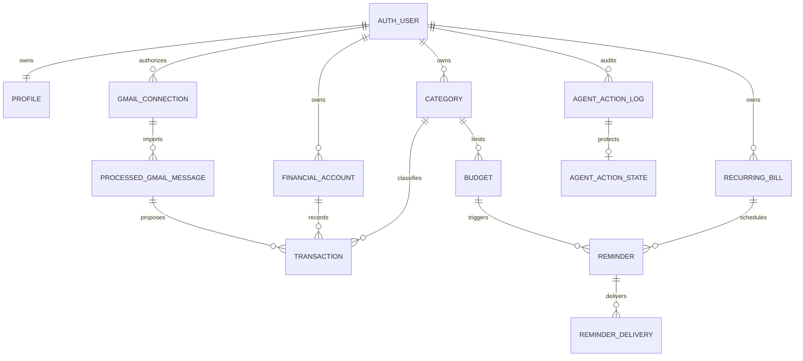

# Data model and security design

Owner: Zoe. Features: F1, F4, F5, F7, F9. Status: Implemented and reviewed.

## Purpose

Monara stores each User's financial records in Supabase while keeping identity, provider connections, and financial writes behind server-owned boundaries. The data model supports reviewed Gmail imports (F1), owned accounts and transaction CRUD (F4/F5), category budgets and threshold Reminders (F7), and reproducible financial insights (F9). Derived insights are calculated from confirmed records and are not persisted as facts.

## How it works

Supabase Auth is the identity root. A new Auth User receives one Profile, Reminder Preferences, and 25 owned default Categories. Every owned relation carries `user_id`; references between owned records use composite `(id, user_id)` foreign keys, so a transaction, Budget, Reminder, or provider record cannot point to another User's resource.



The browser authenticates with Google through Supabase, but Gmail authorization is a separate Composio connection. Gmail ingestion records only the connected address, provider connection ID, provider message ID, processing state, and extracted transaction fields. It does not store raw email bodies, subjects, OAuth tokens, or provider secrets. Each `(gmail_connection_id, gmail_message_id)` and `(processed_gmail_message_id, source_item_index)` pair is unique. Imported transactions must begin `pending`; only confirmed transactions affect totals, budgets, and insights.

The authenticated Next.js route resolves the User from the server session and passes that identity to the financial service. The service validates inputs with `packages/contracts`, then `packages/core/src/supabase-finance-repository.ts` adds the same `user_id` to every service-role query and mutation. The browser never chooses a User ID or transaction source. Direct browser access is read-only for the small set of user-facing tables; connection metadata, delivery state, and agent state are backend-only.

Transactions use one type (`expense`, `income`, or `exclusion`), a `pending` or `confirmed` review status, and at most one Financial Account/payment method. Internal transfers, reimbursements, duplicates, and non-personal records use the confirmed `exclusion` type. They stay available for audit and deduplication but do not affect income or spending. Account balances are not stored or inferred. Unknown Gmail fields remain nullable while pending. Confirmed expenses and income require a positive integer IDR amount and date; a confirmed exclusion may preserve unknown fields so the User can clear an unusable import without inventing data.

F9 calculations live in `packages/core/src/finance.ts` and return basis numbers through `packages/contracts/src/insights.ts`:

- savings rate is `(confirmed income - confirmed spending) / confirmed income`; it is `null` when confirmed income is zero;
- overall safe-to-spend is calendar-month Budget limits minus every confirmed expense, including unbudgeted expenses, divided by remaining days including today; a shortfall is exposed separately and the daily amount never goes below zero;
- category safe-to-spend uses the active Budget period's limit, confirmed category spending, and remaining inclusive days;
- an overspend forecast projects confirmed category spending at the elapsed-day pace through the end of the active Budget period;
- an unusual transaction is at least twice the median of at least three confirmed, non-deleted expenses in the same Category over the previous three complete calendar months;
- a Budget suggestion uses the previous three complete calendar months. Monthly suggestions are average category spending per month; weekly suggestions normalize the same spending by the exact history-day count. No history means no suggestion, and accepting it remains an explicit User action.

`get_dashboard` returns the read-only insight set. `suggest_budget` returns a proposal and never creates or updates a Budget.

## Key decisions

- Use UUIDs plus composite ownership keys instead of global IDs alone. This makes cross-User references fail inside Postgres, even if application code is wrong.
- Keep one transaction table with expense/income/exclusion type instead of separate tables or transfer-specific account pairs. Shared review, source, deduplication, and ownership rules stay consistent; `exclusion` captures records that should not enter financial totals.
- Allow nullable extracted fields only while review is pending instead of inventing uncertain values. Confirmation is blocked until the required financial facts exist.
- Store processed Gmail identifiers instead of raw messages. This supports idempotency and investigation without retaining unnecessary inbox content.
- Store exact integer IDR in Postgres `numeric` and transport it as decimal strings instead of JavaScript floating-point values. Amounts are never rounded silently.
- Compute F9 insights on demand instead of persisting recommendations. The output remains reproducible from confirmed ledger records and cannot become stale independently.
- Keep all financial writes in the Next.js backend instead of granting browser writes. This follows [ADR 0001](../adr/0001-initial-runtime-boundaries.md) and gives web and Agent channels the same validation, ownership, and review rules.
- Do not store account balances. Monara can report recorded cash flow without claiming a bank-verified balance.

## Security and risks

All 18 public product tables enable and force RLS. `anon` has no financial access. `authenticated` receives `SELECT` only on Profile, Financial Accounts, Categories, Transactions, Budgets, recurring bills, Reminder Preferences, and Reminders; owner policies compare `auth.uid()` with the row owner. Gmail connections and processed messages, WhatsApp links, Reminder deliveries, and Agent action/state tables have no authenticated grant. Gmail ingestion functions revoke execution from public roles and grant it only to `service_role`.

The service-role key is server-only and is not authorization by itself. Browser finance routes derive identity from the verified Supabase session. Repository reads, updates, optimistic-lock checks, idempotency lookups, and deletes all include `user_id`. Agent backend calls use a server-held bearer secret; the Agent must resolve the signed-in or verified-WhatsApp User before sending the User ID. A leaked Agent backend secret would widen that trust boundary, so it must remain server-only and be rotated through deployment secrets if exposed.

Database constraints reject fractional IDR, unsupported transaction directions, cross-owner references, duplicate client requests, duplicate Gmail items, a fourth active Gmail connection, and illegal Review Queue transitions. The application does not log raw emails, financial records, auth headers, or tokens.

Open acceptance risks are external rather than schema permissions: production OAuth/provider settings, Agent-to-backend secret handling, provider retry behavior, hosted migration status, and real-message delivery require environment-specific evidence. Historical insight quality depends on enough correctly categorized confirmed data. User-timezone boundaries currently use the server-provided calendar date; acceptance across non-Jakarta time zones remains Planned. No hosted database was changed as part of this review.

## How to verify

Run the complete repository gates:

```bash
pnpm check
pnpm build
```

On a disposable checkout with Docker or OrbStack running, replay every migration, lint functions, run the ownership/RLS red-team suite, and compare generated types:

```bash
pnpm db:check --reset --base-ref origin/main
```

The database suite in `supabase/tests/database/initial_schema_rls.test.sql` proves forced RLS, anonymous denial, User B isolation, no authenticated writes, no authenticated access to backend-only tables or Gmail functions, composite ownership, Gmail and request deduplication, Review Queue transitions, budget/Reminder uniqueness, and cascade cleanup. The service tests in `packages/core/src/finance.test.mjs` prove confirmed-only aggregates, exact F9 basis calculations, three-month unusual flags and Budget suggestions, threshold deduplication, and cross-User failures. Contract and web tests validate the transport boundary and reject malformed responses.

Expected result: all checks pass; the local replay reports every pgTAP assertion successful; generated database types have no diff. A passing local run is not evidence that hosted migrations, OAuth, Composio, or deployment secrets are configured.
