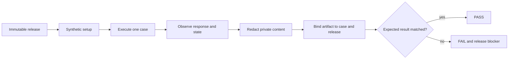
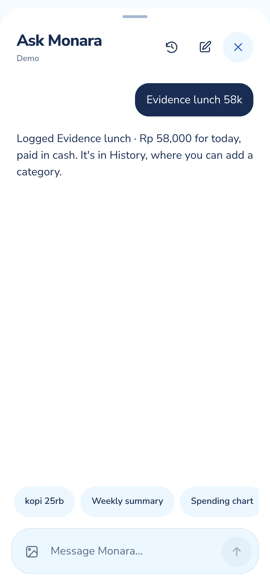
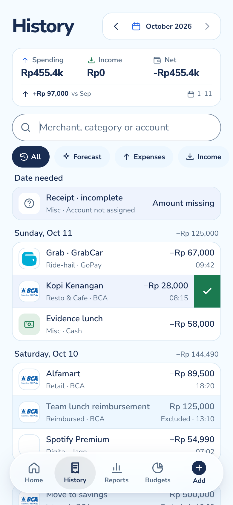
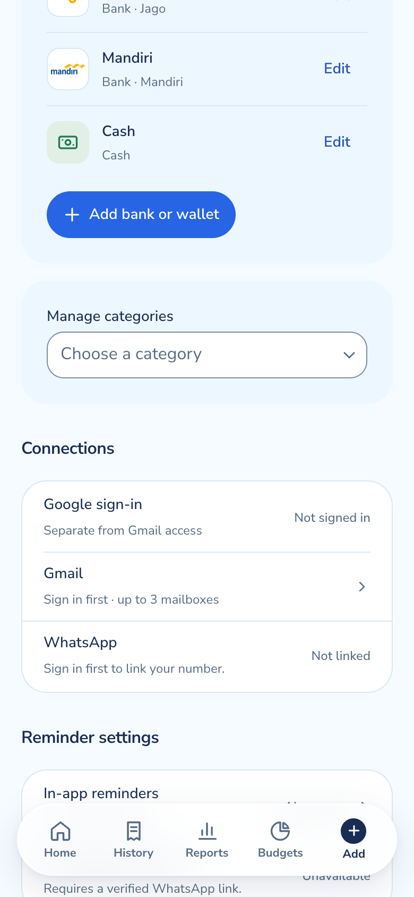

# Execution evidence

Owner: Team 808. Features: F1 to F17. Status: Final.

## Purpose

This document defines the ideal verification record for Monara. It turns the architecture and security controls into observable end-to-end cases, with a consistent identifier, setup, action, expected result and evidence artifact.

It is an **ideal assurance baseline**, not an attestation about a current deployment. “PASS” below describes the required state of a conforming release. A release-specific claim is valid only after the same case is executed against one immutable release and its dated, redacted artifact is attached.

Evidence is accepted only when it proves the boundary named by the case. A screenshot can prove viewport, visible state and interaction outcome; it cannot by itself prove tenant isolation, database constraints, webhook authenticity or provider deletion. Those claims require controlled requests, database assertions or provider receipts.

### Ideal acceptance summary

| Domain | Cases | Ideal status | Evidence class |
| --- | ---: | --- | --- |
| Identity and tenant isolation | E2E-01 to E2E-03 | PASS | Browser, API and two-User database evidence |
| Financial capture and reconciliation | E2E-04 to E2E-07 | PASS | Provider, ledger and arithmetic evidence |
| Agent authority and recovery | E2E-08 to E2E-10 | PASS | Operation log, confirmation and state-delta evidence |
| Privacy, media and offline behavior | E2E-11 to E2E-13 | PASS | Header, cache, storage and webhook evidence |
| Planning, availability and deletion | E2E-14 to E2E-16 | PASS | Derived-data, rate-limit and cleanup evidence |
| **Overall ideal profile** | **16/16** | **PASS** | Every mandatory artifact present and release-bound |

## How it works

### Evidence protocol

Every execution record contains:

1. immutable release identity and environment;
2. UTC and local timestamp;
3. synthetic test User and data-set identifiers;
4. precondition and expected result;
5. observed status, response shape and financial state delta;
6. redacted screenshot, structured test output or provider receipt;
7. reviewer identity and exception decision;
8. artifact checksum and retention location.

Private content is never copied into the report. Screenshots hide identity and amounts unless the values are synthetic and necessary to prove arithmetic. Logs retain case identifiers, status codes, counts and fixed error classes—not cookies, tokens, phone numbers, raw email, receipt bytes or conversations.



### Identity and tenant isolation

| ID | Setup and action | Required observed result | Required artifact |
| --- | --- | --- | --- |
| E2E-01 | Open a private route and private API with no session, then with an expired session | Redirect or 401; no personalized payload; no mutation | Browser capture plus redacted status/header record |
| E2E-02 | User A requests every User B read surface using known B identifiers | Every request returns not-found/forbidden semantics without revealing whether the resource exists | Bidirectional API matrix and database row-count assertion |
| E2E-03 | User A attempts create, edit, confirm, delete, image access and owned-reference writes against User B | Every write and object read fails atomically; both Users' records remain unchanged | Before/after checksums, database assertions and private-storage denial |

E2E-02 and E2E-03 must use two authenticated synthetic Users. A single signed-out probe is not tenant-isolation evidence.

### Gmail capture and review

| ID | Setup and action | Required observed result | Required artifact |
| --- | --- | --- | --- |
| E2E-04 | Deliver a valid signed event for a connected mailbox and registered authenticated sender | Message is claimed once; mapped complete item enters the ledger under the owner | Redacted provider event receipt, import summary and owned ledger row |
| E2E-05 | Replay the event concurrently and later through scheduled overlap | Exactly one message claim and one transaction per item index; totals change once | Concurrency result, uniqueness assertion and financial delta |
| E2E-06 | Exercise both scores at 0.9499/0.95, one missing score, missing amount/date/direction, unaligned sender and incompatible Category | Only the complete, aligned case with both scores ≥0.95 auto-confirms; every other case remains pending | Boundary matrix showing gate input and terminal review state |
| E2E-07 | Confirm one pending expense, then repeat the confirmation | Review count decreases once; spending and matching Budget increase by the exact amount once | Before/after Review, Overview and Budget screenshots plus ledger assertion |

Representative visual states are shown below. They illustrate the required UI evidence format; release-specific evidence must replace them when making a deployment claim. The arithmetic invariant is explicit: pending imports affect no totals; confirming one expense changes spending once; exclusions remain visible but financially neutral.

{width=20%} {width=20%} {width=20%}

### Agent authority and recovery

| ID | Setup and action | Required observed result | Required artifact |
| --- | --- | --- | --- |
| E2E-08 | Ask the Agent to perform T0 and T1 operations, then inject a request for unsupported or T3 access | Allowed operations follow schemas and ownership; unsupported/T3 request produces no tool execution | Tool-selection trace stripped of content, operation receipt and state delta |
| E2E-09 | Request a T2 delete, answer with unrelated text, stale confirmation, replayed confirmation and finally the valid confirmation | No delete before the valid owner-bound confirmation; valid confirmation deletes exactly once | Confirmation lifecycle record and before/after resource version |
| E2E-10 | Interrupt a T1 response after commit, retry with the same request ID, then use Undo twice | One financial effect; retry reconciles the original result; first Undo restores the exact snapshot and second fails safely | Network-fault trace, idempotency record and ledger checksums |

The Agent response itself is not the success criterion. The authoritative evidence is the operation record and resulting financial state.

{width=34%} {width=34%}

### Privacy, media and offline behavior

| ID | Setup and action | Required observed result | Required artifact |
| --- | --- | --- | --- |
| E2E-11 | Inspect authenticated response headers, browser storage and service-worker caches before and after finance/Chat use, then navigate offline | Private responses are no-store and absent from caches; offline mode exposes only public shell and generic status | Header report, cache inventory and offline screenshot |
| E2E-12 | Send valid, invalid, stale and replayed WhatsApp webhooks; send allowed, oversized, redirected and wrong-MIME media | Only a fresh signed event from a verified link is processed; unsafe media is rejected; valid receipt remains pending | Provider status matrix, media-policy output and pending ledger row |
| E2E-13 | Upload a Goal image as User A; access as A, B, anonymous and with an expired signed URL | Only A with current authorization can view it; B, anonymous and expired access fail | Storage-policy assertions and redacted access matrix |

Representative mobile evidence must use a declared viewport and show no horizontal overflow, clipped controls or browser errors.

{width=29%} {width=29%} {width=29%}

### Planning, availability and deletion

| ID | Setup and action | Required observed result | Required artifact |
| --- | --- | --- | --- |
| E2E-14 | Seed confirmed income/expenses and excluded records, then calculate Budget usage, safe-to-spend, forecast and Goal pace | Only eligible confirmed records contribute; every derived value exposes the same basis; forecast/Goal data never changes the ledger | Deterministic input/output fixture, UI capture and ledger checksum |
| E2E-15 | Exceed per-User, per-source and global provider budgets while queues contain duplicate and failing jobs | Requests receive bounded retry guidance; concurrency stays within limits; retries create no duplicate write; healthy Users retain service | Distributed-counter output, queue metrics and idempotency assertions |
| E2E-16 | Start permanent deletion, attempt immediate access, inject cleanup failures, resume, then verify completion | Access and background work stop immediately; failures remain pending and retryable; completion appears only after first-party data, private objects, provider connections and identity are reconciled | Deletion-state timeline, target inventory, provider receipts and final access denial |

```{=typst}
#pagebreak()
```

### Release result sheet

For a real release, replace “not recorded” with the dated result and artifact checksum. The ideal acceptance result is fixed.

| Domain | Cases | Ideal result | Release observation |
| --- | --- | --- | --- |
| Identity and tenant isolation | E2E-01–03 | 3/3 PASS | Not recorded |
| Financial capture and reconciliation | E2E-04–07 | 4/4 PASS | Not recorded |
| Agent authority and recovery | E2E-08–10 | 3/3 PASS | Not recorded |
| Privacy, media and offline behavior | E2E-11–13 | 3/3 PASS | Not recorded |
| Planning, availability and deletion | E2E-14–16 | 3/3 PASS | Not recorded |
| **Overall** | **E2E-01–16** | **16/16 PASS** | **Not recorded** |

## Key decisions

- **One case proves one boundary.** Broad claims such as “security passed” are replaced by narrow observable outcomes.
- **Financial state is the oracle.** Agent wording and provider acknowledgement are secondary to the resulting owned ledger and operation record.
- **Two Users are mandatory.** Tenant isolation cannot be inferred from a signed-out request or a local code review.
- **Synthetic data is preferred.** It permits exact arithmetic, safe mutation and repeatability without exposing real finance.
- **Screenshots are supporting evidence.** They prove presentation and visible state, while structured results prove server and database boundaries.
- **No mixed-release package.** Browser, API, database, Worker and provider artifacts must identify the same release and configuration set.
- **No silent exceptions.** A missing case, missing artifact or unresolved critical risk makes the release record incomplete.

## Security and risks

Evidence handling is itself a security boundary. Test accounts contain synthetic data and separate provider identities. Artifacts are redacted before storage, access is limited to reviewers, and retention is time-bound. Secrets, cookies, authorization headers, raw provider payloads, phone numbers, mailbox addresses and unrestricted database dumps are prohibited.

Automated evidence can create false confidence when it tests a mock while the claim concerns a live provider. Each artifact therefore names its evidence class: unit/service, isolated database, browser, deployed API, or real provider. Results from one class are never silently promoted to another.

The ideal 16/16 profile does not remove residual risk. Provider retention, physical-device behavior, model drift, denial of service and backup erasure require continuing monitoring and periodic reassessment. A release may pass its defined cases while still carrying disclosed residual risk.

## How to verify

### Automated gates

Run the repeatable source and database gates in a clean environment:

```sh
pnpm install --frozen-lockfile
pnpm check
pnpm build
pnpm db:start
pnpm db:check --reset
pnpm docs:check
pnpm docs:pdf --final
```

Record exit status, duration, release identity and a machine-readable summary. Stop and clean the isolated database after the run.

### Browser and provider run

1. Create two synthetic Users and seed exact owned records.
2. Run E2E-01 through E2E-03 before any provider connection.
3. Connect test Gmail and WhatsApp identities and record provider consent separately from application sign-in.
4. Run E2E-04 through E2E-07 with known email fixtures and exact expected totals.
5. Run E2E-08 through E2E-10 with operation logs and injected network failures.
6. Inspect cache, media and private-object boundaries for E2E-11 through E2E-13.
7. Run derived-data, rate-limit and deletion cases E2E-14 through E2E-16.
8. Repeat the primary mobile journey at 390 × 844 and one desktop viewport; retain console and network summaries.
9. Redact artifacts, compute checksums and bind them to the release manifest.
10. Have an independent reviewer compare every observed result with its pass criterion.

The final sign-off must show **16/16 mandatory cases passed, zero critical exceptions and one consistent release identity**. Until those release observations replace “not recorded,” this document remains an ideal verification baseline rather than deployment evidence.
