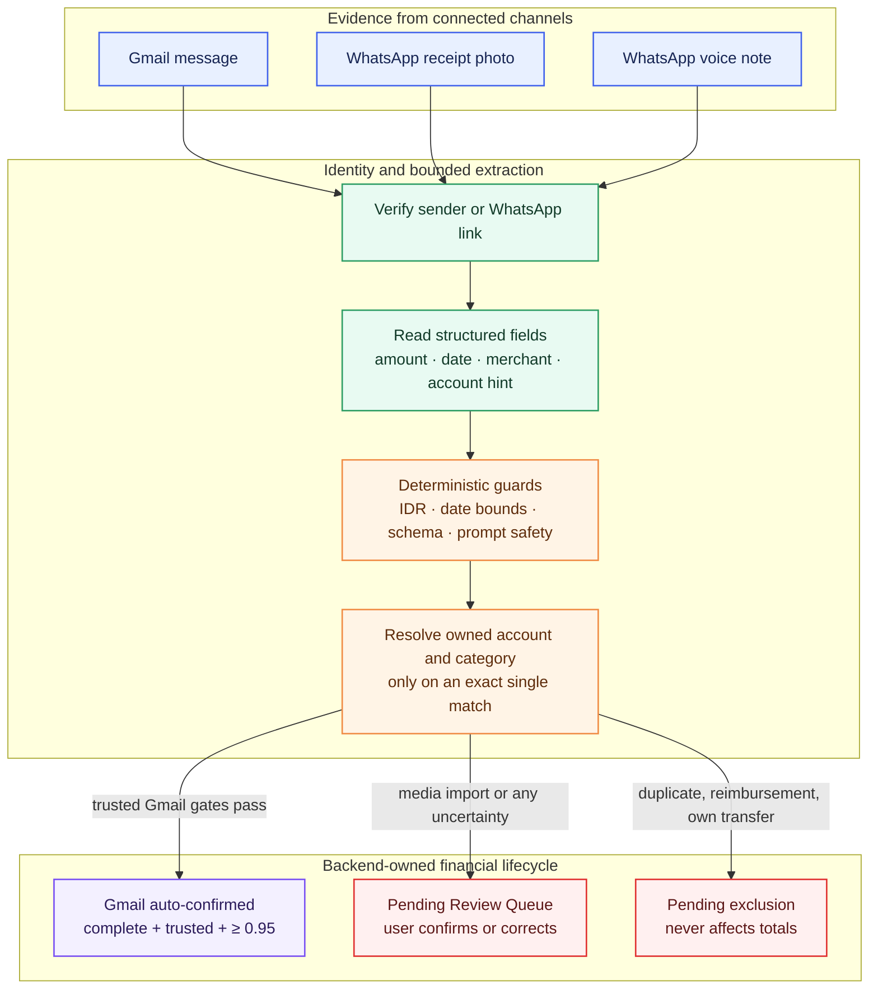

# Import and extraction

Owner: Adlyn. Features: F2, F3, F8, F14. Status: Draft.

## Purpose
The pipeline turns supported, authenticated institution emails, WhatsApp receipt photos, and WhatsApp voice notes into expense, income, or exclusion records. It preserves uncertain data for User review instead of inventing values. All provider imports are pending unless the Gmail auto-confirm policy explicitly applies.

## How it works
Composio authorizes Gmail separately from Supabase sign-in. The agent discovers supported institution senders, retrieves messages for the import window, verifies Gmail authentication results, and sends bounded email text to the structured extractor. Deterministic guards then validate the IDR amount, date, location, account hint, and schema before the Next.js-owned backend records anything.

Each Gmail message is claimed once and each extracted item has a stable source index, so retries do not duplicate transactions. New items are either auto-confirmed by the policy below or remain pending in the Review Queue. Exclusions preserve reimbursements, internal transfers, duplicates, and non-personal activity for audit and deduplication, but never affect totals.

For WhatsApp, a verified sender is queued in the User's Durable Object conversation. Receipt photos are read by `apps/agent/src/whatsapp/receipt.ts`; voice notes are read by `apps/agent/src/whatsapp/voice.ts` through the audio-capable JSON model client. Media bytes are fetched from Kapso, held in memory for the model call, and not stored. Both paths list the User's active accounts and categories, validate Rupiah amounts and bounded dates, resolve an account only on an exact single match, and call the Next.js backend's media-specific pending-write operation. A message id becomes the client request id, so redelivery is idempotent.

## Key decisions
The auto-confirm boundary is `0.95`. A score at or above that value is necessary but not sufficient. The sender must also pass Gmail authentication, the transaction must be an expense or income, amount and date must be present, currency must be IDR, merchant or description must be present, and the institution must resolve to exactly one active Financial Account owned by the User. A sole account for that institution may resolve without a last-four hint; when several accounts match the institution, the last four digits must identify exactly one. Missing or ambiguous fields, unverified senders, exclusions, and scores below `0.95` stay pending.

This conservative boundary is appropriate while confidence is model-reported rather than calibrated against a labeled production dataset. `0.90` would reduce review work but carries more silent-ledger risk. Requiring every item to be reviewed is safer but removes the product's main automation benefit. The threshold should only be lowered after measuring field-level precision and false-confirm rates on synthetic and consented labeled emails.

Category is not an auto-confirm gate. A category can be filled from the User's confirmed merchant history or later enrichment without changing the transaction amount or whether it contributes to totals. Missing values remain null. The retired three-argument ingestion function was removed because it could not carry sender-verification evidence.

Voice audio uses the same conservative field guards as a receipt. A bare Indonesian spoken amount is interpreted as IDR, while another currency is rejected; missing or ambiguous amounts are not saved. The backend operation derives `whatsapp_voice` from the operation route, and callers cannot select a source. The alternative was to let the agent call the general `add_transaction` operation; that was rejected because it would allow an unreviewed voice extraction to affect totals.

## Security and risks
Email, receipt, caption, and voice content are untrusted data and are bounded before model use. Extracted amounts and locations must appear in the source, implausible dates are removed, and any guarded value caps confidence below the auto-confirm threshold. Provider credentials, media bytes, raw email content, and transcripts are not written to transaction records or logs. The backend derives ownership from the verified Gmail connection or WhatsApp link; callers cannot assert a User ID or Financial Account belonging to another User.

The remaining risk is score calibration: a high model confidence is not a statistical guarantee. Sender verification and deterministic completeness checks reduce that risk, while the Review Queue remains the fallback. Production monitoring should track confirmed corrections before any threshold change.

## How to verify
Run `pnpm db:check --reset` in a disposable Docker worktree to replay every migration, lint SQL, run pgTAP ownership tests, and compare generated database types. The tests cover `0.949` pending, `0.950` confirmed, unverified senders, incomplete data, exclusions, unknown and ambiguous accounts, cross-User ownership, retries, and deduplication. Run `pnpm --filter @monara/agent test` for the extractor's amount, currency, date, location, prompt-injection, voice routing, and schema guards. Live audio-provider compatibility and end-to-end WhatsApp delivery remain unverified locally; no accuracy percentage is claimed until a labeled evaluation set has been measured.
