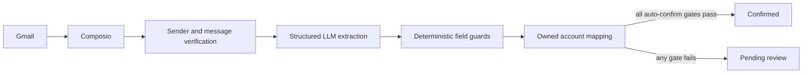

# Import and extraction

Owner: Adlyn. Features: F2, F3, F8, F14. Status: Implemented for Gmail transaction import.

## Purpose
The pipeline turns supported, authenticated institution emails into expense, income, or exclusion records. It preserves uncertain data for User review instead of inventing values. Receipt, voice-note, and WhatsApp ingestion remain separate work.

## How it works
Composio authorizes Gmail separately from Supabase sign-in. The agent discovers supported institution senders, retrieves messages for the import window, verifies Gmail authentication results, and sends bounded email text to the structured extractor. Deterministic guards then validate the IDR amount, date, location, account hint, and schema before the Next.js-owned backend records anything.

Each Gmail message is claimed once and each extracted item has a stable source index, so retries do not duplicate transactions. New items are either auto-confirmed by the policy below or remain pending in the Review Queue. Exclusions preserve reimbursements, internal transfers, duplicates, and non-personal activity for audit and deduplication, but never affect totals.

## Key decisions
The auto-confirm boundary is `0.95`. A score at or above that value is necessary but not sufficient. The sender must also pass Gmail authentication, the transaction must be an expense or income, amount and date must be present, currency must be IDR, merchant or description must be present, and the institution plus last four digits must resolve to exactly one active Financial Account owned by the User. Missing or ambiguous fields, unverified senders, exclusions, and scores below `0.95` stay pending.

This conservative boundary is appropriate while confidence is model-reported rather than calibrated against a labeled production dataset. `0.90` would reduce review work but carries more silent-ledger risk. Requiring every item to be reviewed is safer but removes the product's main automation benefit. The threshold should only be lowered after measuring field-level precision and false-confirm rates on synthetic and consented labeled emails.

Category is not an auto-confirm gate. A category can be filled from the User's confirmed merchant history or later enrichment without changing the transaction amount or whether it contributes to totals. Missing values remain null. The retired three-argument ingestion function was removed because it could not carry sender-verification evidence.

## Security and risks
Email content is untrusted data, is bounded, and is kept inside prompt delimiters. Extracted amounts and locations must appear in the source, implausible dates are removed, and any guarded value caps confidence below the auto-confirm threshold. Provider credentials and raw email content are not written to transaction records or logs. The backend derives ownership from the claimed Gmail connection; callers cannot assert a User ID or Financial Account belonging to another User.

The remaining risk is score calibration: a high model confidence is not a statistical guarantee. Sender verification and deterministic completeness checks reduce that risk, while the Review Queue remains the fallback. Production monitoring should track confirmed corrections before any threshold change.

## How to verify
Run `pnpm db:check --reset` in a disposable Docker worktree to replay every migration, lint SQL, run pgTAP ownership tests, and compare generated database types. The tests cover `0.949` pending, `0.950` confirmed, unverified senders, incomplete data, exclusions, unknown and ambiguous accounts, cross-User ownership, retries, and deduplication. Run `pnpm --filter @monara/agent test` for the extractor's amount, currency, date, location, prompt-injection, and schema guards. No accuracy percentage is claimed until a labeled evaluation set has been measured.
