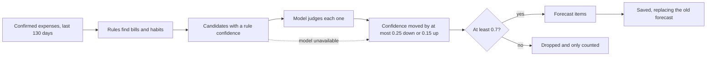

# Spending forecast

Owner: Abhip. Features: F17. Status: Draft.

## Purpose

The forecast tells a User what they are likely to spend for the rest of the month, before they spend it. It lists the payments they are expected to make, such as Spotify on the 25th or chicken rice every Monday, Wednesday and Friday, each with a confidence, and it totals what is expected this week and this month. It runs weekly and on demand, so a demo can trigger it by hand. A forecast is a prediction. It is always labelled as expected, and it never counts toward confirmed spending, income or Budget usage.

## How it works



**Rules** (`packages/core/src/forecast.ts`). The rules read the User's confirmed expenses from the last 130 days and group them by merchant name.

- *Monthly bills.* A merchant paid about once a month, in at least two different months, on days within two days of each other, and recently enough to still be live (the last payment within 45 days). Its expected date is its usual day of the month, and it is skipped if it was already paid this month. A forecast never goes past the end of the month.
- *Weekly habits.* A merchant bought on the same weekday in at least four of the last eight weeks. Every such weekday left in the month becomes an expected date. A merchant that fits both is a habit when it appears six or more times.
- *Amount.* The median of the recent payments, with the lowest and highest as the range. An amount is never made up.
- *Rule confidence.* Monthly: 0.4 for date consistency, 0.3 for steady amounts and 0.3 for how many months it has been seen (up to four). Weekly: 0.5 for how often the weekday is hit, 0.3 for steady amounts and 0.2 for how many times it was seen.

**Model** (`apps/agent/src/forecast.ts`). The web backend sends the candidates to the Agent worker (`POST /forecast/refine`, with the shared secret). The model sees only each candidate's merchant name, dates and amounts, never the User's identity. It returns a confidence and a one-line reason per candidate. The backend then keeps that confidence only within a small band around the rule confidence, down by at most 0.25 and up by at most 0.15, so the model can only mark a candidate down or up, never decide alone, and it can never add an item or change an amount. If the model is unavailable, the rule confidence and reason are used, and the forecast says it did not use the model.

**Threshold.** Items below 0.7 are dropped and only counted ("2 unsure payments left out").

**Totals.** Expected this week (to Sunday), expected this month (to the last day of the month), confirmed spending so far, and the projected month end, which is the confirmed total plus what is still expected this month.

**Did it come true?** When a prediction's date has passed, it is matched to a confirmed expense from the same merchant, made on or after the day the forecast was made, within 3 days and within 35% of the amount. A payment from before the forecast cannot fulfil it. A matched prediction shows as Paid and leaves the remaining total. The forecast reports how many earlier predictions came true. Nothing is stored for this, so it is worked out when the forecast is read.

**Where it runs.**

| Piece | Location |
| --- | --- |
| Tables `forecast_runs` and `forecast_items`, and `replace_forecast` | `supabase/migrations/20261019110000_spending_forecast.sql` |
| Service and repository | `packages/core/src/forecast-service.ts`, `supabase-forecast-repository.ts` |
| Routes | `apps/web/src/app/api/forecast/route.ts` (read and refresh), `api/agent/forecast/refresh/route.ts` (weekly run) |
| Weekly trigger | Worker cron, Mondays 02:00 UTC (09:00 Jakarta) |
| Agent tools | `get_spending_forecast` and `refresh_spending_forecast` (read tier) |
| Interface | A Home card with this week, this month, month end, the list with confidence chips and a Refresh button (`spending-forecast-card.tsx`), and a Forecast filter in History that lists every expected payment of the rest of the month by day, drawn faint because none has happened (`forecast-ledger.tsx`). The public demo shows a sample |

## Key decisions

- **Rules first, the model second.** The alternative was asking the model to predict spending. We rejected it because a model can invent a payment or an amount, and Monara never invents financial data. Here every item and amount comes from a payment the User really made.
- **The model can only nudge confidence.** It could have been allowed to add fuzzy patterns. We kept it to judging and explaining, inside a fixed band, so a wrong or manipulated model answer cannot create a forecast out of nothing.
- **A threshold of 0.7, with dropped items only counted.** Showing every guess would make the forecast noisy and less trusted. Counting the dropped ones keeps it honest about what it left out. The threshold is a setting of the run and is stored with it.
- **One forecast per User, replaced atomically.** Keeping history would add storage and a screen nobody asked for. A single database function replaces the old forecast in one transaction, so a refresh never leaves half a forecast.
- **Realization is derived, not stored.** The match is cheap to compute on read, and storing it would mean writing on every new transaction.
- **The model runs in the Agent worker.** The backend could have called the model itself. The worker already holds the model credentials, so no new secret is needed on the web host.
- **Weekly run through the Worker cron.** The cron already exists for Reminders and Gmail. A separate scheduler would be new infrastructure.

## Security and risks

- The forecast tables are backend-only: row-level security is forced and the browser has no grant, like the chat history tables. Every query includes the User's id, and an item cannot point at another User's run (composite key).
- Forecast routes need a signed-in session and a same-origin request. The weekly route and the model route need the shared agent secret. A refresh made twice within 20 seconds returns the forecast just made, so a double tap does not call the model twice, and a User is limited to 10 refreshes a minute.
- The model receives merchant names, dates and amounts but not the User's identity. Merchant names are treated as untrusted text in the prompt, and the answer is validated and limited to the candidates that were sent.
- The Agent presents a forecast as expected, never as spent. Forecast tools only read and recompute. They do not change the User's records.

Open risks:

- Merchant names reach the model provider, as they do in extraction. The provider's retention terms are not assessed here.
- The rules need history. A new User with under two months of confirmed expenses gets an empty forecast, and the card says so.
- Matching is by merchant name, so a merchant paid under two different names is treated as two merchants.
- The weekly run refreshes up to 25 Users per call, Users without a forecast first and then the oldest, so no one is starved. With more than 25 stale Users it takes several weeks to catch up.
- The forecast was not measured on real spending, only on synthetic history (see below).

## How to verify

```sh
pnpm --filter @monara/core test     # includes forecast.test.mjs and forecast-service.test.mjs
pnpm --filter @monara/agent test    # includes test/forecast.test.ts
pnpm --filter @monara/web test      # includes src/lib/forecast
pnpm db:check --reset --base-ref origin/main   # runs supabase/tests/database/spending_forecast.test.sql
```

On synthetic history, forecasting on 1 October against what then happened in October gave **14 of 16 predictions matched**, with a **mean amount error of 5.2%** among them. In that October the person cancelled Netflix, skipped one chicken-rice day, paid more for Spotify, and started a new subscription that no earlier payment could predict, so the two misses are the cancellation and the skipped day. The backtest is deterministic and lives in `packages/core/src/forecast.test.mjs`. It shows the rules behave as designed on a constructed history. It is not evidence about real spending.

In the app, open Home, press Refresh forecast, and check that the totals and the list appear and that Month end equals confirmed spending so far plus the remaining total. Then confirm a matching payment and refresh: the prediction shows as Paid and leaves the remaining total.
