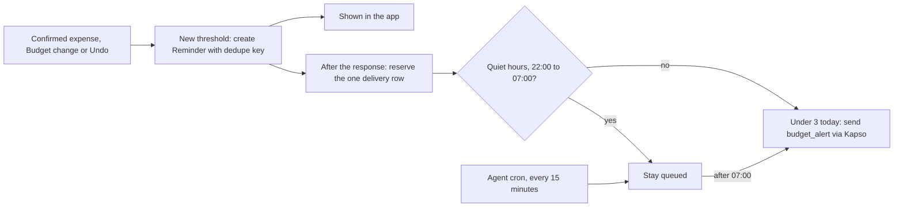

# Reminders

Owner: Abhip. Features: F13. Status: Draft.

## Purpose

A Reminder tells the User that a Budget is nearly used up or has been passed. It always appears in the app, in the notifications list and on the dashboard. If the User has linked and verified a WhatsApp number, the same Reminder is also sent there as a short message, so it reaches them where they already chat. The app is the source of truth, and WhatsApp only adds a copy, because a message can be held back by quiet hours, by the daily limit or by the provider. This section covers F13. **WhatsApp delivery is deferred for the submission.** The code is merged and tested against fakes, but the Meta template approval and a real send were left out, so the demo and every claim here rely on the in-app Reminders. **Only Budget threshold Reminders are built.** Bill-due Reminders are Planned: the data model has a `bill_due` kind, but no code creates one.

## How it works




**Trigger.** The backend checks Budgets whenever it confirms an expense, creates or edits a Budget, or restores a record through Undo (`packages/core/src/finance.ts`, `evaluateBudgetThresholdsFor`). It compares the spending in the active Budget period with two thresholds: the Budget's warning percent and 100%. Spending counts confirmed expenses only, and the period is the Budget's own period, so a backdated expense reports the older period.

**Dedupe.** Each Reminder carries a key made of the Budget, the period start, the limit and the threshold (`budget:<id>:<period>:<limit>:<threshold>`). The same threshold in the same period creates one Reminder. Because the limit is part of the key, raising the limit re-arms the threshold.

**In-app delivery.** The Reminder is saved first. The dashboard shows active ones, and the User can read or archive them. These owned list, read and archive operations do not depend on WhatsApp.

**WhatsApp delivery** (`packages/core/src/budget-alerts.ts`, wired in `apps/web/src/lib/whatsapp/budget-alerts.ts`).

1. After the response goes out, `deliver` runs. It does nothing unless the User has a verified WhatsApp Link with WhatsApp Reminders on, and the link secret and the Kapso settings exist.
2. It reserves exactly one `reminder_deliveries` row for the Reminder. A unique index on Reminder and channel means two callers can never both send it.
3. Between 22:00 and 07:00 in Asia/Jakarta the row stays `queued`.
4. Outside quiet hours it claims the row, counts the User's attempts since local midnight, and skips the alert as `daily_limit` once three have been used.
5. It re-reads the Budget so the message shows current figures, decrypts the number, and sends the `budget_alert` template through Kapso: "Heads up: you have used {{1}}% of your {{2}} budget ({{3}} of {{4}}). {{5}} is left until {{6}}."
6. It settles the row as `sent`, `skipped` or `failed` with a short code. The number and the provider's error text are never stored.

**Queued alerts.** The Agent's cron runs every 15 minutes (`apps/agent/src/reminders.ts`). It calls `/api/agent/reminders/dispatch` with the shared secret, and the backend sends up to 50 queued alerts once quiet hours end. A claim that never reached the provider is retried after 5 minutes. A row whose provider call started and whose outcome is unknown is marked failed and never resent.

**Opt-in and opt-out.** Verifying a WhatsApp number turns WhatsApp Reminders on. Unlinking removes the stored number, so nothing more is sent. There is no separate on and off screen, and the Agent cannot change Reminder settings, so a request to stop Reminders gets an honest "I can't do that" reply.

## Key decisions

- **The app always gets the Reminder, and WhatsApp is an extra copy.** The alternative was WhatsApp only. We rejected it because a message can be held, limited or fail, and the User would then never see the warning.
- **A template message, not free text.** WhatsApp allows free text only within 24 hours of the User's last message. A budget alert is usually proactive, so it needs an approved template.
- **Reserve a delivery row before sending, and never resend an unknown outcome.** The alternative was retrying until the provider confirmed. A repeated money warning is worse than a missed one, so an unknown result is recorded as failed.
- **Quiet hours from 22:00 to 07:00 and at most three WhatsApp alerts a day, both fixed.** The alternative was per-User settings. We rejected them for time: the defaults protect the User from noise and cost nothing to build. The timezone is fixed to Asia/Jakarta because the profile timezone is not read yet.
- **Send after the response, not inside the write.** A slow or failing provider must not make saving a transaction slow or fail. The cost is that a crash after the write can leave a Reminder with no delivery row, which still shows in the app.
- **Keep the number encrypted, not only hashed.** A hash cannot be turned back into a number to send to. The number is sealed with AES-GCM under a key only the backend holds, saved on verification and cleared on unlink.

## Security and risks

- **What a message contains.** Only the Budget name, the percent used, the amounts and the period end. It carries no merchant, transaction, account or email detail.
- **The number.** It is stored as an AES-GCM ciphertext keyed from `WHATSAPP_LINK_SECRET`, alongside the keyed hash used to recognize a sender. The database holds no readable number. Delivery rows and logs keep codes and counts, never numbers or provider messages.
- **Authorization.** The dispatch route accepts only the shared agent secret, and the sender checks the verified link and preference for each User. Without the link secret or Kapso settings, nothing is sent or recorded.
- **Template approval.** The `budget_alert` template must be approved by Meta before sending works, and approval can take up to 48 hours. [The Agent section](agent.md) records its status. We did not verify it with Meta here.

Open risks:

- Anyone who holds both `WHATSAPP_LINK_SECRET` and read access to the database can recover linked numbers. The secret must stay server-side and be rotated through deployment secrets if exposed.
- Links verified before the encrypted number existed keep working for chat, but they get WhatsApp Reminders only after the User links again.
- `sent` means the provider accepted the message. Delivery and read receipts are not recorded.
- Budget names appear in the WhatsApp message, and Kapso and WhatsApp see them with the amounts.
- There is no per-User switch for WhatsApp Reminders short of unlinking, and no setting for quiet hours or the daily limit.
- Bill-due Reminders, a second template, and bill matching are Planned.

## How to verify

```sh
pnpm --filter @monara/core test     # includes packages/core/src/budget-alerts.test.mjs
pnpm --filter @monara/agent test    # includes apps/agent/test/reminders.test.ts
pnpm db:check --reset --base-ref origin/main
```

The core tests cover each rule above: the template parameters come out in the template's order, one alert is sent once and recorded, two concurrent deliveries send one, racing alerts never pass the daily limit, an unlinked or opted-out User gets nothing, alerts held at night go out after 07:00, a stale claim that never reached the provider is retried, a stale row with an unknown provider outcome is never resent, one failing row does not stop the batch, the fourth alert in a day is skipped, and a failure stores a code and not the provider's message. The agent tests cover the cron call and its failure handling. The database suite covers the `reminder_deliveries` table.

On 18 October 2026, on `main` at `00700cd`, `@monara/core` passed 102 of 102 tests and `@monara/agent` passed 170 of 170. These prove the logic against fakes. **An end-to-end send to a real number has not been recorded**, because it needs the approved template, a linked number and a deployed backend.
