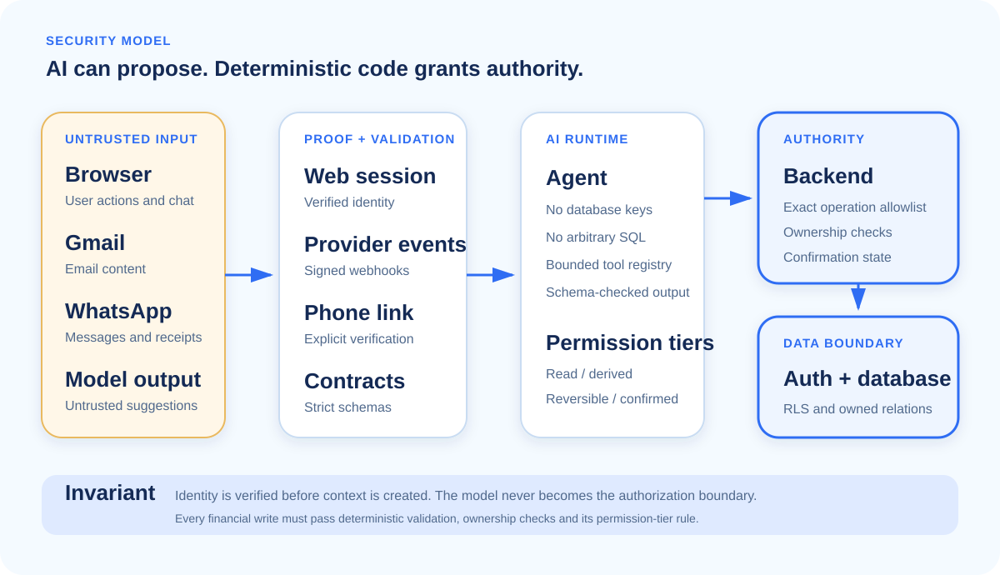
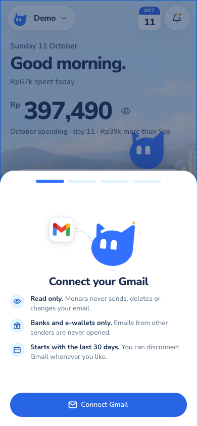

# Security self-assessment and freeze standard

Owner: Team 808. Features: F10, F12, F16. Status: Draft.

**Product:** Monara personal-finance PWA<br>
**Assessment date:** 20 October 2026<br>
**Assurance level:** Internal security assessment, not an independent penetration test

**Candidate decision:** **Pass for a controlled competition demonstration using synthetic data.** Every automated source, database, Agent, browser and build gate run for this assessment passed.

**Production freeze decision:** **Not yet passed for unrestricted real-finance use.** The deployed application is healthy and fails closed at its public authentication boundary, but the assessed hardening candidate has not been deployed, preview and production data environments are not isolated, and authenticated two-User isolation has not been exercised against production. These are release blockers, not hidden footnotes.

## Purpose

### Security posture in 30 seconds

Monara treats the model, emails, chat messages, receipt images and provider events as untrusted input. The model may reason, but it never becomes the authority for identity, ownership, financial truth or destructive action.

Five deterministic layers retain that authority:

1. **Verified identity.** Web session, verified WhatsApp number and Gmail authorization prove different claims and are never interchangeable.
2. **Scoped Agent tools.** The model can request only registered operations with strict inputs.
3. **Backend authorization.** The server resolves the User, validates the exact operation and checks ownership.
4. **Database isolation.** Forced row-level security, owned references and write fences reject cross-User access and stale writes.
5. **Human control.** Uncertain imports stay in review, reversible writes offer Undo, and destructive actions require a short-lived confirmation.

### What “pass” means

| Status | Meaning |
| --- | --- |
| **Pass** | The control exists and its expected result was observed in a deterministic test. |
| **Live verified** | The result was observed against the deployed public service without changing production data. |
| **Candidate only** | The hardening works in the tested release candidate but is not in the current deployment. |
| **Open** | Evidence is missing or the residual risk exceeds the freeze standard. |

A screenshot can prove the deployed page, viewport and visible state. It cannot prove database isolation, secret handling or provider deletion. Those claims require boundary tests and controlled integration evidence.

## How it works

### Scope and threat model

This assessment covers authentication, financial authorization, database ownership, Agent permissions, Gmail ingestion, WhatsApp, media, browser and PWA behavior, background jobs, external providers and account deletion.

Monara assesses cross-User access, caller identity spoofing, replay and duplicate processing, indirect prompt injection, unintended Agent actions, uncertain financial facts, unsafe browser caching, leaked provider output and incomplete deletion. Supabase, Vercel, Cloudflare, Composio, Kapso, the model provider and Brave Search are trusted infrastructure within this prototype threat model. Compromise of a provider control plane, legal compliance certification and bank-grade account verification are outside scope. Monara does not move money or store card credentials.

### Trust boundaries

{ width=92% }

| Boundary | Untrusted input | Deterministic control | Authority after the boundary |
| --- | --- | --- | --- |
| Browser to web backend | URL, form data, model text | Verified Supabase session, same-origin check, schema validation | Signed-in User only |
| WhatsApp to Agent | Sender number, message, media | Provider signature plus explicit signed-in User pairing | Verified linked User only |
| Gmail to ingestion | Sender, headers, body and model extraction | Stored connection, known institution, authenticated sender, strict schema, owned account mapping | Pending or high-confidence owned import |
| Agent to backend | Model-selected tool and arguments | Exact operation registry, scoped schema, ownership and confirmation | Bounded operation only |
| Backend to database | Repository query or mutation | User scope, forced RLS, composite ownership and write constraints | Owned row only |
| Browser to PWA cache | Navigation and API response | Public-asset allowlist and generic offline fallback | No financial or authenticated response cached |

The invariant is simple: **a caller-provided User ID, phone number, mailbox identifier or model statement is never proof of authority.**

### Permission model

| Tier | Capability | Enforcement | Result |
| --- | --- | --- | --- |
| T0 - Read and derived computation | Read owned summaries; refresh disposable projections | Validated operation and no authoritative ledger mutation | **Pass** |
| T1 - Reversible mutation | Add or edit supported records; confirm or exclude pending imports | Strict schema, verified User, ownership, idempotency and Undo | **Pass with bounded residual risk** |
| T2 - Confirmed destructive action | Delete a transaction or budget | Backend-issued, User-bound, single-use, five-minute confirmation | **Pass** |
| T3 - Never available to Agent | Identity deletion, credentials, provider connections and exports | Capability absent from the conversational tool registry | **Pass** |

### Gmail financial integrity

An email may auto-confirm only when all of these are true:

- the mailbox connection is active and belongs to the User;
- the sender is from the supported institution flow and passes sender verification;
- the transaction maps to one active Financial Account owned by that User;
- type, direction, amount, IDR currency and date are complete;
- both extraction and classification confidence are present and at least **0.95**;
- the category is active, compatible and owned; and
- the User has not edited or already resolved the item.

Any failed condition keeps the item pending. Missing values stay missing; Monara does not invent an amount, date, account or category. Provider message identity and item position are unique, so replay cannot create a duplicate transaction.

### Account deletion

Acceptance immediately revokes sessions, blocks the identity and deletes owned application rows. A durable leased cleanup job then removes WhatsApp state, Gmail triggers and connections, private Goal images and the Auth identity. Cleanup targets remain recorded until each provider step succeeds; retrying does not skip unfinished work. Every current user-owned table receives the same live-User write fence so an in-flight privileged job cannot recreate data after deletion starts.

External provider retention and backup erasure remain governed by those providers and are not certified by this assessment.

### Third-party data exposure

| Provider | Data received | Credential boundary | Monara controls provider retention? |
| --- | --- | --- | --- |
| Supabase | Identity and owned application records | Browser session and privileged server role | Application rows: yes; managed backups: no |
| Composio | Gmail authorization and selected message content | Provider-managed OAuth, server API credential | No |
| Model provider | Selected email, chat, receipt and forecast context | Server-side model credential | No |
| Kapso | WhatsApp transport, sender and media | Signed webhook and server API credential | No |
| Brave Search | Public merchant-name query only | Server API credential | No |

Raw emails, conversations, financial rows, authorization headers and tokens are excluded from application logs. Provider retention still needs contractual review before a public real-data launch.

## Key decisions

- **Deterministic code keeps authority.** Prompt instructions assist reasoning but never replace authentication, validation, ownership or database policy. The rejected alternative was trusting the model to decide what it may access.
- **Unknown facts remain unknown.** An incomplete import stays pending rather than receiving invented financial facts. The rejected alternative was maximizing automation at the cost of ledger integrity.
- **A conservative 0.95 auto-confirm boundary requires both scores.** The rejected 0.50 and one-score fallback allowed uncertainty and unauthenticated sender evidence to reach confirmed totals.
- **Reversible actions are the default.** T1 actions use idempotency and Undo; T2 actions require explicit confirmation. The rejected alternative was either approval fatigue for every edit or unrestricted destructive tools.
- **Service-role access is not authorization.** Verified User scope and ownership remain mandatory even for privileged repositories. The rejected alternative was treating possession of a server key as sufficient authority.
- **Authenticated state is never an offline asset.** Monara caches only explicitly public resources and serves a generic offline fallback. The rejected alternative was caching personalized pages for convenience.
- **Deletion is fail-closed and retryable.** Cleanup records remain until every known target is removed. The rejected alternative was returning success after only relational deletion.

## Security and risks

### Threat domains and mandatory controls

| Risk domain | Attack or failure path | Mandatory controls | Required fail-closed result |
| --- | --- | --- | --- |
| Identity and tenant isolation | A spoofed caller or User A requests data owned by User B | Server-resolved identity, ownership checks, forced RLS and owned references | Reject before read or write; return no private payload and create no ledger mutation |
| Agent and model authority | Prompt injection or model output requests an unknown, over-privileged or destructive operation | Strict schemas, registered tools, backend allowlists, permission tiers and confirmation outside the model | Reject the call; destructive action stays pending and model text never becomes authority |
| Gmail financial integrity | Spoofed, incomplete or replayed email reaches confirmed financial totals | Stored connection, authenticated sender, active owned account, complete facts, both confidence scores at 0.95 and unique provider IDs | Keep uncertain input pending; a replay creates no duplicate transaction |
| WhatsApp and media integrity | A forged or replayed webhook, unsafe redirect or unreadable receipt causes a financial write | Signature and freshness checks, verified phone link, redirect restrictions, MIME and byte limits, and idempotency | Reject the request; ambiguous media creates no confirmed transaction |
| Browser and offline privacy | A personalized response, authenticated page or financial API result is cached or exposed cross-origin | Same-origin writes, secure cookies, CSP and framing controls, private `no-store` responses and a service worker restricted to public assets | Serve a generic offline state with no cached account, transaction, budget or conversation content |
| Destructive actions and deletion | A stale, replayed or partially completed deletion removes the wrong state or leaves a known private target behind | Exact confirmation, five-minute expiry, single use, version binding, immediate access revocation and leased retryable cleanup | Keep access revoked; record and retry unfinished provider and private-object targets rather than reporting completion |
| Provider and secret exposure | A browser receives a server credential, a log captures private content or a provider retains more context than required | Server-only credentials, least-data payloads, content-free operational logs, redaction and explicit provider retention boundaries | Stop the path when credentials are missing; disclose uncertain provider erasure as residual exposure |
| Availability, replay and abuse | Distributed bursts, provider timeouts or blind retries exhaust quotas or repeat a write with an unknown outcome | Per-User limits, provider budgets, bounded Agent steps, durable idempotency, queue leases, retry caps and exponential backoff | Reject or delay excess work; reconcile unknown write outcomes before retry and keep degraded state visible |

The decision rules are deliberately strict:

- no deterministic control or retained evidence means no pass;
- identity, ownership and financial truth never come from model output;
- unknown provider outcomes remain visible and are not retried blindly; and
- unfinished deletion targets stay blocked and recorded until cleanup succeeds.

### Control assessment

| ID | Control and expected result | Evidence and reason | Candidate | Current production |
| --- | --- | --- | --- | --- |
| C-01 | Unauthenticated callers cannot read financial APIs | Public API probe returned 401; root redirected to sign-in | **Pass** | **Live verified** |
| C-02 | User A cannot read or mutate User B records | Forced-RLS and ownership red-team assertions passed across all database suites | **Pass** | **Open: live two-User proof required** |
| C-03 | Agent cannot invent arbitrary operations | 277 Agent tests passed; tool schemas, tier checks and backend allowlists rejected invalid actions | **Pass** | **Implemented; credential scope remains open** |
| C-04 | Gmail cannot auto-confirm spoofed or uncertain input | Tests prove authenticated sender, complete facts, active owned account and both scores at 0.95 are mandatory | **Pass** | **Candidate only** |
| C-05 | Duplicate Gmail deliveries do not duplicate ledger rows | Message and item uniqueness plus replay tests passed | **Pass** | **Implemented** |
| C-06 | Destructive actions require explicit short-lived authority | Confirmation binding, expiry, single use and stale-state tests passed | **Pass** | **Implemented** |
| C-07 | Deletion blocks access and cannot leave known private Goal objects | Relational erasure, stale-job denial, durable cleanup and image-path retry tests passed | **Pass** | **Candidate only; real provider erasure unverified** |
| C-08 | Browser pages receive baseline security headers | Candidate sends CSP, frame denial, MIME protection, referrer and permissions policy with no runtime errors | **Pass** | **Open: production CSP absent** |
| C-09 | Financial and authenticated pages are not cached offline | Service-worker tests passed; production HTML returned `private, no-store` | **Pass** | **Live verified** |
| C-10 | Webhook and media input fails closed | Signature, freshness, origin, redirect, MIME and byte-limit tests passed | **Pass** | **Provider integration not destructively tested** |
| C-11 | Candidate builds for both deployed runtimes | Next.js production build and Cloudflare dry-run completed | **Pass** | **Live deployments share the same base revision** |
| C-12 | Mobile surface remains usable after hardening | 390×844 candidate and production runs had zero overflow, console errors or page errors | **Pass** | **Live verified for current revision** |

### Prioritized residual risks

| Risk | Initial | Residual and required treatment |
| --- | --- | --- |
| Preview or development reaches production data | Critical | **Open / High.** Use a separate Supabase project and separately rotated credentials, or make preview fail closed. |
| Shared Agent-to-backend credential is stolen | Critical | **Open / High.** Replace the broad bearer with channel-scoped, rotating, replay-safe capabilities and separate allowlists. |
| Cross-User access regression exists only in hosted configuration | Critical | **Open / Medium.** Run a controlled production test with two synthetic Auth Users after deployment. |
| Hardened Gmail/deletion/browser controls are not live | High | **Open / Medium.** Deploy one reviewed immutable revision, migrate production, then repeat the exact probes. |
| External providers retain sensitive context | High | **Open / Medium.** Confirm retention/deletion terms, minimize prompts and document provider erasure evidence. |
| Per-instance rate limiting is bypassed across instances | High | **Open / Medium.** Move abuse counters to a distributed store and set provider budgets. |
| Separate mutation and audit writes partially succeed | Medium | **Open / Medium.** Use durable idempotency and an outbox for write-bearing Agent turns. |
| Assessment candidate is not an immutable commit and was tested on Node 25.2.1 rather than the repository's preferred Node 24 | Medium | **Open / Low.** Commit the exact candidate and rerun all gates in CI on Node 24 without code changes. |

No Open Critical risk remains inside the local candidate's deterministic control set. Open High risks are deployment architecture issues, so the candidate is acceptable only for a supervised synthetic-data demonstration, not unrestricted real-finance use.

### Incident response

If a credential is exposed, the operator must disable the affected path, rotate the credential, prove the old value is rejected, invalidate outstanding confirmations, inspect content-free event metadata for abuse, restore with the minimum scope and notify affected Users when exposure is established. Raw financial data must not be copied into incident tickets or chat.

## How to verify

### Recorded evidence

| Evidence | Observed result | What it proves |
| --- | --- | --- |
| E-01 Workspace quality gate | **Pass:** lint, typecheck, dependency checks, unit/integration tests, docs and migration validation | Candidate is internally consistent |
| E-02 Automated TypeScript tests | **1,098 passed:** contracts 79, database client 6, core 154, integrations 49, Agent 277, web 293 and repository scripts 240 | Boundaries and failure paths execute as specified |
| E-03 Database replay | **Pass:** 28 migrations replayed from zero | Schema is reproducible from migration history |
| E-04 Database security suite | **396/396 pgTAP passed; schema lint reported no errors** | RLS, ownership, dedupe, Gmail policy, deletion and late-table fences work locally |
| E-05 Frontend health | **React Doctor 100/100** for web and shared UI | No React Doctor findings or warnings |
| E-06 Runtime builds | **Pass:** Next.js production build and Cloudflare Worker dry-run | Both deployable artifacts compile for their target runtime |
| E-07 Candidate browser run | **200; CSP present; 390=390 width; manifest present; 0 console and 0 page errors** | Browser hardening does not break the mobile PWA |
| E-08 Production browser run | **200; 390=390 width; manifest present; 0 console and 0 page errors; CSP absent** | Current deployment is visually healthy and identifies the live CSP gap |
| E-09 Production boundary probes | Root **307** to sign-in; unauthenticated financial API **401**; service worker **200**; personalized HTML `private, no-store` | Public deployment fails closed and does not cache personal pages |
| E-10 Deployment identity | Vercel and Cloudflare both report base revision `c390ba39aa83`; Vercel returned no error-level log entries for the inspected 24-hour window | Web and Worker production revisions agree; absence of logs is not proof of zero latent defects |

### End-to-end security journeys

These journeys are the release-level test cases for the domains in scope. “Candidate pass” means the complete deterministic boundary was exercised locally with synthetic identities or fixtures. “Live verified” is reserved for a read-only observation against the deployed service. The assessment does not claim that a set of passing component tests is one continuous live-provider production journey.

| Journey | Domains and expected invariant | Current evidence |
| --- | --- | --- |
| J-01 Identity and tenant isolation | Sign in as synthetic User A and User B; each may read and mutate only owned profiles, accounts, categories, transactions, budgets, Goals, connections and conversations; logout makes financial APIs unavailable | **Candidate pass.** Forced-RLS and ownership-denial suites pass across the owned tables. **Production open:** authenticated two-User proof is still required |
| J-02 Gmail to ledger | An owned mailbox imports expense, income and exclusion records; account/category compatibility is enforced; uncertain records remain in review; provider replay cannot duplicate the ledger | **Candidate pass** for extraction, categorization, status and dedupe boundaries using synthetic messages. **Production open:** one controlled Composio mailbox journey is still required |
| J-03 Review to financial outputs | Confirm, edit and reject pending records; only confirmed expense and income affect dashboard, budget and forecast totals; exclusions remain visible but do not affect totals | **Candidate pass** through repository, calculation and web route tests. A production mutation run is intentionally not claimed |
| J-04 Agent and WhatsApp authority | Web Chat and a verified phone may request only registered operations; schemas, ownership and confirmation remain enforced outside the model; replayed or unsigned provider input fails closed | **Candidate pass** across 277 Agent tests plus backend operation tests. **Production open:** a real linked-number and provider delivery run is still required |
| J-05 Deletion and offline safety | Deletion revokes access, removes owned rows and records unfinished provider cleanup; retry completes remaining targets; authenticated or financial responses never become offline assets | **Candidate pass** for relational erasure, cleanup leases, private Goal image targets and service-worker behavior. **Production open:** real provider erasure remains unverified |
| J-06 Mobile production smoke | The deployed synthetic demo loads at 390×844, exposes the expected manifest, has no horizontal overflow and emits no browser errors | **Live verified.** HTTP 200, 390=390 viewport width, manifest present, zero console errors and zero page errors |

{ width=48% }

The screenshot was captured directly from the production URL on 20 October 2026. It proves only the deployed page, viewport and visible synthetic-data state. It does not prove RLS, provider authorization, Gmail extraction or successful deletion; those require the corresponding boundary journey above.

Run the reproducible candidate checks:

```bash
pnpm check
pnpm build
pnpm exec supabase db reset --local
pnpm exec supabase db lint --local --schema public --level warning --fail-on warning
pnpm exec supabase test db --local
pnpm db:types --check
```

Then run the mobile browser check at **390×844** and record status, CSP, viewport width, manifest, console errors and page errors. For production, repeat only read-only probes unless a separate synthetic tenant and explicit mutation authorization are available.

### Ideal freeze acceptance

The document may change to **Final — Frozen and Passed** only when all conditions below are true for one immutable release identifier:

- every candidate test and build above passes on Node 24 in CI;
- the candidate is deployed unchanged to both Vercel and Cloudflare;
- production database migration history matches the candidate;
- production returns the candidate CSP and secure cookie behavior;
- preview and production use separate data stores and credentials;
- Agent authority is channel-scoped and replay-safe;
- two synthetic production Users prove mutual read and write denial;
- real provider disconnect and deletion are observed without retaining private application objects;
- no raw email, financial record, token or authorization header appears in logs;
- a second reviewer signs the evidence and confirms every residual risk is represented.

Any later change to identity, authorization, schema/RLS, Agent tools, ingestion, providers, deletion, secrets or deployment invalidates the affected evidence and requires targeted reassessment.

## Conclusion

Monara's candidate security model is defensible for a controlled competition demonstration because deterministic code retains authority and all reproducible automated controls passed. The document deliberately does not convert local success into a false production claim. A true ideal-state pass requires the same hardening to be deployed, environment and Agent credentials to be isolated, and hosted cross-User/provider tests to pass on one immutable revision.
