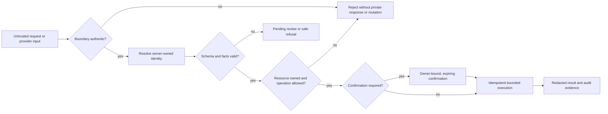

# Security self-assessment

Owner: Team 808. Features: F1 to F17. Status: Final.

## Purpose

This self-assessment evaluates the ideal Monara design against the threats created by personal financial data, external providers and an action-capable language model. It records the control objective, the deterministic boundary that enforces it, the safe failure behavior and the residual risk that remains after mitigation.

This document is intentionally not an implementation inventory or deployment report. Technical mechanisms belong in the **Technical Documentation**. Test artifacts and observed outcomes belong in **Execution Evidence**. Here, a control passes only when its enforcement is independent of model cooperation and its failure leaves financial state unchanged or explicitly pending.

The assurance goal is:

> Untrusted identity, messages, media and model output must never become financial authority without verified identity, owned resources, validated facts and the required human-control step.

## How it works

### Security posture

Monara assumes that email text, receipt images, chat messages, provider events, browser parameters and model output may be malformed or hostile. The system therefore resolves authority in layers:

1. **Authenticate** the human, service or provider boundary.
2. **Resolve** identity from trusted server state rather than caller-supplied identifiers.
3. **Validate** every input against a narrow schema and financial invariant.
4. **Authorize** the requested resource and operation for the resolved User.
5. **Apply human control** when an operation is destructive or evidence is uncertain.
6. **Execute idempotently** with database constraints and optimistic versions.
7. **Record minimal evidence** without storing secrets or raw private content.

### Permission tiers

Permissions are attached to the registered operation, never inferred from a prompt or generated by the model.

| Tier | Authority | Examples | Required control |
| --- | --- | --- | --- |
| T0 | Read owned data | Summary, transaction list, Budget usage, forecast | Authenticated identity, ownership and output filtering |
| T1 | Reversible financial write | Add/edit transaction, confirm review, create/edit Budget | T0 controls plus idempotency, optimistic version and single-use Undo receipt |
| T2 | Destructive financial write | Delete transaction or Budget | T1 controls plus backend-issued confirmation bound to User, action, resource version and five-minute expiry |
| T3 | Identity/provider administration | Connect providers, export, permanent deletion | Excluded from Agent tools; available only through the authenticated settings interface with explicit re-confirmation |

The Agent cannot register tools, change tiers, invent a confirmation or execute a T3 operation. Free-form text such as “yes” has no authority without the matching server-held confirmation.

### Authority by channel

| Channel | Accepted identity proof | Rejected shortcut | Failure behavior |
| --- | --- | --- | --- |
| Web and in-app Chat | Verified, active server session | User ID in a request body | 401 or sign-in redirect; no private payload |
| Gmail | Stored active connection plus valid provider event and owned sender/account mapping | Mailbox, sender or connection ID from the event alone | Reject event or keep extracted item pending |
| WhatsApp | Valid fresh webhook signature plus previously verified phone-owner link | Matching an unverified phone number | Reject without conversation or financial action |
| Agent-to-backend | Rotatable service credential plus server-resolved User binding and operation allowlist | Shared secret as a substitute for User ownership | 401/403; no tool execution |
| Background job | Authenticated scheduler plus database-selected owned work item and lease | Arbitrary User or record identifier supplied by the caller | Reject, release or retry the lease safely |

### Financial-integrity controls

Financial truth is protected independently of extraction quality:

- Every record is owned, and relationships use owner-compatible keys.
- External input is parsed into strict schemas; unknown amounts, dates, currencies or mappings stay unknown.
- Provider and request identifiers are unique, making replay idempotent.
- New imports begin pending.
- A Gmail import auto-confirms only when the sender is authenticated and registered, an active owned account is mapped, all financial facts are explicit, type and Category are compatible, and both extraction and classification confidence are at least **0.95**.
- Receipt images always remain pending.
- Only confirmed expenses and income affect totals. Exclusions, pending and deleted records do not.
- Forecasts, recommendations and Goal projections remain separate derived data.

### Data-protection controls

- Row-level security is enabled and forced on User-facing private tables.
- Browser roles receive only the minimum owned reads needed by the interface; financial writes use authenticated backend services.
- Service credentials, provider credentials and model keys are server-only, independently rotatable and never sent to the browser.
- Private object storage requires owner-scoped paths and signed, short-lived access.
- Raw emails, receipt bytes, authentication headers and provider tokens are not written to application logs.
- Personalized responses use private, no-store caching rules.
- The service worker caches only explicit public assets and a generic offline page.
- Web responses apply a restrictive Content Security Policy, transport security, frame denial, content-type protection and conservative referrer/permissions policies.
- Operational logs use correlation identifiers, event types, counts, latency and fixed error classes rather than private content.

### Availability and recovery controls

Rate limits are distributed across instances and scoped by User, source address, route class and provider budget. Queues use bounded concurrency, leases, capped retries and exponential backoff. A retry reuses the same idempotency key. Unknown write outcomes are reconciled before retry.

Destructive actions and account deletion use durable state machines. Acceptance and completion are distinct: acceptance immediately revokes access, while completion is reported only after all Monara-controlled data and connection cleanup steps succeed. Failed cleanup remains visible and retryable.

## Key decisions

- **The model is not a security boundary.** Prompts improve behavior; schemas, allowlists and backend authorization enforce it.
- **Identity is resolved, not accepted.** A caller-supplied User ID, phone number or provider connection never proves ownership.
- **High-confidence Gmail automation is conjunctive.** Both confidence scores and every deterministic gate must pass; one strong score cannot hide missing evidence.
- **Receipt imports require review.** Images lack the authenticated sender/account context needed for safe automatic confirmation.
- **Destructive intent is server-held.** Confirmation binds a User to one exact action and record version.
- **Financial truth fails closed.** Uncertain input becomes pending, safe refusal or visible degraded state—not a guessed transaction or fake success.
- **Evidence is part of the control.** A claim without a dated, release-bound artifact remains unverified.

## Security and risks

### Control assessment

| Control domain | Principal threat | Mandatory controls | Required safe outcome |
| --- | --- | --- | --- |
| Identity and tenant isolation | Spoofed identity or cross-User record access | Verified server session, owner-scoped repositories, forced RLS, composite ownership relationships | Reject before reading or writing; return no foreign data |
| Agent and model authority | Prompt injection or fabricated tool call | Fixed tool registry, strict schemas, permission tiers, server authorization, confirmation outside the model | Reject unsupported call; leave state unchanged or pending |
| Gmail financial integrity | Spoofed, incomplete or replayed mail enters confirmed totals | Signed provider event, sender authentication, owned mapping, unique message/item key, complete facts, two scores ≥0.95 | Duplicate creates nothing; uncertain item stays pending |
| WhatsApp and media integrity | Forged webhook, unverified sender or malicious media | Signature/freshness check, verified link, origin/MIME/size limits, no redirects, schema validation | Reject request; receipt never auto-confirms |
| Database integrity | Service-role error bypasses tenant controls | Owner-scoped queries, database constraints, transactional functions, optimistic versions, RLS defense in depth | Cross-User link or stale mutation fails atomically |
| Browser and offline privacy | Private response cached, framed or exposed cross-origin | Same-origin mutations, secure cookies, security headers, private no-store responses, public-only service worker | Generic offline state; no cached finance or identity content |
| Secrets and logging | Credential or private-content disclosure | Managed secret storage, least privilege, rotation, log redaction, content-free errors | Missing credential fails closed; logs reveal no private content |
| Availability and replay | Flooding, provider timeout or blind retry | Distributed rate limits, provider budgets, leases, idempotency, retry caps and reconciliation | Excess work is delayed/rejected; uncertain writes are not repeated |
| Destructive actions and deletion | Stale confirmation or partial erasure | Owner/action/version binding, expiry, single use, immediate revocation, durable cleanup inventory | Wrong or replayed action fails; incomplete deletion is never reported complete |

### Detailed risk register

| ID | Risk and impact | Control strength | Residual risk and acceptance condition |
| --- | --- | --- | --- |
| R1 | Prompt injection causes unintended financial activity | Strong for T2/T3 because authority is outside the model; moderate for T1 because the Agent may still request a reversible write | Accept only with adversarial tests, bounded tools, idempotency and visible Undo. Keep high-impact writes outside T1 |
| R2 | One User reads or changes another User's data | Strong when application ownership, composite keys and RLS agree | Accept only after bidirectional two-User read/write denial is tested against the release database and API |
| R3 | A service credential is stolen | Moderate: server-only storage, rotation and allowlists reduce exposure but do not remove bearer-token risk | Require independent credentials per direction, short rotation procedure, anomaly alerts and immediate revocation capability |
| R4 | Gmail produces a wrong confirmed transaction | Moderate: complete facts, sender authentication and dual 0.95 thresholds reduce but cannot eliminate semantic error | Require measured precision on representative mail, correction monitoring and automatic suspension if the correction rate exceeds the approved limit |
| R5 | Duplicate provider delivery changes totals twice | Strong when provider and item keys are unique and retries reuse the same key | Accept after concurrent replay and delayed-delivery tests show one canonical result |
| R6 | Receipt image contains malicious or misleading content | Strong against direct execution because media is bounded and output remains pending | OCR/model error remains; require explicit User review and never auto-confirm receipt-derived records |
| R7 | Private financial or identity data reaches logs or caches | Strong when content-free logging and no-store/public-only cache policies are enforced | Accept after response-header, cache inventory and structured-log scans show no private payload or secret |
| R8 | Provider or model retains data longer than Monara | Limited because provider retention is externally controlled | Require documented processor terms, minimum payloads, deletion request procedures and disclosure to Users |
| R9 | Flooding causes model cost or service degradation | Moderate even with distributed limits because volumetric denial remains possible | Require per-User and per-source quotas, global provider budgets, backpressure, alerts and tested degraded states |
| R10 | Lost response leads the User to repeat a completed write | Strong when request identity and reconciliation are durable | Accept after timeout tests prove one result and the UI distinguishes unknown, saved and failed outcomes |
| R11 | Permanent deletion finishes only partially | Moderate because multiple providers and storage systems cannot commit atomically | Require immediate access revocation, durable target inventory, retry visibility and no completion claim while a target remains unresolved |
| R12 | Authenticated session or device is compromised | Residual product risk after normal session controls | Require secure cookies, session revocation, sensitive-action re-confirmation and clear sign-out/device guidance |
| R13 | Forecast or recommendation is mistaken for financial truth | Strong when derived data is separated and labelled | Accept only if derived values never affect confirmed totals or execute transfers, and every recommendation exposes its basis |
| R14 | Goal image or other private object is exposed | Strong when object paths and signed access are owner scoped | Require cross-User storage denial, expired-link checks and cleanup tests for abandoned uploads |
| R15 | Backup copies outlive active deletion | External operational risk | Publish the backup retention period and ensure restoration procedures reapply deletion tombstones before serving data |
| R16 | A valid but vulnerable release is deployed | Process risk | Require immutable release identity, independent approval, reproducible gates and evidence bound to the exact release |

### Risk decision rules

- A deterministic control and reproducible evidence are required for every pass.
- A successful UI screen does not prove tenant isolation, deletion or provider authenticity.
- A passing local test does not prove a deployed provider journey.
- Provider acceptance does not prove downstream delivery or User receipt.
- A safe refusal is a pass when refusal is the specified behavior and financial state is unchanged.
- Known residual risk must have an owner, monitoring signal and explicit acceptance condition.
- A critical ownership, secret-exposure or destructive-action failure blocks release regardless of aggregate pass percentage.

## How to verify

Security verification is organized by control objective; detailed steps and artifacts are maintained in **Execution Evidence**.

1. **Identity:** test signed-out, expired-session, anonymous and spoofed-identifier requests.
2. **Tenant isolation:** run every owned read and write in both directions between two synthetic Users.
3. **Provider authenticity:** exercise valid, invalid, stale and replayed Gmail and WhatsApp events.
4. **Financial integrity:** prove pending/confirmed/exclusion arithmetic, category compatibility, 0.95 boundaries and duplicate suppression.
5. **Agent authority:** attempt tool injection, tier escalation, cross-User resource use, stale confirmation and unsupported T3 actions.
6. **Recovery:** interrupt each write before request, during execution and after commit; prove one final effect and truthful UI state.
7. **Privacy:** inspect headers, browser storage, service-worker caches, logs, exported artifacts and private-object access.
8. **Deletion:** verify immediate access revocation, leased cleanup, provider disconnect, private-object reconciliation and final identity removal.
9. **Availability:** test quota boundaries, concurrent queues, provider timeouts, backoff and degraded responses without uncontrolled retries.
10. **Release integrity:** bind every artifact to one immutable release and retain both expected and observed outcomes.

### Assurance sign-off matrix

| Decision | Minimum evidence | Release effect |
| --- | --- | --- |
| Identity accepted | Valid and expired-session checks plus server-resolved identity | Blocks every private journey if absent |
| Tenant isolation accepted | Bidirectional two-User read/write and private-object denial | Critical release blocker if any foreign access succeeds |
| Provider intake accepted | Valid, invalid, stale and replayed Gmail/WhatsApp cases | Blocks provider feature if authenticity or dedupe fails |
| Financial integrity accepted | Exact arithmetic, dual-0.95 boundary and terminal review-state checks | Blocks automatic confirmation if any invariant fails |
| Agent authority accepted | Tier escalation, prompt injection, confirmation and Undo cases | Blocks Agent writes if an unsupported action executes |
| Privacy accepted | Header, cache, log and artifact scans | Blocks release if secret or private content is exposed |
| Deletion accepted | Immediate revocation plus complete retryable cleanup timeline | Blocks deletion claim while any target remains unresolved |
| Release accepted | One release identity, all mandatory artifacts and independent review | No aggregate score can override a critical failure |

The assessment is complete only when all mandatory controls have evidence and every residual risk is either accepted within the stated boundary or treated as a release blocker.
