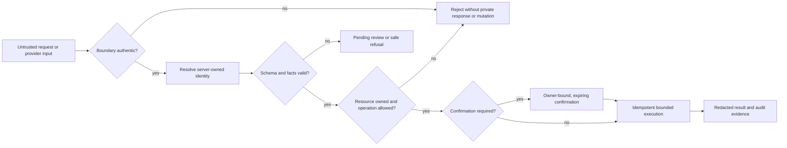
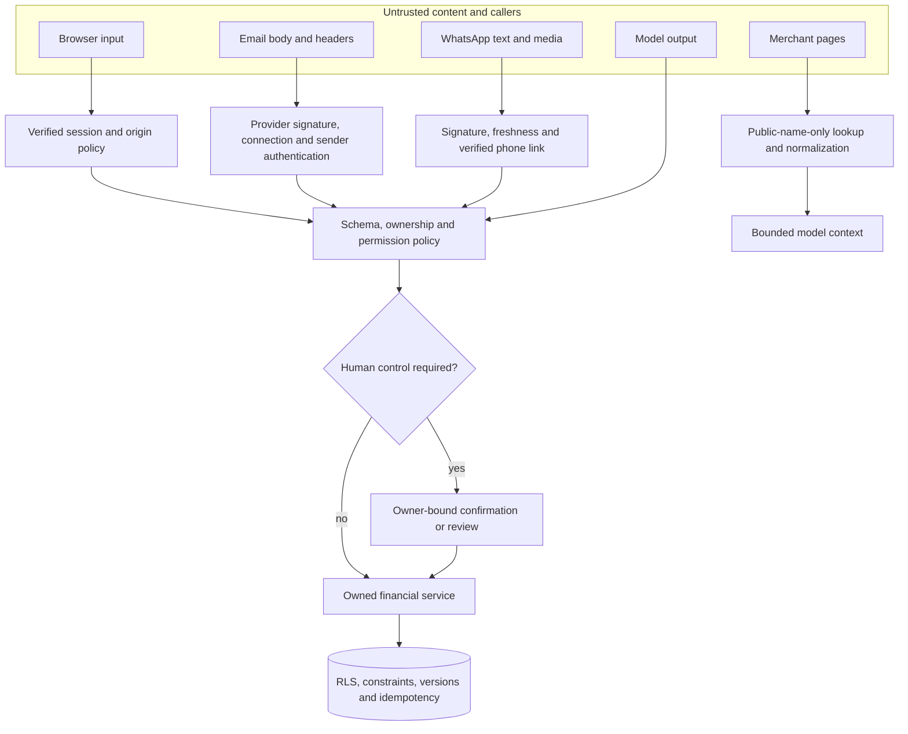

# Security self-assessment

Owner: Team 808. Features: F1 to F17. Status: Final.

## Purpose

This self-assessment evaluates the ideal Monara design against the threats created by personal financial data, external providers and an action-capable language model. It records the control objective, the deterministic boundary that enforces it, the safe failure behavior and the residual risk that remains after mitigation.

This document is intentionally not an implementation inventory or deployment report. Technical mechanisms belong in the **Technical Documentation**. Test artifacts and observed outcomes belong in **Execution Evidence**. Here, a control passes only when its enforcement is independent of model cooperation and its failure leaves financial state unchanged or explicitly pending.

The assurance goal is:

> Untrusted identity, messages, media and model output must never become financial authority without verified identity, owned resources, validated facts and the required human-control step.

### Assessment boundary

The assessment covers the production architecture needed to process personal-finance data safely:

- Google-backed application authentication and session lifecycle;
- ownership enforcement for profiles, accounts, categories, transactions, Budgets, Reminders, Goals, forecasts, conversations and provider connections;
- Gmail consent, event authenticity, message replay, extraction and automatic-confirmation policy;
- WhatsApp linking, webhook authenticity, sender resolution, media handling and ordered conversation processing;
- language-model prompts, tool selection, output validation, permission tiers and destructive confirmation;
- exact financial arithmetic, review state, Category compatibility and derived-data separation;
- private object storage, browser response policy, service-worker caching and screenshot redaction;
- queue leases, idempotency, rate limits, provider budgets, degraded states and recovery;
- account deletion, provider disconnection, private-object cleanup and identity removal;
- release identity, evidence provenance, deployment compatibility and operational monitoring.

Monara is not a bank core and does not custody funds, store card credentials or initiate bank transfers. Payment-network security, bank account ownership verification, provider control-plane compromise, physical access to an unlocked User device and independent legal certification are outside the application assurance boundary. These exclusions do not remove the need to minimize data sent to providers or to disclose provider and backup retention.

### Assurance interpretation

Security claims are narrow and evidence driven.

| Term | Meaning in this assessment |
| --- | --- |
| Control present | A deterministic mechanism exists at the stated boundary |
| Fail closed | Invalid, missing, stale or uncertain authority produces no unintended financial effect and no private disclosure |
| Production pass | The expected result was observed on one immutable production release with a release-bound artifact |
| Controlled pass | A destructive, cross-User or failure scenario was exercised with synthetic identities and exact state assertions |
| Residual risk accepted | The remaining risk, owner, monitoring signal and acceptance condition are explicit |
| Not proven | The artifact class does not establish the claim, even if adjacent tests passed |

A screenshot may prove that a deployed page loaded, displayed a state and remained usable at a viewport. It cannot prove row-level security, webhook authenticity, log redaction or provider erasure. A unit test can prove a deterministic branch but cannot establish that production uses the tested configuration. Provider success can prove acceptance of a request but not downstream User receipt. Every control therefore names the evidence class it requires.

### Security principles

1. **Authority is deterministic.** Model output and external content may propose an action but cannot authorize it.
2. **Identity is derived from a trusted boundary.** Caller-supplied User IDs, phone numbers, mailbox IDs and connection IDs are data, not proof.
3. **Ownership is checked twice.** Application repositories constrain the query, and the database enforces compatible ownership relationships and row-level security.
4. **Uncertainty is a state.** Missing or conflicting financial facts remain pending instead of becoming plausible-looking data.
5. **Writes are repeatable safely.** Request identities, versions, uniqueness and receipts make retry behavior explicit.
6. **Human control grows with impact.** Review governs uncertain imports, Undo governs reversible changes, confirmation governs destructive changes, and account/provider administration stays outside Agent tools.
7. **Private data is absent by default.** Logs, caches, error bodies, evidence and provider payloads contain only the minimum needed for their purpose.
8. **Completion must be truthful.** A workflow with unresolved provider or cleanup state remains in progress rather than reporting success.

## How it works

### Security posture

Monara assumes that email text, receipt images, chat messages, provider events, browser parameters and model output may be malformed or hostile. The system therefore resolves authority in layers:

1. **Authenticate** the human, service or provider boundary.
2. **Resolve** identity from trusted server state rather than caller-supplied identifiers.
3. **Validate** every input against a narrow schema and financial invariant.
4. **Authorize** the requested resource and operation for the resolved User.
5. **Apply human control** when an operation is destructive or evidence is uncertain.
6. **Execute idempotently** with database constraints and optimistic versions.
7. **Record minimal evidence** without storing secrets or raw private content.

### Permission tiers

Permissions are attached to the registered operation, never inferred from a prompt or generated by the model.

| Tier | Authority | Examples | Required control |
| --- | --- | --- | --- |
| T0 | Read owned data | Summary, transaction list, Budget usage, forecast | Authenticated identity, ownership and output filtering |
| T1 | Reversible financial write | Add/edit transaction, confirm review, create/edit Budget | T0 controls plus idempotency, optimistic version and single-use Undo receipt |
| T2 | Destructive financial write | Delete transaction or Budget | T1 controls plus backend-issued confirmation bound to User, action, resource version and five-minute expiry |
| T3 | Identity/provider administration | Connect providers, export, permanent deletion | Excluded from Agent tools; available only through the authenticated settings interface with explicit re-confirmation |

The Agent cannot register tools, change tiers, invent a confirmation or execute a T3 operation. Free-form text such as “yes” has no authority without the matching server-held confirmation.

#### Confirmation and Undo boundaries

T1 and T2 are different control families. A reversible write is not safe merely because the UI has an Undo button. T1 requires an exact prior snapshot, a receipt bound to the resulting version, a short validity window and one-time consumption. If another edit changes the resource, the older Undo fails rather than overwriting newer intent.

T2 first creates a confirmation proposal and performs no destructive mutation. The proposal records the resolved User, operation, resource, reviewed version, expiry and human-readable summary. Execution requires the exact live server record. A replay, different resource, different User, expired token, stale version or unrelated conversational “yes” fails without consuming current state.

T3 operations require a fresh authenticated settings journey and explicit re-confirmation. They are absent from the model's tool definitions and conversational backend allowlist. Hiding a T3 tool from the prompt is insufficient; no callable registration or generic operation escape hatch may exist.

#### Service and background authority

Server-to-server authority is scoped by direction and operation family. Chat, Gmail ingestion, forecasting, reminders and deletion processing use independently rotatable capabilities and separate allowlists. A credential that authorizes one family cannot choose an arbitrary User and invoke another family. The backend combines the service capability with a stored owned work item, connection or session binding before it resolves effective identity.

Every capability has an owner, rotation procedure, revocation path and anomaly signal. Secrets are never placed in URLs, browser bundles, provider payloads, error messages or routine logs. A missing or invalid capability returns 401/403 before tool selection or data access.

### Authority by channel

| Channel | Accepted identity proof | Rejected shortcut | Failure behavior |
| --- | --- | --- | --- |
| Web and in-app Chat | Verified, active server session | User ID in a request body | 401 or sign-in redirect; no private payload |
| Gmail | Stored active connection plus valid provider event and owned sender/account mapping | Mailbox, sender or connection ID from the event alone | Reject event or keep extracted item pending |
| WhatsApp | Valid fresh webhook signature plus previously verified phone-owner link | Matching an unverified phone number | Reject without conversation or financial action |
| Agent-to-backend | Rotatable service credential plus server-resolved User binding and operation allowlist | Shared secret as a substitute for User ownership | 401/403; no tool execution |
| Background job | Authenticated scheduler plus database-selected owned work item and lease | Arbitrary User or record identifier supplied by the caller | Reject, release or retry the lease safely |

### Threat actors and attack surfaces

| Threat actor or condition | Capability assumed | Primary surfaces | Security objective |
| --- | --- | --- | --- |
| Anonymous internet caller | Can send arbitrary HTTP requests and observe public responses | Sign-in, public assets, API and webhook URLs | Reveal no private state and perform no owned mutation |
| Authenticated malicious User | Owns one valid account and can guess identifiers | Finance APIs, object URLs, Chat and provider settings | Cannot infer, read, mutate or delete another User's resources |
| Spoofed provider sender | Can craft email fields, webhook bodies or replay captured payloads | Gmail and WhatsApp ingestion | Cannot pass authenticity, freshness, connection ownership or replay controls |
| Prompt-injection author | Controls email, merchant-page, receipt or chat content | Model context and tool selection | Cannot expand tools, supply identity, bypass confirmation or create unsupported facts |
| Compromised service credential holder | Can present one valid server credential | Agent operations and scheduled endpoints | Blast radius is restricted to the credential's direction, operation family and bound work |
| Network or provider failure | Can delay, duplicate, time out or ambiguously accept a request | All external integrations and queues | Never produce duplicate financial effects or false completion |
| Compromised authenticated session | Can act as the User until revoked | All owned application operations | Sensitive actions require re-confirmation; revocation and sign-out stop future access |
| Operator or evidence reviewer | Can access operational systems and artifacts | Logs, dashboards, screenshots and exports | Receives minimum redacted evidence and cannot use logs as a financial-data export |

### Trust-boundary analysis

At no point does untrusted content become a User, an owner, a tool registration, an amount absent from source evidence or a destructive capability. The same invariant applies even if the content is well-formed and the model produces a confident answer.

### Financial-integrity controls

Financial truth is protected independently of extraction quality:

- Every record is owned, and relationships use owner-compatible keys.
- External input is parsed into strict schemas; unknown amounts, dates, currencies or mappings stay unknown.
- Provider and request identifiers are unique, making replay idempotent.
- New imports begin pending.
- A Gmail import auto-confirms only when the sender is authenticated and registered, an active owned account is mapped, all financial facts are explicit, type and Category are compatible, and both extraction and classification confidence are at least **0.95**.
- Receipt images always remain pending.
- Only confirmed expenses and income affect totals. Exclusions, pending and deleted records do not.
- Forecasts, recommendations and Goal projections remain separate derived data.

#### Gmail automatic-confirmation policy

Automatic confirmation is the highest-risk automation because it can move external model output into authoritative totals. The policy is therefore conjunctive: every deterministic and probabilistic gate must independently pass. A high model score cannot repair an unverified sender, unknown amount, ambiguous account or incompatible Category.

| Gate | Pass requirement | Safe failure state |
| --- | --- | --- |
| Provider event | Valid signature, fresh timestamp and supported event shape | Reject before queueing |
| Connection | Active stored connection owned by one active User | Reject or stop sync |
| Institution sender | Exact registered sender plus aligned email authentication | Import may remain pending; never auto-confirm |
| Account | Exactly one active owned account supported by stated evidence | Leave account unassigned and pending |
| Financial facts | Explicit positive whole-rupiah amount, IDR, real date and direction | Preserve unknown field and pending state |
| Type and Category | Expense/income kind and active owner-compatible Category | Leave Category unknown or pending |
| Extraction score | Present and at least 0.95 | Pending |
| Classification score | Present and at least 0.95 | Pending |
| Record state | New, unedited and unresolved item with stable source identity | Return existing terminal state |

Exclusions and receipt-derived records do not auto-confirm. A verified self-identity match may propose the Internal exclusion Category, but the record remains visible and financially neutral. User correction rate is monitored as a quality control. If the approved false-confirm or correction threshold is exceeded, automatic confirmation is suspended without disabling import and review.

#### Exact arithmetic and derived-data separation

Financial calculations accept only valid confirmed records and use whole-rupiah integer arithmetic. The database and shared services enforce the same eligibility rules so a UI cannot accidentally include a pending, excluded, deleted or foreign record. Category names and logos never determine financial kind. Forecast and Goal outputs exist in separate tables and contracts; they cannot be joined into spending totals as if they were transactions.

Tests include equality at Budget limits, one rupiah over, zero limits, leap days, month boundaries, payday periods, stale versions and totals beyond normal JavaScript safe-number aggregation. Any conversion that cannot preserve the exact value fails visibly instead of rounding.

### Data-protection controls

- Row-level security is enabled and forced on User-facing private tables.
- Browser roles receive only the minimum owned reads needed by the interface; financial writes use authenticated backend services.
- Service credentials, provider credentials and model keys are server-only, independently rotatable and never sent to the browser.
- Private object storage requires owner-scoped paths and signed, short-lived access.
- Raw emails, receipt bytes, authentication headers and provider tokens are not written to application logs.
- Personalized responses use private, no-store caching rules.
- The service worker caches only explicit public assets and a generic offline page.
- Web responses apply a restrictive Content Security Policy, transport security, frame denial, content-type protection and conservative referrer/permissions policies.
- Operational logs use correlation identifiers, event types, counts, latency and fixed error classes rather than private content.

#### Data inventory and retention

| Data category | Purpose | Retention and deletion rule | External exposure |
| --- | --- | --- | --- |
| Auth identity and Profile | Session and User preferences | Until account deletion; session revocation is immediate at deletion acceptance | Supabase Auth and Google sign-in boundary |
| Financial ledger | Transactions, accounts, categories and Budgets | Until User deletion or an explicit owned record action | Supabase database; selected facts may reach the model for an authorized task |
| Gmail connection and import metadata | Consent state, sync cursor, message/item dedupe and aggregate outcomes | Until disconnect/deletion; no raw mailbox archive | Composio holds OAuth and retrieves selected messages |
| WhatsApp Link and transient conversation state | Resolve inbound identity and maintain ordered conversation context | Link until unlink/deletion; transient context expires; web Chat follows explicit history policy | Kapso transports messages and media |
| Goal images and receipt media | Private planning image and one receipt-processing task | Private Goal objects until replacement/deletion; receipt bytes are not retained beyond the declared workflow unless explicitly needed as a private source artifact | Storage provider and model provider receive bounded media |
| Forecasts and insights | Reproducible derived planning views | Replaceable derived state; deletion removes it with the User | Selected bounded candidate context may reach the model |
| Operational telemetry | Availability, abuse and incident response | Time-bounded according to operational policy; content-free | Hosting and monitoring providers |
| Evidence artifacts | Demonstrate release controls | Redacted, access-limited and retained for the assessment period | Reviewers only |

Backups and processor-held copies may outlive active application records. The retention period, restoration treatment and deletion-request process are disclosed. Restoring a backup must reapply deletion tombstones before any recovered data becomes available.

#### Browser and storage privacy

Authenticated pages and finance APIs use private, no-store response policy. Mutations require same-origin checks in addition to session authentication. Cookies are secure and use conservative same-site behavior. Content Security Policy limits script, connection, frame and object sources; frame denial and MIME protection reduce browser confusion attacks; referrer and permissions policies minimize ambient disclosure.

The service worker owns a fixed public cache namespace and explicit allowlist. It never caches application HTML, private API results, authentication routes, React Server Component payloads or any response marked private/no-store. Public fetches omit credentials and must return an expected content type. Offline navigation receives only a generic shell that contains no identity, totals, transactions, Budget or conversation state.

Private object paths include owner scope and are never accepted as authorization by themselves. The server verifies ownership before issuing a short-lived signed URL. Foreign User, anonymous and expired access fails. Replaced, abandoned and deleted objects enter deterministic cleanup workflows.

### Availability and recovery controls

Rate limits are distributed across instances and scoped by User, source address, route class and provider budget. Queues use bounded concurrency, leases, capped retries and exponential backoff. A retry reuses the same idempotency key. Unknown write outcomes are reconciled before retry.

Destructive actions and account deletion use durable state machines. Acceptance and completion are distinct: acceptance immediately revokes access, while completion is reported only after all Monara-controlled data and connection cleanup steps succeed. Failed cleanup remains visible and retryable.

#### Abuse resistance and provider budgets

Rate limiting protects four different resources: User attention, application capacity, provider quota and model cost. Limits are enforced in a shared store when they must hold across instances. Route policies distinguish read, mutation, Chat, manual refresh, webhook and administrative traffic. Provider adapters also respect upstream retry guidance and a global call budget.

An exceeded limit returns a stable 429 or delayed-queue outcome with bounded retry information. It does not partially execute the operation, leak whether another User exists or cause healthy Users to share one abusive User's queue. Queue concurrency is bounded per invocation and per User; poison work reaches a terminal review or failure state after capped attempts instead of retrying forever.

#### Recovery and deletion safety

Every write records enough identity to answer whether it completed. A timeout is not automatically classified as failure. The caller reconciles the request identity or reads current authoritative state before retry. UI state differentiates rejected, saved and unknown outcomes so a User is not encouraged to repeat an uncertain write.

Deletion acceptance creates a durable cleanup inventory before it reports completion. Access revocation and a live-User write fence take effect immediately. Cleanup leases prevent two workers from independently completing the same provider or object target. Failed targets remain visible with attempt and next-retry state. Provider disconnection, private-object cleanup and identity removal are not collapsed into one unprovable “deleted” flag.

### Incident response and secret compromise

An incident begins when evidence indicates credential exposure, foreign access, unintended financial mutation, provider replay, private logging, deletion failure or a release/configuration mismatch.

1. Disable or narrow the affected route, capability or provider connection.
2. Rotate the credential and verify that the old value is rejected.
3. Revoke relevant sessions, outstanding confirmations and queue leases.
4. Preserve content-free event metadata and immutable release identity.
5. Determine affected Users and state deltas without copying raw finance into tickets or chat.
6. Restore from the smallest safe scope, reconcile unknown provider outcomes and reapply deletion tombstones.
7. Notify affected Users when exposure or incorrect financial state is established.
8. Add a deterministic regression case and reassess every control sharing the boundary.

No incident response step authorizes an operator to export raw mailboxes, conversations or full financial tables into a general-purpose collaboration system.

## Key decisions

- **The model is not a security boundary.** Prompts improve behavior; schemas, allowlists and backend authorization enforce it.
- **Identity is resolved, not accepted.** A caller-supplied User ID, phone number or provider connection never proves ownership.
- **High-confidence Gmail automation is conjunctive.** Both confidence scores and every deterministic gate must pass; one strong score cannot hide missing evidence.
- **Receipt imports require review.** Images lack the authenticated sender/account context needed for safe automatic confirmation.
- **Destructive intent is server-held.** Confirmation binds a User to one exact action and record version.
- **Financial truth fails closed.** Uncertain input becomes pending, safe refusal or visible degraded state—not a guessed transaction or fake success.
- **Evidence is part of the control.** A claim without a dated, release-bound artifact remains unverified.

### Rejected security shortcuts

| Rejected shortcut | Why it is unsafe | Adopted control |
| --- | --- | --- |
| Trust the model to decide what it may do | Prompt injection or model error could expand authority | Fixed tool registry, strict schemas, backend allowlists and permission tiers |
| Accept a body User ID after service authentication | A stolen service credential could impersonate any User | Direction-scoped capabilities plus server-bound session, connection or leased work identity |
| Auto-confirm from one confidence score | A confident classifier could hide uncertain extraction or missing facts | Both scores ≥0.95 and every deterministic gate required |
| Treat sender address as authenticated | Email From fields are spoofable | Registered sender plus aligned email authentication and stored connection |
| Retry every timeout | The first write may have committed | Durable request identity and reconciliation before retry |
| Put destructive tools behind a prompt rule | Model text can ignore the rule | Server-held, owner-bound confirmation and no T3 tool registration |
| Use service-role access as ownership | Privileged access can bypass row-level security | Explicit repository ownership, composite references and RLS defense in depth |
| Cache the authenticated app shell | Old financial and identity state could remain offline | Public-only allowlist and generic offline page |
| Log raw payloads for debugging | Logs become a second sensitive database | Structured content-free events and redacted evidence |
| Report deletion complete after database rows disappear | Provider, storage or identity targets may remain | Durable cleanup inventory with explicit accepted and complete states |

### Control ownership

Every production control has one operational owner even though multiple layers contribute.

| Control family | Primary owner responsibility | Required monitoring |
| --- | --- | --- |
| Authentication and sessions | Configure providers, cookie policy, revocation and active-User checks | Sign-in failures, expired/revoked session attempts and sensitive-action re-confirmation failures |
| Financial authorization | Maintain operation registry, ownership-scoped repositories and resource versions | 401/403 rates, foreign-resource attempts, stale conflicts and unknown write outcomes |
| Database isolation | Maintain RLS, grants, composite keys, constraints, functions and migrations | Policy failures, schema drift, privileged-write anomalies and migration mismatch |
| Gmail and WhatsApp integrity | Maintain signatures, sender/link mapping, replay keys and provider configuration | Signature/freshness failures, connection mismatch, queue age and duplicate conflicts |
| Model boundary | Maintain schemas, tool tiers, context minimization and provider budgets | Unsupported tool attempts, validation failures, step limits and model/provider errors |
| Privacy and evidence | Maintain logging policy, cache policy, private storage and artifact redaction | Secret scans, private-cache inventory, object-access denial and evidence retention |
| Deletion | Maintain write fences, target inventory, leases and provider cleanup | Pending target age, retry count, stale session access and incomplete deletion |
| Release integrity | Bind web, Worker, database and evidence to one release | Revision mismatch, failed gates, unsigned exceptions and unreviewed critical risk |

## Security and risks

### Control assessment

| Control domain | Principal threat | Mandatory controls | Required safe outcome |
| --- | --- | --- | --- |
| Identity and tenant isolation | Spoofed identity or cross-User record access | Verified server session, owner-scoped repositories, forced RLS, composite ownership relationships | Reject before reading or writing; return no foreign data |
| Agent and model authority | Prompt injection or fabricated tool call | Fixed tool registry, strict schemas, permission tiers, server authorization, confirmation outside the model | Reject unsupported call; leave state unchanged or pending |
| Gmail financial integrity | Spoofed, incomplete or replayed mail enters confirmed totals | Signed provider event, sender authentication, owned mapping, unique message/item key, complete facts, two scores ≥0.95 | Duplicate creates nothing; uncertain item stays pending |
| WhatsApp and media integrity | Forged webhook, unverified sender or malicious media | Signature/freshness check, verified link, origin/MIME/size limits, no redirects, schema validation | Reject request; receipt never auto-confirms |
| Database integrity | Service-role error bypasses tenant controls | Owner-scoped queries, database constraints, transactional functions, optimistic versions, RLS defense in depth | Cross-User link or stale mutation fails atomically |
| Browser and offline privacy | Private response cached, framed or exposed cross-origin | Same-origin mutations, secure cookies, security headers, private no-store responses, public-only service worker | Generic offline state; no cached finance or identity content |
| Secrets and logging | Credential or private-content disclosure | Managed secret storage, least privilege, rotation, log redaction, content-free errors | Missing credential fails closed; logs reveal no private content |
| Availability and replay | Flooding, provider timeout or blind retry | Distributed rate limits, provider budgets, leases, idempotency, retry caps and reconciliation | Excess work is delayed/rejected; uncertain writes are not repeated |
| Destructive actions and deletion | Stale confirmation or partial erasure | Owner/action/version binding, expiry, single use, immediate revocation, durable cleanup inventory | Wrong or replayed action fails; incomplete deletion is never reported complete |

### Detailed risk register

| ID | Risk and impact | Control strength | Residual risk and acceptance condition |
| --- | --- | --- | --- |
| R1 | Prompt injection causes unintended financial activity | Strong for T2/T3 because authority is outside the model; moderate for T1 because the Agent may still request a reversible write | Accept only with adversarial tests, bounded tools, idempotency and visible Undo. Keep high-impact writes outside T1 |
| R2 | One User reads or changes another User's data | Strong when application ownership, composite keys and RLS agree | Accept only after bidirectional two-User read/write denial is tested against the release database and API |
| R3 | A service credential is stolen | Moderate: server-only storage, rotation and allowlists reduce exposure but do not remove bearer-token risk | Require independent credentials per direction, short rotation procedure, anomaly alerts and immediate revocation capability |
| R4 | Gmail produces a wrong confirmed transaction | Moderate: complete facts, sender authentication and dual 0.95 thresholds reduce but cannot eliminate semantic error | Require measured precision on representative mail, correction monitoring and automatic suspension if the correction rate exceeds the approved limit |
| R5 | Duplicate provider delivery changes totals twice | Strong when provider and item keys are unique and retries reuse the same key | Accept after concurrent replay and delayed-delivery tests show one canonical result |
| R6 | Receipt image contains malicious or misleading content | Strong against direct execution because media is bounded and output remains pending | OCR/model error remains; require explicit User review and never auto-confirm receipt-derived records |
| R7 | Private financial or identity data reaches logs or caches | Strong when content-free logging and no-store/public-only cache policies are enforced | Accept after response-header, cache inventory and structured-log scans show no private payload or secret |
| R8 | Provider or model retains data longer than Monara | Limited because provider retention is externally controlled | Require documented processor terms, minimum payloads, deletion request procedures and disclosure to Users |
| R9 | Flooding causes model cost or service degradation | Moderate even with distributed limits because volumetric denial remains possible | Require per-User and per-source quotas, global provider budgets, backpressure, alerts and tested degraded states |
| R10 | Lost response leads the User to repeat a completed write | Strong when request identity and reconciliation are durable | Accept after timeout tests prove one result and the UI distinguishes unknown, saved and failed outcomes |
| R11 | Permanent deletion finishes only partially | Moderate because multiple providers and storage systems cannot commit atomically | Require immediate access revocation, durable target inventory, retry visibility and no completion claim while a target remains unresolved |
| R12 | Authenticated session or device is compromised | Residual product risk after normal session controls | Require secure cookies, session revocation, sensitive-action re-confirmation and clear sign-out/device guidance |
| R13 | Forecast or recommendation is mistaken for financial truth | Strong when derived data is separated and labelled | Accept only if derived values never affect confirmed totals or execute transfers, and every recommendation exposes its basis |
| R14 | Goal image or other private object is exposed | Strong when object paths and signed access are owner scoped | Require cross-User storage denial, expired-link checks and cleanup tests for abandoned uploads |
| R15 | Backup copies outlive active deletion | External operational risk | Publish the backup retention period and ensure restoration procedures reapply deletion tombstones before serving data |
| R16 | A valid but vulnerable release is deployed | Process risk | Require immutable release identity, independent approval, reproducible gates and evidence bound to the exact release |

### Risk severity model

Initial severity combines plausible impact with exposure before controls. Residual severity reflects the ideal controls operating as designed; it does not mean the risk disappears.

| Level | Meaning | Release treatment |
| --- | --- | --- |
| Critical | Cross-User disclosure, credential compromise with broad authority, irreversible unintended financial action or systemic private-data exposure | Must be prevented and verified; any observed failure blocks the release |
| High | Incorrect confirmed financial state, replay with financial effect, persistent private exposure or deletion reported complete while known data remains | Requires strong deterministic control, monitoring and explicit acceptance; unresolved failure blocks the affected feature |
| Moderate | Recoverable incorrect state, bounded availability/cost impact or external processor risk with limited direct control | Accept only with visible recovery, ownership and continuing monitoring |
| Low | Limited presentation or operational issue with no private disclosure or authoritative financial effect | Track and repair through normal release management |

| ID | Initial | Residual in the ideal design | Monitoring signal | Owner action if signal triggers |
| --- | --- | --- | --- | --- |
| R1 | Critical | Moderate | Unsupported operation, tier escalation or adversarial tool attempt | Disable write tools, inspect scoped events and rerun adversarial suite |
| R2 | Critical | Low | Foreign-resource denial or ownership-constraint failure | Freeze release, revoke affected sessions and inspect access boundary |
| R3 | Critical | Moderate | Invalid credential attempts, anomalous operation family or unexpected User binding | Revoke and rotate capability; narrow route while investigating |
| R4 | High | Moderate | Auto-confirm correction rate or sender-authentication anomaly | Suspend auto-confirm and route all imports to review |
| R5 | High | Low | Uniqueness conflict or repeated financial delta for one provider identity | Stop ingestion, reconcile canonical rows and repair dedupe path |
| R6 | High | Moderate | Media validation failure or high receipt correction rate | Disable receipt creation or require stricter manual entry |
| R7 | Critical | Low | Secret scan, private-cache entry or content-bearing log | Remove access, purge artifact where possible and rotate exposed credentials |
| R8 | High | Moderate | Processor retention or deletion request cannot be verified | Minimize payload, disclose boundary and suspend processor if unacceptable |
| R9 | High | Moderate | Queue age, provider budget or rate-limit rejection spikes | Apply backpressure, reduce concurrency and protect healthy tenants |
| R10 | High | Low | Unknown write remains unreconciled or same request creates two effects | Block further writes and reconcile by request identity |
| R11 | High | Moderate | Deletion target exceeds its cleanup objective | Keep access revoked, alert operator and retry target without completion claim |
| R12 | High | Moderate | Sensitive operation from a new/revoked session or failed re-confirmation | Revoke sessions and require reauthentication |
| R13 | Moderate | Low | Derived value shown without basis or affects ledger total | Hide affected insight and rebuild from authoritative data |
| R14 | High | Low | Foreign/private object access or orphan cleanup failure | Revoke signed access and reconcile object inventory |
| R15 | High | Moderate | Restore contains a deleted identity or retention exceeds policy | Block restored service and reapply tombstones before access |
| R16 | Critical | Low | Web, Worker, database or evidence revision mismatch | Stop release and rebuild the full evidence set on one revision |

### Risk interdependencies

Risks are not independent. Credential compromise amplifies cross-User and destructive-action risk. Provider replay becomes financial harm only if dedupe or confirmation also fails. Model error becomes authoritative only if schema, ownership or tier enforcement fails. Backup retention becomes an active exposure only if restoration ignores deletion tombstones. Release review therefore tests combinations rather than counting isolated rows.

The highest-value compound scenarios are:

- stolen service capability plus caller-supplied User identity;
- authenticated User plus a foreign resource identifier;
- malicious email plus spoofed sender plus high model confidence;
- duplicate provider event plus timeout after commit plus queue retry;
- stale T2 confirmation plus a newer resource edit;
- account deletion plus an in-flight queue job and a failing provider disconnect;
- private page load followed by offline navigation and browser restart;
- valid source release plus stale Worker or unapplied database migration.

Each compound scenario has a corresponding E2E case or controlled failure injection in Execution Evidence.

### Risk decision rules

- A deterministic control and reproducible evidence are required for every pass.
- A successful UI screen does not prove tenant isolation, deletion or provider authenticity.
- A passing local test does not prove a deployed provider journey.
- Provider acceptance does not prove downstream delivery or User receipt.
- A safe refusal is a pass when refusal is the specified behavior and financial state is unchanged.
- Known residual risk must have an owner, monitoring signal and explicit acceptance condition.
- A critical ownership, secret-exposure or destructive-action failure blocks release regardless of aggregate pass percentage.

## How to verify

Security verification is organized by control objective; detailed steps and artifacts are maintained in **Execution Evidence**.

1. **Identity:** test signed-out, expired-session, anonymous and spoofed-identifier requests.
2. **Tenant isolation:** run every owned read and write in both directions between two synthetic Users.
3. **Provider authenticity:** exercise valid, invalid, stale and replayed Gmail and WhatsApp events.
4. **Financial integrity:** prove pending/confirmed/exclusion arithmetic, category compatibility, 0.95 boundaries and duplicate suppression.
5. **Agent authority:** attempt tool injection, tier escalation, cross-User resource use, stale confirmation and unsupported T3 actions.
6. **Recovery:** interrupt each write before request, during execution and after commit; prove one final effect and truthful UI state.
7. **Privacy:** inspect headers, browser storage, service-worker caches, logs, exported artifacts and private-object access.
8. **Deletion:** verify immediate access revocation, leased cleanup, provider disconnect, private-object reconciliation and final identity removal.
9. **Availability:** test quota boundaries, concurrent queues, provider timeouts, backoff and degraded responses without uncontrolled retries.
10. **Release integrity:** bind every artifact to one immutable release and retain both expected and observed outcomes.

### Detailed security journeys

#### Identity and two-User isolation

Create two synthetic Users with separate sessions and separate records in every owned domain. Exercise each read and mutation in both directions: Profile, accounts, categories, transactions, Budgets, Reminders, Goals, private images, forecasts, Gmail connections, WhatsApp Link, conversations, operation receipts and deletion state. Test valid identifiers belonging to the other User rather than only random identifiers. The pass condition is no foreign payload, no existence disclosure beyond the route's documented semantics and no state delta for either User.

Repeat through browser-facing APIs, service operations, direct authenticated database roles and private object access. Service-role repository tests remain necessary because service-role access can bypass RLS; RLS tests remain necessary because application filters can regress. The two layers must agree.

#### Provider authenticity and replay

For each webhook, retain the exact raw-body signature process and timestamp window. Test valid current signature, wrong secret, modified body, missing header, malformed signature, stale timestamp, duplicate event, concurrent duplicate and delayed replay. The rejected path must occur before identity resolution, queue publication or response-body logging.

For Gmail, additionally test replaced and disconnected provider accounts, unregistered senders, failed alignment, ambiguous owned accounts, multi-item messages and scheduled overlap. For WhatsApp, test outbound echoes, unlinked senders, expired verification challenges, multiple events in one delivery, media redirects, wrong host, oversized bytes and signature/MIME mismatch.

#### Agent and model authority

Run normal T0 and T1 tasks, then adversarial requests for arbitrary SQL, service secrets, another User's data, unregistered tools, tier changes, T3 operations and deletion without confirmation. Embed the same instructions in email content, receipt text, merchant evidence and stored conversation history. Success means the model may refuse or answer safely, but the authoritative condition is that no unsupported tool executes and the owned ledger checksum remains unchanged.

Exercise T2 with unrelated text, a generic “yes”, wrong User, wrong resource, stale version, expired confirmation, consumed confirmation and the valid matching confirmation. Exercise Undo with expired, consumed, foreign and stale receipts. The correct error class must not reveal foreign resource details.

#### Financial and review integrity

Build a matrix across expense, income and exclusion; pending, confirmed, rejected and deleted; exact limit, one rupiah over and zero Budget; known and unknown account; compatible and incompatible Category; stated and missing date; and both confidence scores at 0.9499, 0.95 and absent. Test duplicate confirmation, correction, deletion and Undo. Every expected total is calculated independently from the fixture and compared as an integer.

#### Browser, cache and evidence privacy

Inspect response headers for private routes and APIs, cookie flags, Content Security Policy, frame protection and referrer policy. Enumerate Cache Storage, service-worker requests, local/session storage and browser databases before and after finance and Chat use. Navigate offline to every protected surface. Search operational logs and generated artifacts for fixture secrets, emails, phone numbers, tokens and raw financial payloads. The generic offline experience may be cached; authenticated state may not.

#### Deletion and restoration

Accept deletion with active sessions, pending queue work, private images, web conversations, a WhatsApp Link and Gmail connections. Verify immediate access denial and write fencing. Inject failure into each cleanup target and confirm the state remains in progress with a retryable target. Resume work after lease expiry, complete every target and verify final identity denial. Re-register the same external identity and prove a new empty account. Restore a backup fixture and confirm deletion tombstones are reapplied before serving data.

### Evidence handling standard

Every retained artifact contains the case ID, environment, immutable release identity, timestamp, precondition, observed result and checksum. Screenshots use synthetic data or redact identity and private values before storage. Structured output keeps counts, stable status codes and error classes. Raw cookies, authorization headers, signing secrets, provider bodies, email content, phone numbers, receipt bytes, conversations and unrestricted database dumps are prohibited.

Artifacts are access limited and time bounded. Reviewers receive only what is necessary to evaluate the named control. If an artifact must be regenerated, the old and new release identities remain distinguishable; results from different releases are never combined into one aggregate pass.

### Assurance sign-off matrix

| Decision | Minimum evidence | Release effect |
| --- | --- | --- |
| Identity accepted | Valid and expired-session checks plus server-resolved identity | Blocks every private journey if absent |
| Tenant isolation accepted | Bidirectional two-User read/write and private-object denial | Critical release blocker if any foreign access succeeds |
| Provider intake accepted | Valid, invalid, stale and replayed Gmail/WhatsApp cases | Blocks provider feature if authenticity or dedupe fails |
| Financial integrity accepted | Exact arithmetic, dual-0.95 boundary and terminal review-state checks | Blocks automatic confirmation if any invariant fails |
| Agent authority accepted | Tier escalation, prompt injection, confirmation and Undo cases | Blocks Agent writes if an unsupported action executes |
| Privacy accepted | Header, cache, log and artifact scans | Blocks release if secret or private content is exposed |
| Deletion accepted | Immediate revocation plus complete retryable cleanup timeline | Blocks deletion claim while any target remains unresolved |
| Release accepted | One release identity, all mandatory artifacts and independent review | No aggregate score can override a critical failure |

### Security acceptance checklist

- Web, Worker, database and evidence identify one reviewed release.
- Anonymous and expired-session requests reveal no private payload.
- Bidirectional two-User read, write and private-object denial pass.
- Service capabilities are independently scoped, rotatable and tested for revocation.
- Gmail and WhatsApp signature, freshness, ownership and replay matrices pass.
- Both Gmail confidence boundaries and every deterministic automatic-confirm gate pass.
- Receipt media remains pending and unsafe media creates no record.
- T0–T3, confirmation, Undo, prompt-injection and foreign-resource cases pass.
- Pending, confirmed, exclusion, correction, deletion and Budget arithmetic match exact fixtures.
- Unknown write outcomes reconcile to one result before any retry.
- Private responses, logs, caches and artifacts contain no prohibited content.
- Distributed quotas, queue leases, provider budgets and degraded states behave as documented.
- Deletion revokes access immediately and reports completion only after every target is reconciled.
- Backup restoration reapplies deletion state before data is served.
- Residual risks have owners, monitoring signals and explicit acceptance decisions.
- An independent reviewer signs the release evidence with zero unresolved critical failure.

The assessment is complete only when all mandatory controls have evidence and every residual risk is either accepted within the stated boundary or treated as a release blocker.

### Exceptions and continuous assurance

An exception never converts a failed mandatory control into a pass. It records the affected boundary, reason, compensating control, accountable owner, expiry, monitoring signal and explicit release decision. Critical identity, tenant-isolation, secret-exposure, destructive-action or financial-integrity failures cannot be accepted for the reviewed release. Lower-severity exceptions expire automatically and must be reassessed against a named release before renewal.

Production assurance continues after sign-off because provider behavior, secrets, schedules, model configuration and traffic patterns can change independently of application source. The minimum recurring review is:

| Frequency or trigger | Review | Required outcome |
| --- | --- | --- |
| Every deployment | Release identity, migration compatibility, private-route boundary, Agent contract and public cache policy | Evidence is attached to one release; incompatible planes block rollout |
| Daily | Queue age, failed/retried jobs, provider quotas, schedule execution and deletion backlog | Delayed or stuck work is visible without logging private payloads |
| Weekly | Authentication anomalies, signature failures, rate-limit events, duplicate suppression and elevated confirmation corrections | Trends have an owner and threshold; abnormal behavior opens investigation |
| Monthly | Access inventory, service capability scope, private-storage policy and backup/deletion reconciliation | Excess access is removed and deletion obligations remain enforceable |
| Secret rotation | Old/new credential overlap, callback validation, revocation and failure-path test | Old credential is unusable and missing/invalid secrets fail closed |
| Provider or model change | Data-retention terms, endpoint allowlist, tool compatibility and adversarial regression suite | Changed dependency cannot expand authority or data exposure silently |
| Security incident | Containment, evidence preservation, User impact, recovery and recurrence control | Financial state is reconciled and the affected assurance claims are rerun |

The reviewer signs a release only after confirming that every mandatory case names an expected result and an observed result, all critical failures are resolved, accepted residual risks have owners and expiry conditions, and the evidence package contains no private content or credentials. A later incident or configuration drift reopens only the affected decisions, but the replacement evidence must still bind to a complete compatible release manifest.
