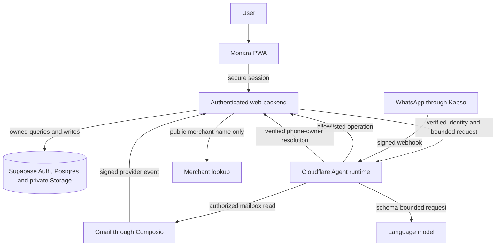
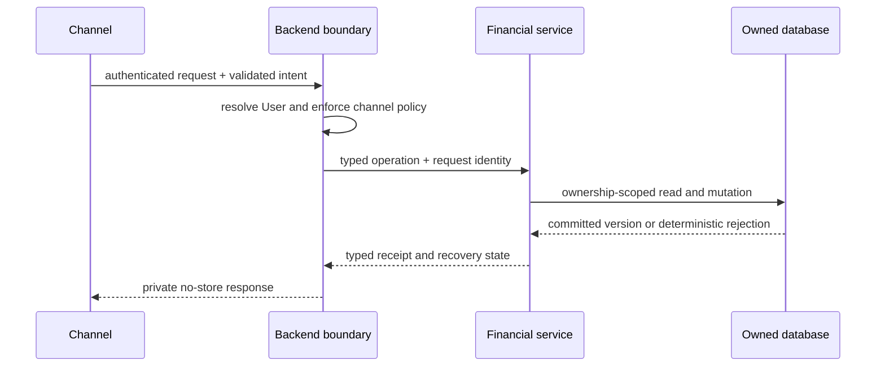
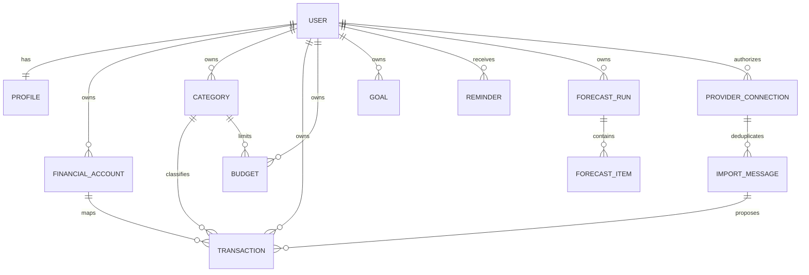
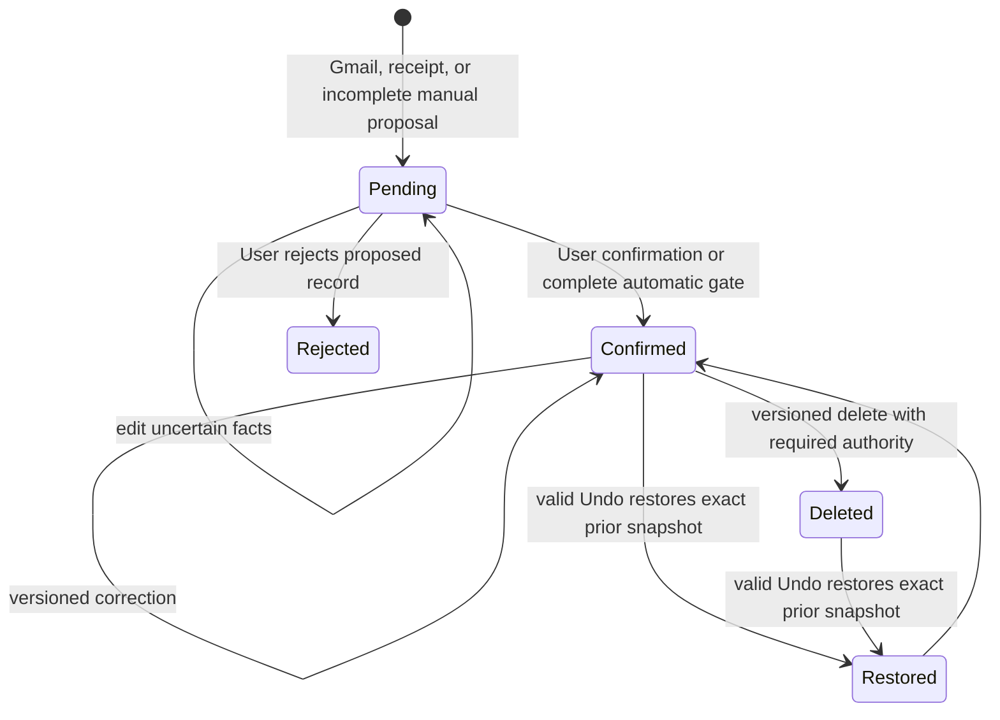
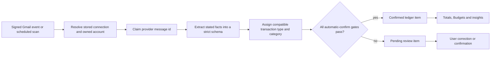
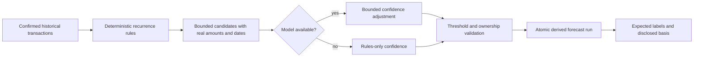
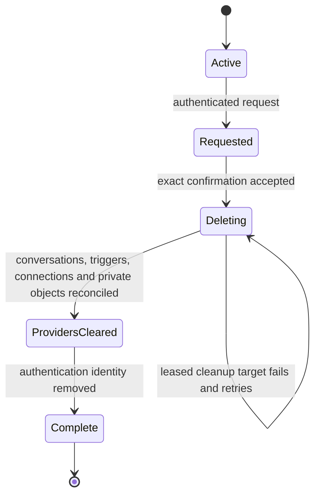

# Technical documentation

Owner: Team 808. Features: F1 to F17. Status: Final.

## Purpose

This document defines the ideal technical design for Monara, a personal-finance PWA that turns user-authorized Gmail and WhatsApp inputs into an owned financial ledger. It explains the system boundaries, data model, processing rules, recovery behavior and verification contract. It is a design specification, not a claim about any particular deployment.

The three-document package has a strict separation of responsibility:

- **Technical Documentation** defines what the system is and how it must behave.
- **Security Self-Assessment** explains threats, controls, failure behavior and residual risk.
- **Execution Evidence** defines the observable proof required before a release may be called conforming.

The authoritative financial model is deliberately small. A transaction is an **expense**, **income** or **exclusion**. An exclusion records an event such as reimbursement or movement between the User's own accounts but does not affect income, spending, Budget usage or savings calculations. A transaction is **pending** until review or a strictly gated automatic decision makes it **confirmed**.

## How it works

### System boundaries

Monara separates interactive requests, durable Agent work and financial persistence. The browser is never an authority for identity or ownership. The web backend resolves the authenticated User and owns every financial mutation. The Agent can reason and request allowlisted operations, but it cannot write directly to the database. Supabase provides authentication, relational persistence, row-level security and private object storage. Composio mediates Gmail consent, and Kapso transports WhatsApp messages.



The trust rule is consistent across every path: **external input may propose data, but only authenticated backend policy may create authority**.

### Component responsibilities

| Component | Owns | Must never own |
| --- | --- | --- |
| Browser PWA | Presentation, temporary drafts, explicit User intent | Provider secrets, trusted User identifiers, direct financial writes, private offline caches |
| Web backend | Session verification, ownership checks, validation, financial services, provider connection state | Unbounded model reasoning |
| Agent runtime | Conversation planning, extraction orchestration, queues and schedules | Direct ledger access, identity proof, unrestricted tools |
| Database | Durable records, constraints, row-level security, idempotency and atomic functions | Provider credentials or raw email content |
| Gmail and WhatsApp adapters | Consent, transport and normalized provider events | Financial decisions |
| Model provider | Structured proposals within schemas | Identity, ownership, amounts not present in source data, final destructive authority |

### Runtime topology and deployment contract

The production design uses two independently deployable runtimes because interactive finance requests and durable background work have different failure modes. The web application runs the browser interface and the authenticated backend. The Agent runtime hosts conversational reasoning, provider queues and scheduled work. Supabase supplies authentication, relational state and private object storage. A deployment is complete only when all three planes identify the same reviewed release and their contracts are compatible.

| Plane | Runtime responsibility | Availability requirement | Security boundary |
| --- | --- | --- | --- |
| Web and API | Render the PWA, verify browser sessions, enforce same-origin mutation policy and execute financial services | Interactive requests return a definite success, safe rejection or recoverable unknown state | Browser data is untrusted; identity is resolved from the server session |
| Agent and queues | Plan conversations, validate tools, process Gmail jobs, process WhatsApp messages and run schedules | Work is leased, bounded and retryable; duplicate delivery is harmless | Model output is untrusted; the Agent has no direct financial database authority |
| Data plane | Store owned records, enforce constraints and provide private objects | Mutations are atomic at their declared boundary and query results are ownership scoped | Row-level security and composite ownership remain active even when application checks exist |
| Provider plane | Deliver Gmail events, WhatsApp events, model responses and merchant context | Provider failures remain visible and receive capped retry treatment | Provider credentials stay server-side and provider responses never become authorization |

The web and Agent communicate through a versioned operation protocol. Every request identifies the operation, channel, request identity and validated arguments. The backend resolves the effective User from authenticated context, never from model text. Responses contain a typed result, a stable error class and, for write operations, enough receipt information to reconcile or reverse the action. Neither runtime returns raw provider response bodies to the browser.

Configuration follows a fail-closed contract:

- public browser configuration contains only the Supabase project URL and publishable key;
- service-role, provider, model and inter-service credentials exist only in server environments;
- development, preview and production use separate credentials and data planes;
- missing required configuration disables the affected integration instead of returning simulated success;
- deployment health confirms configuration presence and contract compatibility without disclosing a secret;
- schedules and queue consumers are released together with the operations they invoke.

### End-to-end request lifecycle

Every state-changing journey follows the same sequence even when it begins in a different channel:

1. **Receive.** Accept a browser request, signed provider event or leased background job.
2. **Authenticate the channel.** Verify the web session, provider signature, stored connection or service capability.
3. **Resolve identity.** Derive the User and channel from trusted server state.
4. **Validate intent.** Parse a strict contract and reject unknown fields, unsupported operations and invalid money or dates.
5. **Authorize resources.** Load owned records and verify the complete relationship, including account, Category, Budget, Goal and connection ownership.
6. **Apply policy.** Enforce review state, permission tier, confirmation, confidence gate, version and rate limit.
7. **Execute once.** Use one idempotency identity and an atomic repository operation for the declared effect.
8. **Record the result.** Store the resulting version, receipt or terminal import state without private payload logging.
9. **Reconcile presentation.** Refresh authoritative state and show success, failure or an explicit unknown-result recovery path.



Reads never rely on a resource identifier alone. Mutations additionally require current version information where stale editing would be unsafe. If the caller loses a response, it reconciles by request identity or authoritative read before it offers another mutation. This is the shared reliability rule for manual UI actions, Agent tools, Gmail imports, scheduled forecasts and deletion cleanup.

### Data classification and minimization

Monara handles four data classes and gives each a different retention and transport rule.

| Class | Examples | Storage and transport rule |
| --- | --- | --- |
| Public product assets | Icons, fonts, manifest and generic offline page | May be cached and served without credentials after MIME validation |
| Account metadata | Profile name, verified channel status and provider connection state | Private, owner scoped and never embedded in public cache entries |
| Financial data | Transactions, Budgets, Goals, forecasts, receipts and review state | Private, non-cacheable, integer-safe and available only through authenticated services |
| Credentials and provider authority | Service-role key, provider key, model key, connection token and signing secret | Server-only; never returned, persisted in a financial row or written to application logs |

Only the minimum context needed by an integration leaves the backend. Merchant enrichment receives a normalized public merchant name, not a ledger row. The model receives bounded facts for one task, not an unrestricted account export. Operational logs use request IDs, durations, counts and stable error classes. Raw emails, receipt bytes, conversation text, authentication headers and financial payloads are excluded from routine logs.

### Canonical data model

Every private record is owned by exactly one User. Relationships between owned records carry the owner as part of the relationship, preventing a transaction from referencing another User's account or category even when an identifier is known.



Core invariants:

1. Monetary amounts use whole rupiah integers; unknown values remain unknown.
2. Confirmed expenses increase spending; confirmed income increases income.
3. Pending, deleted and exclusion records never affect financial totals.
4. Categories have immutable financial kinds. Expense Budgets accept expense categories only.
5. Forecasts and Goal projections are derived estimates, never ledger transactions.
6. A provider message and its extracted item index are unique, so replay cannot create another transaction.
7. Dates preserve source meaning. A stated transaction date wins; Gmail may fall back to the message arrival date in Jakarta; other unknown dates remain pending.

#### Entity responsibilities

| Entity | Authoritative fields | Important invariants |
| --- | --- | --- |
| Profile | User identity reference, display name, locale and verified preferences | One active profile per authenticated User; deletion state blocks new owned writes |
| Financial Account | Owner, account type, display name, optional institution and last-four reference, active state | No stored balance is inferred; imported items may map only to an active owned account |
| Category | Owner or immutable system preset, financial kind, icon and active state | Kind never changes after creation; archived categories remain valid for historical rows |
| Transaction | Owner, kind, cash direction, whole-rupiah amount, date, source, review state, account, Category and version | Pending values may be unknown; confirmed expense/income values must be complete; exclusions remain financially neutral |
| Budget | Owner, expense Category, whole-rupiah limit, weekly or monthly period, start anchor and warning threshold | Only confirmed expenses with the matching owned Category contribute |
| Reminder | Owner, kind, period identity, threshold or due-date basis, read/archive state | Generated warning identities are unique so retries cannot create another logical alert |
| Goal | Owner, target amount, target date, optional private image and acknowledged progress | Suggestions are derived; no record represents custody or an automatic transfer |
| Forecast Run and Item | Owner, month, basis window, candidate merchant/date/amount, confidence and generation metadata | One published run replaces the previous derived view atomically; items never affect the ledger |
| Provider Connection | Owner, provider account reference, verified address/number, status and sync cursor | The external identifier is not accepted from a caller as proof of ownership |
| Import Message | Connection, provider message identity, received time, claim state and item count | Connection plus message identity is unique; item position is stable across retries |
| Operation Receipt | Owner, request identity, operation, resource version, before/after state and expiry | A receipt can reconcile one operation; an Undo capability is short-lived and single use |

#### Transaction lifecycle

The transaction state machine separates uncertain observation from authoritative finance.



The following rules prevent presentation state from becoming financial truth:

- a pending record may retain unknown amount, date, kind, Category or account;
- a pending record never contributes to spending, income, Budgets, savings or forecast history;
- confirming expense or income requires a positive whole-rupiah amount, valid date, stated direction and compatible references;
- confirming an exclusion records the event and direction but keeps it outside financial totals;
- correction preserves the record identity and source while creating a new version;
- deletion is a state transition with an auditable receipt, not a client-side removal from a list;
- a rejected import remains represented by its terminal import outcome so provider replay cannot recreate it;
- a stale version, consumed receipt or unknown request identity fails without changing the current record.

#### Money, dates and time zones

Rupiah amounts are transported as validated decimal strings and stored as bounded integers. Arithmetic uses exact integer operations. Formatting into `Rp` labels happens only at the presentation edge. Fractions, non-finite values, unsafe conversions and unsupported currencies are rejected before a financial mutation.

Dates use calendar semantics rather than implicit browser time zones. A transaction carries its stated local date. Provider timestamps are instants and are converted to Asia/Jakarta only when the source has no transaction date and the product rule permits a fallback. Budget periods calculate inclusive boundaries from their configured anchor. Month navigation validates real calendar months and clamps shorter months deliberately rather than relying on JavaScript date normalization.

| Calculation boundary | Required behavior |
| --- | --- |
| Month start and end | Include both boundary dates and exclude every other date |
| Weekly Budget | Use one explicit seven-day interval derived from its anchor |
| Monthly payday Budget | Preserve the selected day; clamp a missing day to the last real day without drifting the next period |
| Current-period average | Include confirmed expenses only through the current local day |
| Historical comparison | Compare complete periods or equal elapsed days; state which basis is used |
| Large totals | Sum as integers beyond normal display-number precision, then format safely |
| Unknown date | Keep the record pending or exclude it from date-based calculations; never silently use today |

### Gmail ingestion and review

Gmail sign-in is separate from Monara sign-in. A User explicitly authorizes a mailbox and maps each supported sender to an owned Financial Account. Initial discovery covers the previous 30 days. Later runs use a bounded overlap so delayed messages are found without unbounded mailbox access.



Automatic confirmation is intentionally difficult. Every gate must pass:

- the provider event and mailbox connection are authentic and active;
- the sender is registered for the User's mapped Financial Account and email authentication aligns;
- the amount, IDR currency, date and cash direction are explicit in the source;
- the transaction type and Category are compatible and owned by the same User;
- extraction confidence is at least **0.95**;
- classification confidence is at least **0.95**;
- the item is still pending, has not been edited and has not already been processed.

Missing either confidence score fails the gate. A model score never compensates for a missing fact or ownership check. Items that fail any gate remain visible in the Review Queue and do not affect totals.

Categorization follows deterministic rules before model suggestions. A verified match to the User's own identity becomes the Internal exclusion category. A known incoming payment maps to an income category. Other items use the most specific compatible category supported by source evidence. Ambiguous classifications remain pending rather than falling back to an invented fact.

#### Mailbox discovery and account mapping

Connection begins with explicit Gmail consent, followed by deterministic sender discovery across a bounded 30-day window. The discovery result identifies supported institutions but does not create a Financial Account silently. The User confirms the account type and may provide a nickname or last-four reference. Subsequent extraction maps an email to that owned account through registered sender evidence and account digits stated in the message. Sender name alone identifies the institution, not the exact account.

If one active account matches, the pipeline may assign it. If several accounts could match and the message does not contain sufficient digits, the account remains unassigned and the item stays pending. Account assignment is never guessed from the most recently used wallet or from a logo. Deactivating an account prevents future automatic mapping while historical transactions preserve their reference.

#### Ingestion stages

| Stage | Input | Deterministic output | Failure behavior |
| --- | --- | --- | --- |
| Event validation | Raw provider body, signature and timestamp | Authenticated provider event with provider account and message ID | Reject before parsing or queueing |
| Connection resolution | Provider account reference | One active owned connection and sync policy | Reject unknown, replaced or inactive connection |
| Message claim | Connection, message ID and trigger/schedule reason | One durable claim and attempt identity | Existing terminal claim returns its recorded result |
| Message retrieval | Authorized connection and message ID | Minimal headers, sender evidence, provider timestamp and selected body content | Record retryable provider failure without copying the response body |
| Sender verification | From address, authentication results and institution registry | Registered institution and authenticated-sender flag | Unregistered or unaligned sender cannot auto-confirm |
| Extraction | One normalized message and strict schema | Zero or more stated transaction candidates | Schema failure or missing financial facts remains reviewable; no invented values |
| Account mapping | Candidate evidence plus active owned accounts | One owned account or explicit unknown | Ambiguity stays unassigned |
| Categorization | Candidate, owned categories and bounded merchant evidence | Compatible Category proposal and confidence | Incompatible, unknown or provider-failed result stays uncategorized |
| Recording | Stable message claim and item index | One pending or confirmed transaction plus terminal import status | Unique conflict returns the canonical existing row |

The pipeline processes independent messages concurrently with a bounded worker pool. Concurrency is high enough to reduce mailbox latency but never unbounded. A job receives a fixed provider-call budget, deadline and maximum attempt count. Rate-limit responses preserve provider retry guidance. An oversized batch is split before provider work so each invocation stays inside runtime limits.

#### Deduplication and replay safety

Two independent keys prevent duplicate financial effects:

1. **Provider identity:** connection plus provider message ID identifies the email event.
2. **Item identity:** message claim plus stable item index identifies each extracted transaction within a multi-transaction email.

The transaction fingerprint, including owned account, amount, source date and reference when available, is a secondary diagnostic and reconciliation signal. It does not silently merge distinct provider messages because two legitimate transactions can share the same amount and day. Concurrent trigger delivery, scheduled overlap and a User retry therefore converge on one canonical claim and one row per extracted item.

The scheduled scan keeps a bounded overlap with the last successful cursor. A newly connected or newly mapped account receives a 30-day lookback once; later scans advance from the stored cursor while retaining enough overlap to recover delayed mail. Each run records counts for listed, claimed, imported, pending, confirmed, skipped and failed messages. A partial provider page never advances the cursor past unprocessed mail.

#### Review behavior and correction feedback

Review presents the source channel, stated facts and uncertainty without exposing a numerical confidence score as a substitute for judgment. The User may correct, confirm, classify as exclusion or reject an item. Corrections update the owned record through optimistic concurrency and never change its provider identity. A later pipeline attempt sees that the User edited or resolved the item and cannot overwrite the decision.

Automatic-confirm quality is monitored through later User corrections. A release defines an approved correction-rate limit and enough observations before the 0.95 threshold is treated as calibrated. Exceeding that limit disables automatic confirmation while keeping ingestion and review available. The system prefers extra review work over a false confirmed expense or income.

### WhatsApp and receipt ingestion

A WhatsApp number becomes an identity signal only after the signed-in User completes a short-lived verification challenge. Incoming webhooks require a valid signature and freshness window before sender resolution. Text conversations use the same Agent permissions as web Chat.

Receipt media is accepted only from the configured provider origin, without redirects, within a strict byte limit, and as JPEG, PNG or WebP. Extracted facts pass the same schema and ownership checks as Gmail. Every receipt-created transaction remains **pending**, regardless of model confidence, because an image provides weaker sender and account context. Unreadable or incomplete images create no confirmed financial state.

#### WhatsApp identity and ordering

Linking begins inside the authenticated Profile. The backend creates a short-lived challenge, and only possession of the matching WhatsApp number can complete it. The resulting link stores a recoverable encrypted number and a lookup representation needed for inbound resolution. A caller-supplied phone number never selects a User.

The webhook pipeline verifies the provider signature against the exact raw body and checks freshness before it parses messages. It ignores outbound echoes and unsupported event shapes. Each provider message identity is deduplicated. A per-User conversation queue preserves order so a later message cannot overtake the response to an earlier one. Redelivery after a successful reply returns the stored terminal outcome rather than running the model again.

Conversation memory is private and bounded. Recent turns may be retained for continuity, but financial operation receipts remain structured objects rather than becoming trusted free-form text. After the inactivity window, transient WhatsApp context expires. Web Chat history is persistent for the signed-in User and supports explicit conversation boundaries; restoring history never restores an expired destructive confirmation.

#### Receipt parsing contract

Receipt processing separates media handling from financial interpretation:

1. authorize the linked sender and fetch media only from the approved provider host;
2. refuse redirects, unsupported MIME, mismatched file signatures and oversized content;
3. send a bounded image plus task schema to the model;
4. validate merchant, amount, currency and date independently of the model's prose;
5. map an account only when exactly one owned account fits the evidence;
6. create one pending transaction using the provider message identity as request identity;
7. reply with the parsed result, missing fields and an explicit review or Undo path.

An image-only message is a valid receipt request. A non-receipt image, unreadable amount, future date without source support or foreign currency that cannot be represented creates no invented rupiah transaction. If an otherwise valid receipt lacks a unique account, the pending proposal remains unassigned and asks the User which account paid.

### Agent execution model

The Agent uses a plan–validate–execute–explain loop:

1. Parse the User's request and current conversation context.
2. Select only a registered tool.
3. Validate tool arguments against a shared schema.
4. Apply the permission tier outside the model.
5. Resolve identity and ownership in the backend.
6. Execute one bounded operation with an idempotency key.
7. Return a receipt containing the result and recovery options.

| Tier | Meaning | Examples | Enforcement |
| --- | --- | --- | --- |
| T0 | Read-only | Summary, ledger query, Budget usage, forecast | Executes after schema, identity and ownership checks |
| T1 | Reversible write | Add or edit a transaction, confirm review, create or edit a Budget | Executes once and returns an Undo receipt with expiry and version binding |
| T2 | Destructive write | Delete transaction or Budget | Requires a backend-issued, owner-bound, single-use confirmation before execution |
| T3 | Account or provider administration | Connect or disconnect Gmail, link WhatsApp, export, permanent account deletion | Never exposed as an Agent tool; available only in the authenticated settings interface |

The model cannot change a tier, manufacture a confirmation or expand the tool registry. A confirmation is bound to one User, action, resource version and short expiry. Replayed, stale or cross-User confirmations fail without mutation.

#### Tool protocol and response semantics

Tool definitions are generated from shared validation contracts and expose only fields the model may choose. User identity, channel authority, request identity, provenance and ownership metadata are injected by trusted code. Unknown keys are rejected. Backend responses are validated again before any content becomes model context.

| Result class | Agent behavior | User-facing behavior |
| --- | --- | --- |
| Definite success | Store typed receipt and updated resource version | Explain exactly what changed and show Undo when eligible |
| Definite rejection | Do not retry automatically | Explain the safe reason, such as invalid input, missing ownership or expired confirmation |
| Rate limited or temporarily unavailable | Preserve bounded retry guidance | Ask the User to retry later without implying a write occurred |
| Unknown write outcome | Stop further writes and reconcile by request identity | State that completion is being checked; never fabricate success or send a new mutation |
| Stale resource | Return the current version without overwriting it | Ask the User to review the newer state |

T0 includes read and disposable derived computation. It cannot alter a transaction, Budget, Goal, identity or provider connection. A forecast refresh may replace derived forecast rows because they are reproducible projections outside the authoritative ledger. T1 operations are reversible only when their receipt can restore the exact prior state; unsupported or externally irreversible actions never enter T1 merely because the model describes them as reversible.

T2 is a two-step protocol. The first request validates ownership and produces a confirmation proposal with a short display summary. The second request must present the matching server-held confirmation while it is unused, unexpired and bound to the current resource version. Generic words such as “yes” in another turn have no authority. Confirmation consumption and the destructive operation are coordinated so replay cannot produce another effect.

T3 remains outside conversation tooling. Connecting or disconnecting a provider, exporting private data and deleting an account require the authenticated settings interface and explicit User interaction. The Agent may explain where the setting exists but cannot invoke a hidden backend endpoint.

#### Prompt and model boundary

System instructions improve behavior but are not a security control by themselves. Email bodies, receipt text, merchant pages, previous conversation turns and tool output are all labelled as data. The model receives an allowlisted tool registry and bounded context. Deterministic code then enforces schema, tier, identity, ownership, confirmation and financial invariants even when the model follows a malicious instruction.

Model availability is optional for correctness. Deterministic account matching, exact financial arithmetic, review rules and permission checks continue without it. When classification or conversational generation is unavailable, the system produces a safe review state or a clear degraded response. It never promotes an uncertain result merely to keep automation moving.

### Budgets, insights, forecasts and Goals

Only confirmed expenses feed Budget usage. Weekly and monthly periods use explicit calendar boundaries. Threshold Reminders are deduplicated by Budget, period and threshold so retries do not create multiple alerts.

Financial insights remain reproducible:

- **Savings rate** = confirmed income minus confirmed expenses, divided by confirmed income.
- **Safe to spend** = remaining applicable Budget allowance divided by inclusive remaining days.
- **Overspend forecast** extrapolates the confirmed spending pace and exposes its basis.
- **Unusual transaction** compares an expense with a sufficient history window and category median.
- **Budget suggestion** uses recent confirmed expenses and remains a proposal until the User saves it.

Forecasting is rules-first. Recurring merchant patterns create candidates from confirmed history and real prior amounts. The model may adjust confidence inside a narrow band but cannot add merchants, dates or amounts. Low-confidence candidates are omitted and counted as omitted. Forecast items are labelled expected and never enter spending totals.

Goals describe a desired purchase or savings target, optional private image, target date and manually acknowledged progress. Income, expense and Budget history may suggest a sustainable contribution pace, but Monara never moves money automatically or presents a projection as a balance.

#### Budget periods and alerts

A Budget belongs to one expense Category and declares a limit, period kind, anchor and warning threshold. Calendar-month Budgets begin on the first day. Payday Budgets begin on a chosen day and cross months when necessary. Weekly Budgets preserve a seven-day cycle independent of the selected report month. Usage is calculated from the Budget's true active interval, not from whatever month happens to be visible in the interface.

| Budget state | Condition | Presentation and notification behavior |
| --- | --- | --- |
| Not started | Current local date precedes the active interval | Show the start date; do not inflate current headroom |
| Healthy | Usage below warning threshold | Show exact used and remaining amounts |
| Near limit | Usage reaches warning threshold but remains below limit | Create one deduplicated warning for the period and threshold |
| At limit | Usage equals the limit exactly | Distinguish equality from overspending |
| Over budget | Usage exceeds the limit | Show exact excess and one deduplicated over-budget update |
| Paused | Budget is inactive | Preserve history but exclude it from current guidance and alerts |

Reminder delivery observes User preferences, verified channel status, quiet hours and a daily cap. A reminder is claimed before delivery, and stale claims become retryable only after their lease expires. A provider timeout with an unknown send outcome is reconciled rather than resent blindly. Read and archive state changes presentation only; they never mark a bill as paid or alter the financial ledger.

#### Reproducible insight formulas

Every insight exposes the basis that produced it. No label such as “safe”, “unusual” or “likely” can hide a missing denominator or insufficient history.

| Insight | Input population | Formula and guard |
| --- | --- | --- |
| Spending | Confirmed expense records in the selected period | Exact integer sum; excludes income, exclusion, pending, deleted and invalid records |
| Income | Confirmed income records in the selected period | Exact integer sum with the same calendar boundary rules |
| Net | Confirmed income minus confirmed expenses | A flow result, never presented as an account balance |
| Savings rate | Confirmed income and expense | `(income - expense) / income`; unavailable when income is zero or missing |
| Safe to spend | Active applicable limits and all confirmed current-period expenses | Remaining total allowance divided by inclusive remaining days; zero when exhausted |
| Overspend forecast | Current confirmed pace, period length and Budget limit | Projected period-end usage minus limit; labels the as-of date and basis |
| Unusual transaction | Confirmed expense plus sufficient comparable category history | Compare with robust historical median and minimum sample size; unavailable otherwise |
| Budget suggestion | Recent complete confirmed expense periods | Proposal based on recent distribution and variability; requires explicit User save |

Dashboard, History, Reports and Budget details read the same authoritative ledger and shared aggregation rules. Filters change the listed rows, not the headline total for the selected period unless the interface explicitly labels a filtered subtotal. Equal-name custom categories remain distinct by identifier. Renaming a Category updates its label without moving history into another Category.

#### Forecast lifecycle

Forecast candidates are generated from recurring evidence in confirmed history. The deterministic stage identifies merchant, cadence, next date and prior real amount. Model refinement may adjust only confidence inside an allowed range. It cannot invent a candidate, merchant, amount or date. Publishing a run replaces the previous month's derived items atomically so the interface never mixes two runs.



The forecast scheduler refreshes only Users whose view is missing, stale or belongs to a completed month. It processes a bounded batch and cannot starve later Users indefinitely. Manual refresh has a cooldown and per-User limit. Provider failure retains the previous valid run with a freshness warning rather than clearing the page or inserting invented predictions.

#### Goal Planner

A Goal is a planning record for a desired purchase or savings target. The User provides the name, whole-rupiah target, optional target date and optional image. Images are validated by length and file signature, stored in a private owner-scoped bucket and served through short-lived signed access. Replacing or deleting an image schedules cleanup of the previous object; an abandoned upload is also reconciled.

Goal intelligence uses the most recent complete 90-day window of confirmed income and expenses. It calculates available historical surplus and distributes a suggested contribution pace across active Goals. Pending records, exclusions, negative surplus and unavailable history never become imaginary savings capacity. Rounding allocates every rupiah deterministically while preserving the total suggested surplus.

| Goal output | Meaning | What it must not imply |
| --- | --- | --- |
| Required pace | Target remaining divided by time remaining | A guaranteed ability to save |
| Suggested contribution | Conservative share of recent confirmed surplus | Money was moved or reserved |
| Projected completion | Date implied by current acknowledged progress and contribution pace | A bank balance or investment return |
| Shortfall | Difference between required and suggested pace | Advice to borrow or purchase anyway |

Progress is acknowledged manually. Monara does not custody funds, initiate transfers or infer that spending less automatically funded a Goal. Editing a transaction recomputes future suggestions but never rewrites acknowledged Goal progress.

### Interface and PWA behavior

The interface is mobile-first but uses the same financial model at every viewport. Protected routes wait for a verified session and a complete owned snapshot. A failed authenticated load never falls back to sample finance. The public demo is clearly labelled, uses synthetic in-memory data and cannot call private financial operations.

Primary surfaces have distinct responsibilities:

| Surface | Primary question | Data contract |
| --- | --- | --- |
| Home | What needs attention now? | Current confirmed totals, actionable review count, Budget status and concise derived insights |
| History | What happened and what is pending? | Paginated owned ledger with stable filters and exact transaction state |
| Reports | How did money flow over time? | Complete period aggregates, category identity and drill-downs back to canonical transactions |
| Budgets | What limits apply and how are they progressing? | Active period boundaries, exact usage, warning state and editable owned resources |
| Goals | What am I planning for? | Target, progress, private image and transparent contribution suggestion |
| Chat | What can Monara explain or do? | Private conversation history, bounded tools, operation receipts and visible confirmation state |
| Profile and Connections | Who am I and which channels are authorized? | Session identity, Gmail connection, WhatsApp Link, owned accounts/categories and deletion entry point |

Mutation interfaces preserve the User's draft after validation errors. They block repeated taps before rendering completes, carry the reviewed resource version and distinguish three outcomes: rejected before dispatch, definitely saved, or uncertain because the response was lost. The last outcome locks further writes until reconciliation. Toasts and Chat receipts explain the authoritative result and surface a valid Undo without covering navigation on small screens.

Accessibility is part of the component contract. Controls have semantic labels and keyboard operation; charts expose equivalent text and keyboard selection; dialogs retain focus; color is not the only state signal; motion respects reduced-motion preferences; and minimum touch targets survive the 390-pixel mobile layout. Amount hiding affects visual presentation and screenshots but never changes stored values.

The service worker caches only a named allowlist of public assets: manifest, application icons, fonts and a generic offline page. It performs credential-free public fetches, validates successful MIME types and removes obsolete Monara caches during activation. Personalized navigation, authentication routes, React Server Component responses, financial APIs and `private` or `no-store` responses bypass caching. Offline private navigation therefore returns a generic unavailable state, never an old account screen.

### Recovery and deletion

Every mutation carries a request identifier. Repeating the same request returns the original result or a safe conflict rather than creating a second financial event. Optimistic versions prevent stale edits. Undo restores the exact prior snapshot atomically and consumes its receipt once.

If a response is lost, the interface first reconciles server state. It does not silently issue a new mutation. Queue jobs use bounded concurrency, leases, capped retries and exponential backoff. Unknown provider outcomes are reconciled before retry.

Permanent deletion requires a current authenticated session, explicit acknowledgement and an exact confirmation phrase. Acceptance immediately revokes access and stops background work. Durable cleanup removes Monara-controlled financial data, conversations and private images, disconnects provider access, then removes the authentication identity. Completion is reported only after every first-party target is reconciled; provider-retained messages and backups follow their published retention boundaries.

#### Idempotency and concurrency

Idempotency is defined at the business-operation boundary, not only at the HTTP request. Each create or provider event has a stable request identity. Reusing the identity with the same validated input returns the original result. Reusing it with different input fails as a conflict. Update and delete operations additionally compare the expected resource version so a retry cannot overwrite a newer User action.

| Race or interruption | Required resolution |
| --- | --- |
| Two browser taps create the same resource | One request identity, one resource and one receipt |
| Provider sends the same event concurrently | One durable claim and one terminal item per stable index |
| Response disappears after commit | Reconciliation returns the committed result; no second mutation is sent |
| Two edits use the same old version | One succeeds; the other receives a stale conflict with current state |
| Undo races with a newer edit | Version binding prevents the Undo from overwriting the newer edit |
| Queue worker dies after acquiring work | Lease expiry makes the same job recoverable without duplicating terminal state |
| Deletion starts while background work exists | Deleting identity fence prevents new owned writes; remaining cleanup is retried |

Atomicity is stated narrowly. One database function can atomically update financial state and its local receipt. A third-party revocation and a database transaction cannot share one atomic commit. Such workflows use a durable state machine, record unfinished targets and report completion only after reconciliation.

#### Permanent deletion state machine



Acceptance and completion are different events. Acceptance immediately invalidates active sessions, blocks sign-in state from reaching finance, stops scheduled work for the User and fences every owned write. Cleanup inventories known first-party and provider targets. Each target records pending, leased, completed or failed-retryable state. A worker can resume after interruption without forgetting which targets remain.

The deletion boundary is explicit. Monara removes application rows, private object storage, stored conversations, provider connections under its control and its authentication identity. It requests provider disconnection where supported. It does not delete source Gmail messages, the Google account, already delivered WhatsApp messages, public merchant facts or externally managed backups outside the documented retention process.

Re-registering with the same external identity after completed deletion creates a new empty Monara account. Old preferences, ledger records, Goal images, provider links and conversation history are not restored.

### Operations and observability

Operational telemetry must be useful without becoming another private data store. Each runtime emits structured events containing a stable event name, request or job identity, stage, duration, attempt count, outcome class and bounded counts. Logs exclude message bodies, prompts, transaction descriptions, amounts, email addresses, phone numbers, cookies, tokens and authorization headers.

Key service indicators are grouped by boundary:

| Boundary | Indicators | Alert condition |
| --- | --- | --- |
| Web finance | authenticated error rate, stale conflicts, uncertain writes and latency | Sustained failure or an increase in unresolved writes |
| Gmail | event-validation failures, list/read latency, claim conflicts, pending rate, auto-confirm correction rate and queue age | Backlog, provider limit, unexpected confirmation rate or duplicate invariant failure |
| WhatsApp | signature failures, sender-resolution failures, ordered queue age, media rejection and send reconciliation | Replay pattern, unresolved send outcome or per-User queue growth |
| Agent/model | tool validation failures, unsupported operation attempts, step count, provider rate limit and no-action completion | Tier escalation attempt, repeated model failure or provider budget exhaustion |
| Database | RLS denial, ownership constraint failure, lock wait, function error and migration version | Foreign ownership attempt, schema drift or elevated write failure |
| Deletion | accepted accounts, pending targets, lease age and retry count | Any cleanup target exceeds its service objective |

Health endpoints reveal service name, compatible revision and coarse configuration readiness only. They never disclose secrets, User counts or provider identifiers. A deployment verification checks the exact web and Worker revisions, required schedules, protected maintenance routes and migration state before release acceptance.

Rate limits apply at several layers: per-User interactive operations, per-source webhooks, provider-call budgets, bounded queue concurrency and global service budgets. A distributed store backs limits that must hold across instances. Rejections return stable retry guidance. Limits protect availability but never replace identity, ownership or idempotency.

### Degraded operation

Monara keeps financial truth usable when an optional dependency fails.

- If the model is unavailable, deterministic reads, arithmetic and existing ledger operations remain available; uncertain imports stay pending.
- If merchant lookup fails, the transaction remains uncategorized or uses only existing deterministic evidence.
- If Composio is unavailable, existing finance remains readable and the Gmail connection reports a degraded state; scheduled overlap recovers later.
- If Kapso is unavailable, web use remains available and outbound delivery remains pending rather than marked sent.
- If the Agent Worker is unavailable, direct authenticated finance operations remain available; Chat reports unavailability without simulating a reply.
- If Supabase is unavailable, protected financial surfaces fail explicitly and never substitute demo data.
- If the browser is offline, only public cached assets and a generic offline state are shown.

Recovery favors consistency over availability for write-bearing actions. Read-only stale derived data may remain visible with an age label, but authoritative balances, transaction state and provider connection status are never fabricated.

## Key decisions

- **One backend owns financial truth.** Web, Gmail, WhatsApp and Agent requests converge on the same validated services.
- **Uncertainty remains visible.** Missing facts and weak confidence create pending review instead of invented values.
- **Exclusion replaces transfer accounting.** Movement between the User's own accounts remains auditable without double-counting income or expense.
- **Deterministic gates surround model reasoning.** Models propose; schemas, ownership, confidence thresholds and permission tiers decide.
- **Derived information stays separate from the ledger.** Forecasts, suggestions and Goal projections cannot silently become transactions.
- **Idempotency is a data invariant.** Provider replay, queue retry and double-click behavior are safe by construction.
- **Offline mode is public-only.** The service worker may cache the shell and generic offline assets, never authenticated pages, API responses or financial data.

### Decision record summary

| Decision | Rejected alternative | Reason and consequence |
| --- | --- | --- |
| Backend-owned financial services | Browser or Agent writes directly to Supabase | Centralizes validation, ownership, versioning and receipts; every channel shares the same invariants |
| Separate web and Agent runtimes | Put all background work inside interactive server functions | Queues, schedules and per-User ordering need durable execution independent of page requests |
| Provider-managed Gmail OAuth | Store Google refresh tokens in Monara | Reduces credential custody; provider retention and availability remain explicit dependencies |
| Signed events plus scheduled overlap | Trust a webhook alone or scan the entire mailbox repeatedly | Fast imports recover after missed delivery while preserving bounded access and duplicate safety |
| Pending as a first-class state | Fill missing values or reject every incomplete event | Preserves source evidence and allows User correction without polluting totals |
| Expense, income and exclusion | Model internal transfers as paired income/expense or a second transfer ledger | Keeps one auditable transaction model and prevents self-movement from double-counting finance |
| Immutable Category kind | Infer type from display name or allow type mutation | Keeps historical arithmetic stable and makes Budget compatibility deterministic |
| T0–T3 operation tiers | Let prompt wording decide sensitivity | Makes authority inspectable and enforceable outside the model |
| Undo receipts and optimistic versions | Blind retry or unrestricted rollback | Supports recovery without overwriting newer state |
| Rules-first forecasting | Let a model invent predictions from a full ledger | Keeps amounts and dates grounded in confirmed history and preserves reproducibility |
| Private Goal storage | Public image URLs | Owner checks and signed expiry apply to personal planning media |
| Public-only service worker | Cache authenticated pages for convenience | Avoids persisting financial or identity state in browser caches |
| Leased deletion workflow | Report success after the relational transaction | Keeps unfinished provider and object cleanup visible and retryable |

The decisions optimize for a competition-scale personal-finance assistant without pretending to be a bank core. Monara records and explains personal finance; it does not hold funds, initiate bank transfers, store card credentials or provide guaranteed investment outcomes.

## Security and risks

Security is layered across identity, ownership, input validation, database constraints, provider verification, tool permissions and recovery. No single token, model response or browser field is sufficient to authorize a financial action. Sensitive credentials remain server-side, private responses are non-cacheable, logs contain operational metadata rather than financial content, and security failures leave financial state unchanged.

Residual risk remains even in the ideal design: provider retention is outside Monara's direct control; model output can be wrong despite strict gates; a compromised authenticated session can issue valid User actions; distributed denial of service can degrade availability; and backups may outlive active records. The Security Self-Assessment defines these risks and their acceptance conditions without duplicating implementation detail.

### Technical control layers

| Layer | Control | Failure result |
| --- | --- | --- |
| Identity | Verified session, linked phone challenge, stored provider connection and scoped service capability | No User is resolved; operation stops |
| Input | Strict schemas, whole-rupiah bounds, real calendar dates, MIME/signature/size limits and unknown-field rejection | Invalid input is rejected before an owned write |
| Ownership | Backend repository filters, composite owner relationships, row-level security and private object paths | Foreign resource appears absent or forbidden; no mutation occurs |
| Financial integrity | Transaction state machine, compatible Category kinds, complete confirmation facts and exact arithmetic | Item remains pending or mutation fails atomically |
| Model authority | Registered tools, tier checks, bounded context and backend confirmation | Unsupported or escalated request produces no tool effect |
| Provider integrity | Raw-body signatures, freshness, origin allowlists, stored connection resolution and replay keys | Event is rejected or converges on an existing result |
| Recovery | Request identity, optimistic version, Undo binding, queue lease and reconciliation | Duplicate or stale work does not create another financial effect |
| Privacy | Server-only credentials, private no-store responses, content-free logs and public-only caching | Sensitive content is not returned to an unauthorized or offline surface |

The design assumes the deployment platform, database provider and configured integration control planes operate according to their published isolation guarantees. Compromise of a User's unlocked device or a provider control plane remains outside what application logic alone can prevent. Those assumptions are disclosed and tested through failure behavior where practical.

## How to verify

Verification must cover the same boundaries described above rather than relying on a successful build alone:

1. Replay the database schema from zero and prove row-level security, composite ownership, typed Category compatibility and unique import keys with two isolated Users.
2. Exercise valid, invalid, stale and replayed provider events. Confirm that only stored connections and verified sender mappings can reach ingestion.
3. Test the Gmail gate at 0.9499 and 0.95 for both scores, plus missing facts, missing scores, sender-authentication failure, stale edits and duplicate messages.
4. Test Agent tiers with spoofed identity, cross-User identifiers, prompt injection, stale confirmations and repeated Undo.
5. Verify exact financial totals across pending, confirmed, exclusion and deleted records, including boundary dates and large integer amounts.
6. Run queue interruption and unknown-result recovery tests without producing duplicate writes.
7. Inspect mobile and desktop flows for keyboard access, clear review state, no horizontal overflow and truthful degraded states.
8. Confirm the service worker stores only allowlisted public assets and returns no personalized response while offline.
9. Complete provider connection, receipt, reminder and deletion journeys with synthetic accounts and redacted artifacts.
10. Record the results using the case identifiers and evidence rules in the Execution Evidence document.

### Reproducible verification sequence

Run the release gates from a clean checkout with the supported runtime and immutable dependency lock:

```sh
pnpm install --frozen-lockfile
pnpm check
pnpm build
pnpm docs:check --final
pnpm docs:pdf --final
```

Run database verification against an isolated disposable stack:

```sh
pnpm db:start
pnpm db:check --reset
pnpm db:types --check
```

The database run must begin from zero, apply every migration in order, run lint at the configured failure level and execute ownership, RLS, Gmail, Budget, forecast, Goal, deletion and storage assertions. It must create two synthetic Users and test both directions of foreign access. A passing migration replay does not by itself prove the hosted database is at the same revision.

Run browser verification at mobile and desktop widths. The minimum journey covers sign-in boundary, Home, Review, History, Reports, Budgets, Goals, Chat, Profile, provider connections, offline navigation and deletion entry. Record console errors, page errors, failed network requests, horizontal overflow, keyboard operation, focus return and visible recovery state. Use synthetic or redacted values.

Run provider and Agent verification with dedicated test identities:

1. connect a test Gmail mailbox and record provider consent separately from application sign-in;
2. deliver known valid, invalid, stale and replayed Gmail events;
3. test 30-day first sync, incremental overlap, multi-item mail and account ambiguity;
4. link a test WhatsApp number, validate sender resolution and exercise signed, unsigned, stale and replayed events;
5. send allowed, redirected, oversized, wrong-MIME and unreadable media;
6. run normal Agent tasks and adversarial prompts across T0–T3 boundaries;
7. interrupt writes before dispatch, during execution and after commit, then reconcile;
8. execute the full deletion workflow with injected provider and private-object failures.

### Production acceptance

A production release is acceptable only when the evidence names one immutable web revision, one compatible Worker revision and one database migration state. Production checks repeat the public authentication boundary, owned read paths, provider connection, signed webhook behavior, private caching rules, schedules, health endpoints and a controlled set of synthetic mutations. High-impact destructive and cross-User cases use dedicated synthetic tenants and pre-approved fixtures.

For each case, retain:

- case ID and narrow control objective;
- environment and immutable release identity;
- precondition, action and expected result;
- observed status and exact state delta;
- redacted screenshot, structured assertion or provider receipt;
- timestamp, reviewer and artifact checksum;
- any exception, residual risk and decision.

Screenshots support visible-state claims. They do not substitute for database isolation, provider authenticity, idempotency or deletion evidence. A successful local gate does not become a production observation. The Execution Evidence document owns the final case matrix and release decision.

A release conforms only when every mandatory case has a dated artifact, an identifiable release, an expected result and an observed result. The absence of evidence is not a pass.

The production acceptance review is performed by plane so that a healthy user interface cannot conceal an incompatible Worker, database or provider configuration:

| Acceptance plane | Required production proof | Blocking condition |
| --- | --- | --- |
| Web release | Immutable revision, successful build, public availability and correct private-route behavior | Revision is unknown, deployment is degraded or a private route exposes personalized content |
| Agent release | Compatible operation-contract version, health response, bounded execution and scheduled jobs | Worker and web contracts differ, health is unavailable or a protected route accepts anonymous access |
| Database | Ordered migration inventory, generated-type agreement, RLS/ownership evidence and backup readiness | A migration is missing, types drift, foreign access succeeds or recovery is untested |
| Gmail | Intended production auth configuration, stored owned connection, signed callback path and replay protection | Connection is ambiguous, callback origin is wrong, authenticity fails or duplicate processing creates a second item |
| WhatsApp | Verified phone link, signed webhook, safe media path and bounded outbound delivery | Sender is unresolved, signature/freshness fails open or unsafe media reaches extraction |
| Model | Approved endpoint/model family, registered tool set, bounded context and permission-tier enforcement | Model or tool inventory is unknown, arbitrary tools execute or model text bypasses backend policy |
| Browser and PWA | Mobile/desktop journeys, private no-store responses, public-only service-worker cache and generic offline state | Financial or identity data persists in a public/offline cache or a primary journey is unusable |
| Recovery | Request identities, queue leases, reconciliation, Undo and deletion-resume evidence | Unknown outcomes are blindly retried or cleanup is reported complete with an unresolved target |
| Observability | Content-free logs, alert ownership, queue/provider signals and evidence retention | Operators cannot distinguish healthy, delayed and failed states without exposing private content |

### Operational handoff

The release handoff gives the operator enough information to run the system without granting broader authority than the application needs. It includes the immutable release manifest, compatible contract versions, migration state, scheduled-job inventory, provider callback origins, secret owners, rate-limit budgets, alert routes, backup/restore procedure and the case matrix used for acceptance. Secret values, raw provider payloads and User financial records are never part of the handoff document.

The first-response runbook uses the same failure vocabulary shown to the User:

1. **Unavailable.** Confirm deployment health and dependency reachability. Do not claim that a write failed until reconciliation has checked its request identity.
2. **Delayed.** Inspect queue age, lease ownership, provider retry windows and budget exhaustion. Preserve the existing work identity when resuming.
3. **Rejected.** Identify the deterministic boundary that rejected the operation: identity, schema, ownership, permission tier, signature, freshness, confidence or state transition.
4. **Needs review.** Keep the financial item pending and show the missing or ambiguous fact. Never manufacture the value to clear the queue.
5. **Partially deleted.** Maintain access revocation, expose deletion as in progress, retry only unfinished targets and reconcile every provider/private-object result.
6. **Recovered.** Record the final state, request identity, affected release and evidence checksum. Recovery is complete only when a repeat request converges on that same state.

After deployment, smoke verification repeats the signed-out boundary, one owned read, provider connection status, Agent health, schedule presence, private-cache inspection and a synthetic no-impact action. Any material configuration change creates a new release identity and invalidates dependent evidence. This keeps the operational system, the security assessment and the execution dossier aligned over time.
