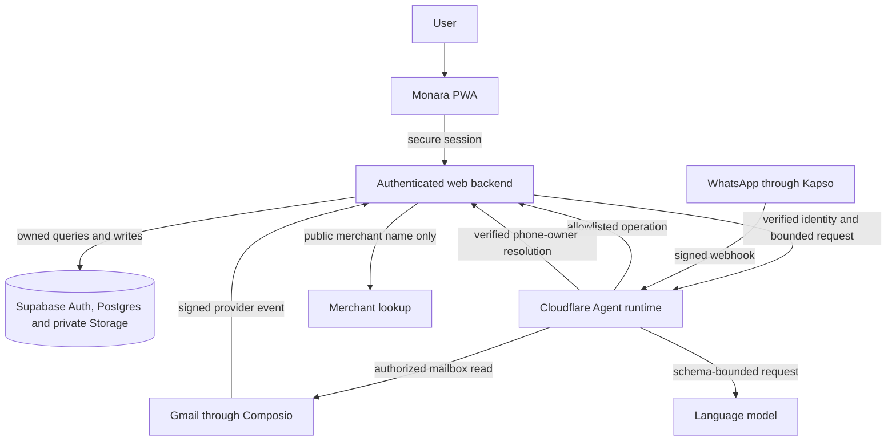
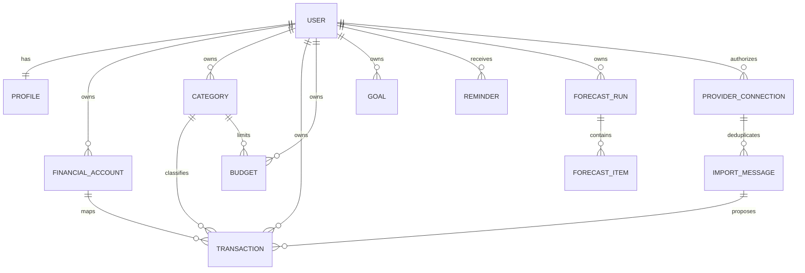
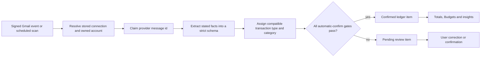

# Technical documentation

Owner: Team 808. Features: F1 to F17. Status: Final.

## Purpose

This document defines the ideal technical design for Monara, a personal-finance PWA that turns user-authorized Gmail and WhatsApp inputs into an owned financial ledger. It explains the system boundaries, data model, processing rules, recovery behavior and verification contract. It is a design specification, not a claim about any particular deployment.

The three-document package has a strict separation of responsibility:

- **Technical Documentation** defines what the system is and how it must behave.
- **Security Self-Assessment** explains threats, controls, failure behavior and residual risk.
- **Execution Evidence** defines the observable proof required before a release may be called conforming.

The authoritative financial model is deliberately small. A transaction is an **expense**, **income** or **exclusion**. An exclusion records an event such as reimbursement or movement between the User's own accounts but does not affect income, spending, Budget usage or savings calculations. A transaction is **pending** until review or a strictly gated automatic decision makes it **confirmed**.

## How it works

### System boundaries

Monara separates interactive requests, durable Agent work and financial persistence. The browser is never an authority for identity or ownership. The web backend resolves the authenticated User and owns every financial mutation. The Agent can reason and request allowlisted operations, but it cannot write directly to the database. Supabase provides authentication, relational persistence, row-level security and private object storage. Composio mediates Gmail consent, and Kapso transports WhatsApp messages.

The trust rule is consistent across every path: **external input may propose data, but only authenticated backend policy may create authority**.

### Component responsibilities

| Component | Owns | Must never own |
| --- | --- | --- |
| Browser PWA | Presentation, temporary drafts, explicit User intent | Provider secrets, trusted User identifiers, direct financial writes, private offline caches |
| Web backend | Session verification, ownership checks, validation, financial services, provider connection state | Unbounded model reasoning |
| Agent runtime | Conversation planning, extraction orchestration, queues and schedules | Direct ledger access, identity proof, unrestricted tools |
| Database | Durable records, constraints, row-level security, idempotency and atomic functions | Provider credentials or raw email content |
| Gmail and WhatsApp adapters | Consent, transport and normalized provider events | Financial decisions |
| Model provider | Structured proposals within schemas | Identity, ownership, amounts not present in source data, final destructive authority |

### Canonical data model

Every private record is owned by exactly one User. Relationships between owned records carry the owner as part of the relationship, preventing a transaction from referencing another User's account or category even when an identifier is known.

Core invariants:

1. Monetary amounts use whole rupiah integers; unknown values remain unknown.
2. Confirmed expenses increase spending; confirmed income increases income.
3. Pending, deleted and exclusion records never affect financial totals.
4. Categories have immutable financial kinds. Expense Budgets accept expense categories only.
5. Forecasts and Goal projections are derived estimates, never ledger transactions.
6. A provider message and its extracted item index are unique, so replay cannot create another transaction.
7. Dates preserve source meaning. A stated transaction date wins; Gmail may fall back to the message arrival date in Jakarta; other unknown dates remain pending.

### Gmail ingestion and review

Gmail sign-in is separate from Monara sign-in. A User explicitly authorizes a mailbox and maps each supported sender to an owned Financial Account. Initial discovery covers the previous 30 days. Later runs use a bounded overlap so delayed messages are found without unbounded mailbox access.

Automatic confirmation is intentionally difficult. Every gate must pass:

- the provider event and mailbox connection are authentic and active;
- the sender is registered for the User's mapped Financial Account and email authentication aligns;
- the amount, IDR currency, date and cash direction are explicit in the source;
- the transaction type and Category are compatible and owned by the same User;
- extraction confidence is at least **0.95**;
- classification confidence is at least **0.95**;
- the item is still pending, has not been edited and has not already been processed.

Missing either confidence score fails the gate. A model score never compensates for a missing fact or ownership check. Items that fail any gate remain visible in the Review Queue and do not affect totals.

Categorization follows deterministic rules before model suggestions. A verified match to the User's own identity becomes the Internal exclusion category. A known incoming payment maps to an income category. Other items use the most specific compatible category supported by source evidence. Ambiguous classifications remain pending rather than falling back to an invented fact.

### WhatsApp and receipt ingestion

A WhatsApp number becomes an identity signal only after the signed-in User completes a short-lived verification challenge. Incoming webhooks require a valid signature and freshness window before sender resolution. Text conversations use the same Agent permissions as web Chat.

Receipt media is accepted only from the configured provider origin, without redirects, within a strict byte limit, and as JPEG, PNG or WebP. Extracted facts pass the same schema and ownership checks as Gmail. Every receipt-created transaction remains **pending**, regardless of model confidence, because an image provides weaker sender and account context. Unreadable or incomplete images create no confirmed financial state.

### Agent execution model

The Agent uses a plan–validate–execute–explain loop:

1. Parse the User's request and current conversation context.
2. Select only a registered tool.
3. Validate tool arguments against a shared schema.
4. Apply the permission tier outside the model.
5. Resolve identity and ownership in the backend.
6. Execute one bounded operation with an idempotency key.
7. Return a receipt containing the result and recovery options.

| Tier | Meaning | Examples | Enforcement |
| --- | --- | --- | --- |
| T0 | Read-only | Summary, ledger query, Budget usage, forecast | Executes after schema, identity and ownership checks |
| T1 | Reversible write | Add or edit a transaction, confirm review, create or edit a Budget | Executes once and returns an Undo receipt with expiry and version binding |
| T2 | Destructive write | Delete transaction or Budget | Requires a backend-issued, owner-bound, single-use confirmation before execution |
| T3 | Account or provider administration | Connect or disconnect Gmail, link WhatsApp, export, permanent account deletion | Never exposed as an Agent tool; available only in the authenticated settings interface |

The model cannot change a tier, manufacture a confirmation or expand the tool registry. A confirmation is bound to one User, action, resource version and short expiry. Replayed, stale or cross-User confirmations fail without mutation.

### Budgets, insights, forecasts and Goals

Only confirmed expenses feed Budget usage. Weekly and monthly periods use explicit calendar boundaries. Threshold Reminders are deduplicated by Budget, period and threshold so retries do not create multiple alerts.

Financial insights remain reproducible:

- **Savings rate** = confirmed income minus confirmed expenses, divided by confirmed income.
- **Safe to spend** = remaining applicable Budget allowance divided by inclusive remaining days.
- **Overspend forecast** extrapolates the confirmed spending pace and exposes its basis.
- **Unusual transaction** compares an expense with a sufficient history window and category median.
- **Budget suggestion** uses recent confirmed expenses and remains a proposal until the User saves it.

Forecasting is rules-first. Recurring merchant patterns create candidates from confirmed history and real prior amounts. The model may adjust confidence inside a narrow band but cannot add merchants, dates or amounts. Low-confidence candidates are omitted and counted as omitted. Forecast items are labelled expected and never enter spending totals.

Goals describe a desired purchase or savings target, optional private image, target date and manually acknowledged progress. Income, expense and Budget history may suggest a sustainable contribution pace, but Monara never moves money automatically or presents a projection as a balance.

### Recovery and deletion

Every mutation carries a request identifier. Repeating the same request returns the original result or a safe conflict rather than creating a second financial event. Optimistic versions prevent stale edits. Undo restores the exact prior snapshot atomically and consumes its receipt once.

If a response is lost, the interface first reconciles server state. It does not silently issue a new mutation. Queue jobs use bounded concurrency, leases, capped retries and exponential backoff. Unknown provider outcomes are reconciled before retry.

Permanent deletion requires a current authenticated session, explicit acknowledgement and an exact confirmation phrase. Acceptance immediately revokes access and stops background work. Durable cleanup removes Monara-controlled financial data, conversations and private images, disconnects provider access, then removes the authentication identity. Completion is reported only after every first-party target is reconciled; provider-retained messages and backups follow their published retention boundaries.

## Key decisions

- **One backend owns financial truth.** Web, Gmail, WhatsApp and Agent requests converge on the same validated services.
- **Uncertainty remains visible.** Missing facts and weak confidence create pending review instead of invented values.
- **Exclusion replaces transfer accounting.** Movement between the User's own accounts remains auditable without double-counting income or expense.
- **Deterministic gates surround model reasoning.** Models propose; schemas, ownership, confidence thresholds and permission tiers decide.
- **Derived information stays separate from the ledger.** Forecasts, suggestions and Goal projections cannot silently become transactions.
- **Idempotency is a data invariant.** Provider replay, queue retry and double-click behavior are safe by construction.
- **Offline mode is public-only.** The service worker may cache the shell and generic offline assets, never authenticated pages, API responses or financial data.

## Security and risks

Security is layered across identity, ownership, input validation, database constraints, provider verification, tool permissions and recovery. No single token, model response or browser field is sufficient to authorize a financial action. Sensitive credentials remain server-side, private responses are non-cacheable, logs contain operational metadata rather than financial content, and security failures leave financial state unchanged.

Residual risk remains even in the ideal design: provider retention is outside Monara's direct control; model output can be wrong despite strict gates; a compromised authenticated session can issue valid User actions; distributed denial of service can degrade availability; and backups may outlive active records. The Security Self-Assessment defines these risks and their acceptance conditions without duplicating implementation detail.

## How to verify

Verification must cover the same boundaries described above rather than relying on a successful build alone:

1. Replay the database schema from zero and prove row-level security, composite ownership, typed Category compatibility and unique import keys with two isolated Users.
2. Exercise valid, invalid, stale and replayed provider events. Confirm that only stored connections and verified sender mappings can reach ingestion.
3. Test the Gmail gate at 0.9499 and 0.95 for both scores, plus missing facts, missing scores, sender-authentication failure, stale edits and duplicate messages.
4. Test Agent tiers with spoofed identity, cross-User identifiers, prompt injection, stale confirmations and repeated Undo.
5. Verify exact financial totals across pending, confirmed, exclusion and deleted records, including boundary dates and large integer amounts.
6. Run queue interruption and unknown-result recovery tests without producing duplicate writes.
7. Inspect mobile and desktop flows for keyboard access, clear review state, no horizontal overflow and truthful degraded states.
8. Confirm the service worker stores only allowlisted public assets and returns no personalized response while offline.
9. Complete provider connection, receipt, reminder and deletion journeys with synthetic accounts and redacted artifacts.
10. Record the results using the case identifiers and evidence rules in the Execution Evidence document.

A release conforms only when every mandatory case has a dated artifact, an identifiable release, an expected result and an observed result. The absence of evidence is not a pass.
